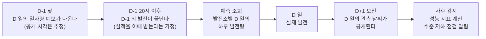
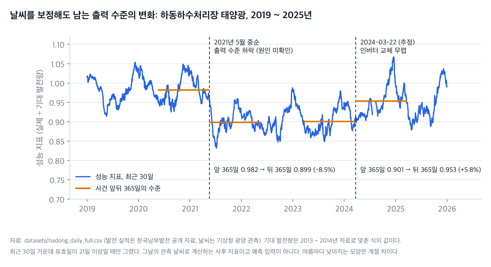

# ① 이해관계자 가치 (Pain Point)

- 평가 항목: 2-1 (설계)
- 담당:
- 상태: 초안 (2026-10-07). 고객과 범위는 [결정 기록 0001](../decisions/0001-customer-and-scope.md)의 제안을 따랐고 팀이 아직 확정하지 않았다. 여러 발전소로 넓힐 때의 불편은 [11절](#11-여러-발전소를-묶어-운영할-때의-불편-확장-제안)에 따로 적었다

## 통합가이드가 요구하는 것

팀이 정의한 이해관계자가 겪는 불편함과 그 중요성, 그리고 서비스 장애·응답 지연·모델 품질 저하가 생겼을 때 이해관계자에게 미치는 영향을 정의한다. [도메인 매핑표](domain-mapping.md)를 기준으로 쓴다.

## 이 문서의 표기

문장이나 표의 칸 앞에 내용의 성격을 적었다. 여섯 항목 모두 같은 표기를 쓴다.

| 표기 | 뜻 |
| --- | --- |
| **[사실]** | 공식 문서나 원자료에서 확인한 것 |
| **[조사]** | 조사 보고서([`../research/`](../research/))의 결과나 권고. 출처와 조건을 붙인다. 팀이 확정한 결정이 아니다 |
| **[제안]** | 이 기획서가 제안하는 설계나 운영 목표. 근거는 상태가 "제안"인 [결정 기록](../decisions/)에 있다 |
| **[현재]** | 커밋 `58d6ff8` 의 코드가 지금 하는 일 |
| **[실행]** | 2026-10-07 에 직접 실행하거나 계산해 확인한 결과. [검증 기록](evidence/validation.md)의 번호를 붙인다 |
| **[미확인]** | 확인하지 못한 것. 가정으로 두었거나 범위 밖으로 둔 것 |
| **[과제]** | 구현해야 하는 것 |

## 본문

### 1. 한 줄로

**[제안]** 작은 태양광 발전소 여러 곳을 묶어 운영하는 전력 중개 사업자의 운영 담당자가 **발전소별 다음 날 하루 발전량 예측을 매일 같은 방식으로 받고, 예측이 어긋나기 시작한 발전소와 설비에 이상이 생긴 발전소를 구분해 알 수 있게** 한다. 우리는 그 솔루션을 만들어 공급하고 운영한다.

### 2. 실제 자료와 가상의 시나리오

이 기획서에는 실제인 것과 가정한 것이 섞여 있다. 먼저 갈라 둔다.

| 구분 | 내용 | 성격 |
| --- | --- | --- |
| 발전소 | 하동하수처리장 태양광(경상남도 하동군), 설비 용량 55kW | **[사실]** 한국남부발전 태양광발전기 사양정보(2026-09-22 수정). [T1](../research/merged/T1-plant-data.md) |
| 발전 실적 | 2013-01-01 ~ 2026-02-28 의 4,807일. 하루 합계와 시간대별 24칸 | **[사실]** 공공데이터포털 「한국남부발전(주)\_하동하수처리장 태양광발전실적」. [`datasets/README.md`](../../datasets/README.md) |
| 제도 | 재생에너지 발전량 예측제도. 전날 10시와 17시에 다음 날의 시간대별 24칸을 내고, 시간대별 평균 오차율이 4% 이하이면 4원/kWh, 4% 초과 6% 이하이면 3원/kWh, 6% 를 넘으면 0원을 받는다. 참여 요건은 **설비 용량** 20MW 초과다. 발전기 1기의 용량이거나, 묶음 안 태양광·풍력 설비 용량의 합계다. 발전량의 기준이 아니고 기간이 붙지 않는다 | **[사실]** 전력시장운영규칙(2026.7.25 시행) 제14장과 별표2 Ⅴ. [T6](../research/merged/T6-scheme.md). 2026-10-07 에 다시 대조했다([M08](evidence/multi-plant/validation.md#m08)) |
| 고객 | 전력 중개 사업자(작은 발전소를 묶어 전력시장에서 대신 거래하는 사업자) 한 곳. 이 발전소가 그 묶음의 구성원이다 | **[미확인]** 가정이다. 55kW 한 곳은 혼자 참여할 수 없고, 이 발전소가 실제로 어느 묶음에 들어 있는지는 공개 자료로 확인되지 않았다 |
| 우리 | 예측 서빙과 운영 파이프라인을 만들어 고객에게 공급하고 운영한다 | **[제안]** [0001](../decisions/0001-customer-and-scope.md) |
| 만드는 것 | 발전소 한 곳의 다음 날 **하루 합계 한 값**의 예측, 그 품질 관리, 상태 감시 | **[제안]** 시간대별 예측, 전력거래소 제출, 정산금 계산은 만들지 않는다. **[현재]** 서비스는 발전소 한 곳만 다룬다. 여러 곳으로 넓히는 것은 제안이다(11절) |

**[제안]** 그래서 이 문서는 제도를 산업의 배경으로만 쓴다. 하루 합계 예측을 "시장에 낸다"거나 "정산받는다"고 쓰지 않는다.

### 3. 이해관계자

| 역할 | 누구인가 | 이 서비스에서 하는 일 | 무엇이 걸려 있는가 |
| --- | --- | --- | --- |
| 주 이해관계자, 예측 사용자 | 전력 중개 사업자의 운영 담당자 | 매일 저녁 발전소별 다음 날 예상 발전량을 조회한다. 평소와 다르게 움직이는 발전소를 찾는다 | 묶음 전체의 예측 품질. 발전소별 예측이 묶음의 예측에 그대로 실린다 |
| 서비스 운영자 | 솔루션을 공급하는 우리 팀의 운영 담당 | 서버를 띄우고, 모델을 학습해 올리고, 게이트와 감시의 결과를 본다. 재학습과 되돌리기를 결정한다 | 서비스가 멈추지 않는 것, 나쁜 모델이 올라가지 않는 것 |
| 설비 담당자 | 발전소의 점검과 정비를 맡는 사람 | 점검 알림을 받고 현장을 확인한다. 정비를 마치면 알린다 | 발전량 손실. 고장을 늦게 알수록 손실이 쌓인다 |
| 발전 사업자 | 발전소의 주인 | 직접 쓰지 않는다. 실적 자료를 준다 | 발전 수입 |

- **[미확인]** 이 발전소의 점검을 대행 업체가 하는지 상주 관리자가 하는지는 확인되지 않았다. 설비 담당자는 역할로만 정의한다.
- **[사실]** 전력거래소는 예측값을 받고 정산하는 기관이다. 이 서비스의 사용자가 아니다.

### 4. 업무 시나리오

**[제안]** 대상일을 D 라고 하자. 운영 담당자의 하루는 이렇게 흘러간다. 시각의 근거는 [② 의 4절](2-solution-and-goals.md#4-언제-예측하고-무엇을-언제-받는가)에 있다.

1. D-1 저녁, 운영 담당자는 그날까지의 발전 실적과 D 일의 일사량 예보가 들어간 파일을 올리고 D 일의 예측을 조회한다.
2. 예측값을 묶음의 다음 날 물량을 가늠하는 자료로 쓴다. 이 값을 시간대별 제출값으로 바꾸는 일은 고객의 일이고 이 서비스의 범위 밖이다.
3. D 일이 지나고 관측 날씨가 공개되면, 서비스는 "그날 날씨였으면 얼마가 나왔어야 하는가"에 견줘 실제 발전량이 어느 수준인지를 계산한다.
4. 그 수준이 여러 날에 걸쳐 내려가 있으면 서비스 운영자와 설비 담당자에게 알린다. 설비가 멈춘 것으로 보이면 점검을 요청하고 모델은 건드리지 않는다. 수준이 바뀐 채 이어지면 모델을 다시 학습시켜 검증한 뒤 교체한다.

### 5. 지금 무엇이 불편한가

모델만 있고 운영 체계가 없을 때 생기는 일이다.

| # | 불편 | 언제 생기는가 | 누구에게 어떤 영향인가 | 필요한 대응 |
| --- | --- | --- | --- | --- |
| P1 | 예측이 한 사람의 PC 에 있는 노트북에만 있다. 매일 같은 방식으로 받을 수 없다 | 담당자가 자리에 없을 때, PC 가 바뀔 때, 모델을 다시 학습한 뒤 | 운영 담당자가 그날의 값을 받지 못해 "어제 값 그대로" 같은 단순한 방법으로 메운다 | 언제든 같은 요청에 같은 방식으로 답하는 서빙 API, 상태를 확인하는 헬스체크 |
| P2 | 잘못된 입력이 조용히 들어간다 | 20일이 안 되는 자료, 날짜가 빠지거나 순서가 뒤바뀐 파일, 단위가 다른 값을 넣었을 때 | 오류 없이 틀린 예측이 나온다. 운영 담당자는 틀린 줄 모른다 | 요청과 업로드 파일의 검증. 틀린 입력은 이유와 함께 거절한다 |
| P3 | 새 모델이 이전 모델보다 나쁜지 모르는 채로 바뀐다. 지금 어떤 모델이 답하고 있는지도 모른다 | 재학습한 뒤, 학습 자료를 바꾼 뒤 | 품질이 떨어진 예측이 그대로 나간다. 문제가 생겨도 어느 모델 때문인지 되짚을 수 없다 | 기준을 통과한 모델만 올리는 배포 게이트, 버전 기록, 통과하지 못하면 이전 버전을 유지 |
| P4 | 발전소의 출력 수준이 바뀌었는데 아무도 모른다 | 설비의 일부가 고장 나거나 성능이 떨어졌을 때 | 설비 담당자는 손실이 쌓이는 것을 모른다. 운영 담당자가 받는 예측은 실제보다 높게 치우친다 | 발전소별 상태 감시와 알림 |
| P5 | 설비가 멈춘 것과 모델이 낡은 것을 구분하지 못한다 | 며칠간의 정지나 부분 정지가 있을 때 | 정지한 구간으로 모델을 다시 학습시키면 모델이 잘못된 수준을 배운다. 반대로 수준이 바뀌었는데 그대로 두면 치우침이 남는다 | 정지와 수준 변화를 가르는 규칙. 앞의 것은 점검 요청과 재학습 보류, 뒤의 것은 재학습과 재검증 |

P4 는 이 발전소에서 실제로 있었던 일이다.

발전 실적: 한국남부발전(공공데이터포털). 날씨 관측: 기상청 종관기상관측(ASOS) 광양(266).

- **[실행]** 2021년 5월 중순을 경계로 성능 지표(실제 발전량 ÷ 그날의 관측 날씨로 계산한 기대 발전량)가 앞 365일 0.982 에서 뒤 365일 0.899 로 8.5% 내려갔다. 2024-03-22 무렵을 경계로는 0.901 에서 0.953 으로 5.8% 올라갔다. ([V20](evidence/validation.md#v20))
- **[조사]** 내려간 날은 2021-05-13 ~ 05-22 사이의 어느 날이다. 그 사이가 흐려서 하루로 좁히지 못했다. 직후 6주로 보면 −11% 다. ([T5](../research/merged/T5-drift-demo.md))
- **[미확인]** 원인은 모른다. 정비 기록, 계약, 보도를 찾지 못했다. 2024년의 상승은 인버터 교체 계약(2024-01-03) 뒤의 일이지만 시공일과 인과는 확인되지 않았다.
- 성능 지표는 대상일의 관측 날씨로 계산하는 사후 값이다. 예측 시점에는 받을 수 없다.

P5 의 예도 자료에 있다. **[조사]** 2024-07-10 ~ 07-18 의 9일 동안 실제 발전량이 기대의 0.26 ~ 0.64배였다가 07-19 에 0.82배로 올라왔다([T5](../research/merged/T5-drift-demo.md)). 원인은 확인되지 않았지만, 며칠 만에 돌아온 이런 구간을 모델이 배울 새 수준으로 볼 수는 없다.

### 6. 그 불편이 왜 중요한가

사실로 확인된 크기와 가정을 넣어 계산한 크기를 나눠 적는다.

| 무엇 | 크기 | 성격과 조건 |
| --- | --- | --- |
| 제도에서 오차가 돈으로 바뀌는 방식 | 오차율 4% 와 6% 에서 끊기는 계단. 6% 를 넘는 시간대는 0원 | **[사실]** 전력시장운영규칙 별표2 Ⅴ. 태양광은 2025-06-01 부터 |
| 시장의 오차율 수준 | 육지 태양광의 월평균 오차율이 30개월 평균 5.71%. 30개월 가운데 8개월은 6% 를 넘었다 | **[조사]** 2023-10 ~ 2026-03 의 전력거래소 공개 통계. 평균을 내는 방식과 대상 범위는 공개되지 않았다. [T7](../research/merged/T7-value.md) |
| 제도 전체의 정산금 | 2025년 약 234.84억 원 | **[조사]** 공식 통계의 잠정값. [T7](../research/merged/T7-value.md) |
| 묶으면 한 곳의 변화가 보이지 않는다 | 하수처리장이 8.5% 낮아져도 하동 5곳 묶음의 오차율은 0.06%p 움직인다. 묶음 오차율은 달마다 2.3%p 흔들린다 | **[조사]** 2023-10 ~ 2026-02 에 저하를 넣어 본 계산이다. 전날 값 예측. 이번 반박 검증에서 원자료로 다시 계산하지는 못했다. [T7](../research/merged/T7-value.md) |
| 2021년 하락으로 줄어든 발전량 | 첫 1년에 약 6,600kWh | **[조사]** 성능 지표로 계산한 사후 추정이다. 광양 일사계의 수준 변화만큼 불확실하다. 판매 단가가 자료에 없어 금액으로 바꾸지 않았다. [T7](../research/merged/T7-value.md) |
| 예측 방법에 따른 오차의 차이 | 같은 264일에서 어제 값 그대로 82.4kWh, 7일 평균 71.7kWh, 예보를 쓰는 규칙 45.3kWh, 직접 학습한 모델 41.6kWh (하루 평균 발전량 194.2kWh) | **[실행]** 시험 2025-06-09 ~ 2026-02-27. [② 의 7절](2-solution-and-goals.md#7-단순한-기준-예측과-견주면). ([V19](evidence/validation.md#v19), [V30](evidence/validation.md#v30)) |
| 평균 규모 사업자에게 오차율 1%p 의 크기 | 연 약 3,400만 원(가정에 따라 2,700만 ~ 5,500만 원) | **[조사]** **가상의 계산이다.** 평균 규모 171MW 는 5,125MW ÷ 30곳의 단순 평균이고, 오차의 모양은 단순 예측의 것을 평균 5.71% 에 맞춰 줄인 것이다. 실제 사업자의 값이 아니다. 정산금 총액 기준이며 사업자의 수입(수수료)은 이보다 작다. [T7](../research/merged/T7-value.md) |
| 하동 한 곳의 정산금 | 상한 연 약 28만 원 | **[조사]** **가상의 상한이다.** 55kW 한 곳은 혼자 참여할 수 없다. 모든 대상 시간대가 4원이라고 가정했다. [T6](../research/merged/T6-scheme.md) |

**[제안]** 이 표에서 끌어내는 결론은 세 가지다.

- 발전소 한 곳에서는 예측 정산금의 크기가 작다. 이 서비스의 가치를 "정산금을 늘린다"에 두지 않는다. **우리 모델이 정산금을 얼마 올린다는 말은 하지 않는다.**
- 묶음 단위의 지표로는 한 곳의 변화가 보이지 않는다. 그래서 **발전소별로 본다.**
- 가치는 세 가지에 둔다. 예측을 끊기지 않게 주는 것(P1, P2), 올리는 모델의 품질을 관리하는 것(P3), 발전소별 이상을 알리는 것(P4, P5).

### 7. 장애, 지연, 품질 저하가 생기면

세 가지를 따로 본다. 목표값은 [②](2-solution-and-goals.md#6-운영-목표)에, 대응 정책은 [③](3-operations-design.md)에 있다.

**서비스 장애 (예측을 받을 수 없다)**

- 누구에게: 운영 담당자.
- 무슨 일이: 그날의 발전소별 예측이 없다. 직접 만들거나 단순한 방법으로 메워야 한다.
- 얼마나: 메우는 방법에 따라 다르다. **[실행]** 예보를 쓰는 규칙(규칙C)으로 메우면 오차가 45.3kWh 로 모델(41.6kWh)과 비슷하고, 예보 없이 7일 평균으로 메우면 71.7kWh 로 커진다. 같은 264일의 값이다. ([V19](evidence/validation.md#v19))
- 견딜 수 있는 정도: **[제안]** 하루에 한 번 쓰는 서비스다. 예측 시간대(전날 20 ~ 24시) 안에 되살아나면 영향이 없다. 그 시간대를 통째로 놓치면 그날의 예측을 잃는다.
- **[현재]** 지금의 서버는 정상 입력에도 500 을 돌려준다. 빈칸이 남아 있어서다. ([V04](evidence/validation.md#v04))

**응답 지연 (예측이 늦게 온다)**

- 누구에게: 운영 담당자, 그리고 이 API 를 부르는 고객의 다른 프로그램.
- 무슨 일이: 한 건이 늦는 것 자체는 하루 한 번 쓰는 일에 큰 문제가 아니다. 문제는 두 경우다. 발전소 수백 곳을 차례로 조회할 때 지연이 곱해진다. 그리고 재학습이 배치 요청의 응답 안에서 돌기 때문에 그 요청이 수십 초 걸릴 수 있다.
- 얼마나: **[실행]** 모델 한 건의 계산은 중앙값 32.7ms 였다. 모델을 처음 불러오는 요청은 그보다 훨씬 느리다(불러오는 데 0.89초, 처음 계산에 251.5ms). 주가 예시 파일로 학습한 같은 구조의 모델에 무작위 입력을 넣어 잰 값이다. 엔드포인트의 응답 시간은 아직 재지 못했다. ([V17](evidence/validation.md#v17))
- **[현재]** 대시보드는 배치를 보낼 때 "fine-tuning이 걸리면 수십 초 걸릴 수 있습니다"라고 안내한다(`static/index.html` 359행).

**모델 품질 저하 (예측이 틀리기 시작했는데 아무도 모른다)**

- 누구에게: 운영 담당자(치우친 예측), 설비 담당자(쌓이는 손실).
- 무슨 일이: 발전소의 출력 수준이 내려가면 예측이 한동안 실제보다 높게 나온다. 하루하루의 오차는 날씨 때문에 원래 크게 흔들리므로 사람이 눈으로 알아채기 어렵다.
- 얼마나: **[조사]** 발전량을 14% 낮춘 실험에서 그 뒤 21일의 예측이 실제보다 평균 7.4% 높았다. 예보를 넣은 실습 LSTM(학습 정답일 2023-11-07 ~ 2025-02-28)에 인위로 넣은 하락이고, 시드 3개 × 시작일 43개의 평균이다. 조사가 저장해 둔 결과를 다시 집계한 값이며 우리가 학습한 모델의 값이 아니다. ([T5](../research/merged/T5-drift-demo.md))
- 왜 모르는가: **[실행]** 오차의 크기(RMSE)로는 보이지 않는다. 직접 학습한 모델에서 변화가 없는 21일의 RMSE 가 45.1kWh, 발전량을 14% 낮춘 같은 21일이 34.5kWh 였다. 오히려 내려갔다. 날씨를 걷어 낸 성능 지표로 보면 같은 두 배치가 −2.2% 와 −15.6% 로 갈린다. ([V30](evidence/validation.md#v30), [V21](evidence/validation.md#v21))
- **[미확인]** 치우친 예측이 고객의 정산금을 얼마나 줄이는지는 계산할 수 없다. 우리 모델은 하루 합계만 내고 정산은 시간대별이다.

### 8. 불편에서 기능, 목표, 검증으로

여섯 항목이 이어지는 줄기다. 불편마다 무엇이 해결하고, 무엇을 목표로 삼고, 무엇으로 확인하는지를 적었다.

| 불편 | 해결하는 기능 ([②](2-solution-and-goals.md)) | 운영 목표와 정책 ([②](2-solution-and-goals.md#6-운영-목표), [③](3-operations-design.md)) | 검증 방법 ([⑥](6-demo.md)) | 지금의 상태 |
| --- | --- | --- | --- | --- |
| P1 예측이 노트북에만 있다 | FastAPI 의 `POST /predict`, `GET /health`, 컨테이너 | 예측 응답 1초 이하, 예측 시간대의 가용성 99% 이상 | 장면 2(정상 예측), 장면 6(컨테이너) | **[현재]** 예측은 500, 컨테이너는 빌드 실패. 빈칸 때문이다 |
| P2 잘못된 입력 | 요청 스키마 검증(422), 업로드 파일 검증(400) | 길이, 타입, 범위, 빠진 값, 날짜의 순서와 연속성을 거른다 | 장면 1(업로드), 장면 2(422) | **[실행]** 요청 검증은 동작한다. 업로드 검증은 날짜와 값의 내용을 보지 않는다 |
| P3 나쁜 모델이 올라간다 | MLflow 의 실행 기록과 레지스트리, 배포 게이트 | 기준 예측과 견준 상대 게이트, 통과하지 못하면 이전 버전 유지 | 장면 3(게이트 통과), 장면 4(게이트 실패), 장면 5(버전 전환) | **[실행]** 통과의 경로는 주가 예시 파일로, 차단의 경로는 태양광 파일로 돌려 봤다. 기준값이 주가의 눈금이라 태양광 모델이 통과한 적은 없다 |
| P4 수준 변화를 모른다 | 성능 지표의 감시, `aiops.log` 의 알림 | 날마다 최근 21일의 성능 지표를 본다. 기준선보다 7.5% 넘게 낮으면 알림. 4주 안에 알린다 | 장면 7(정상 배치와 주입 배치), 장면 8(로그), 2021년의 사후 감시 | **[현재]** 감시는 RMSE 4.00 기준이고 빈칸으로 돌지 않는다. 성능 지표의 판정은 계산으로만 확인했다 |
| P5 정지와 수준 변화를 못 가른다 | 정지·보류 규칙, 재학습 보류 | 정지와 보류는 점검 알림과 재학습 보류, 그 밖의 저하는 재학습과 게이트 | 장면 10(설비 이상), 장면 9(재학습 뒤의 서빙 모델) | **[과제]** 코드에 없다. 설계만 있다 |

### 9. 확인하지 못한 것과 이 문서에서의 처리

| 확인하지 못한 것 | 이 문서에서 어떻게 다뤘는가 |
| --- | --- |
| 하동하수처리장이 실제로 어느 묶음에 들어 있는지, 한국남부발전이 육지에 예측형 묶음을 갖고 있는지 | 가상의 고객으로 적었다. 실제 고객이나 참여 사례로 쓰지 않았다 |
| 2021년 하락과 2024년 상승의 원인 | "관측된 변화"라고 적었다. 고장이나 교체의 결과라고 쓰지 않았다 |
| 실제 중개 사업자의 오차 분포, 수수료, 판매 단가 | 금액은 가상의 계산이라고 밝혔고 서비스의 효과로 쓰지 않았다 |
| 중개 사업자의 운영 담당자가 하루 합계 예측을 실제로 어떻게 쓰는지 | 4절의 쓰임은 가정이다. 사업자를 만나 확인한 것이 아니다 |
| 이 발전소의 점검 체계 | 설비 담당자를 역할로만 정의했다 |

후속 조건은 [`../followups.md`](../followups.md)에 옮겨 적었다.

### 10. 근거

- 고객과 범위의 선택지와 근거: [결정 기록 0001](../decisions/0001-customer-and-scope.md)
- 제도와 손익의 조사: [T6 제도](../research/merged/T6-scheme.md), [T7 고객과 손익](../research/merged/T7-value.md), [통합 보고서](../research/report.md) 4절과 7절
- 설비의 이력: [T2](../research/merged/T2-history-outage.md), [T5](../research/merged/T5-drift-demo.md)
- 직접 실행한 값: [검증 기록](evidence/validation.md)
- 여러 발전소로 넓히는 범위와 제도 조건의 재확인: [결정 기록 0010](../decisions/0010-multi-plant-scope-and-scheme.md), [확장 문서](multi-plant-extension.md)

### 11. 여러 발전소를 묶어 운영할 때의 불편 (확장 제안)

**[현재]** 1 ~ 10절은 발전소 한 곳을 다루는 지금의 서비스를 기준으로 썼다. 고객인 중개 사업자는 발전소를 여러 곳 묶어 운영한다. 이 절은 그 운영 담당자가 **여러 자원을 함께 볼 때** 생기는 불편을 따로 적는다. 서비스를 넓히는 설계는 [확장 문서](multi-plant-extension.md)에 있고 아직 구현하지 않았다.

**먼저 바로잡을 것.** 팀에서 "설비 용량 합이 20MW 이상이어야 제도를 적용받으므로 여러 발전소가 필요하다"는 설명이 나왔다. **[사실]** 규정은 "이상"이 아니라 "초과"이고, 더하는 것은 묶음 안 태양광·풍력의 **설비 용량**이며, 용량 말고도 등록, 계량, 구성 비율, 등록시험이 따로 있다([확장 문서 2절](multi-plant-extension.md#2-제도-조건의-확인)). **[실행]** 우리가 가진 자료의 설비 용량 합계는 하동하수처리장 55kW, 하동군 5곳을 모두 더해도 606.17kW 로 20MW 의 3.03% 다. ([M03](evidence/multi-plant/validation.md#m03), [M04](evidence/multi-plant/validation.md#m04)) 그래서 **여러 발전소의 자료를 모았다는 것을 제도의 참여 요건을 채웠다고 쓰지 않는다.** 포트폴리오는 가상의 묶음이다([0010](../decisions/0010-multi-plant-scope-and-scheme.md)).

| # | 불편 | 지금은 어떻게 되는가 | 근거 |
| --- | --- | --- | --- |
| P6 | 발전소마다 자료의 모양이 다르다 | 같은 기관의 공시끼리도 용량 표기가 다르고(공설운동장 369.85kW 와 0.37MW), 열 이름이 다르고(정수장은 `(kw)` 가 없다), 좌표가 없는 곳이 있다(보건소). 사람이 발전소마다 맞춰야 한다 | **[사실]** 한국남부발전의 공시. **[실행]** 다섯 파일을 같은 도구로 변환하고 검증했다. ([M04](evidence/multi-plant/validation.md#m04)) |
| P7 | 합계만 보면 한 곳의 문제가 보이지 않고, 한 곳만 보면 합계의 품질을 모른다 | 구성원 한 곳이 8.5% 낮아져도 묶음의 오차율은 0.06%p 움직인다. 반대로 발전소별 오차를 더한 값은 합계의 오차가 아니다 | **[조사]** [T7](../research/merged/T7-value.md). **[실행]** 하동 5곳의 합계 RMSE 는 발전소별 RMSE 의 합의 96.7% 였다(7일 평균, 시험 264일). 기준 예측의 값이다. ([M05](evidence/multi-plant/validation.md#m05)) |
| P8 | 일부 발전소의 자료나 모델이 빠지면 합계가 조용히 작아진다 | 빠진 곳이 있는지 알리는 곳이 없다. 남은 곳만 더한 값을 합계로 읽게 된다 | **[실행]** 평가 도구는 구성원이 빠지면 합계를 내지 않고 누락을 알린다. 합성 자료로 확인했다. ([M02](evidence/multi-plant/validation.md#m02)의 S16, S17) |
| P9 | 구성이 바뀐 것을 수준 변화로 읽는다 | 발전소를 더하거나 빼면 합계의 수준이 달라진다. 구성의 이력이 없으면 드리프트와 가를 수 없다 | **[제안]** 구성에 버전과 적용 기간을 둔다. **[실행]** 구성 변경을 걸친 기간의 평가를 멈추는 것을 합성 자료로 확인했다(S12) |
| P10 | 한 발전소에 맞춘 값이 다른 발전소에 조용히 적용된다 | 입력 상한 1,320kWh 는 55kW 기준이라 큰 발전소의 정상 값이 거절된다. 마지막에 올린 파일이 다른 발전소의 학습에 쓰이고, 다른 발전소의 스케일러가 붙어도 오류가 나지 않는다 | **[실행]** 공설운동장은 4,807일 가운데 1,936일이 상한을 넘고 지금의 업로드 검증에서 거절된다. 나머지 둘도 지금의 코드로 재현했다. ([M07](evidence/multi-plant/validation.md#m07)) |

**장애, 지연, 품질 저하의 영향도 여러 곳이면 달라진다.**

| 무엇 | 발전소 한 곳일 때 | 여러 곳일 때 | 설계에서 다룬 곳 |
| --- | --- | --- | --- |
| 서비스 장애 | 그 발전소의 예측이 없다 | 서버가 멈추면 모든 발전소의 예측이 없다. 한 발전소의 모델만 문제이면 그 발전소만 빠지고, 합계는 "일부 누락"으로 나가야 한다 | [한 PC 운영 2.2절](single-pc-operation.md#22-작업-기록과-중복-방지), [확장 문서 8.1절](multi-plant-extension.md#81-fastapi) |
| 응답 지연 | 한 건의 계산 | 포트폴리오 예측은 발전소 수만큼 길어진다. **[실행]** 한 건의 계산이 12.9ms(중앙값)라 차례로 돌리면 100곳에 약 1.3초다(추정). 재학습이 요청 안에서 돌면 걸리는 발전소 수만큼 더 길어진다 | [한 PC 운영 4절](single-pc-operation.md#4-규모-산정식) ([M09](evidence/multi-plant/validation.md#m09)) |
| 품질 저하 | 그 발전소의 예측이 치우친다 | 한 곳의 저하는 합계에 묻힌다. 여러 곳이 함께 내려가면 설비가 아니라 날씨나 예보 입력을 의심해야 한다 | [확장 문서 8.3절](multi-plant-extension.md#83-aiops) |

**[제안]** 불편에서 기능으로 이어지는 줄기는 8절과 같다. P6 은 자료 계약과 검증 도구([자료 계약](multi-plant-data-contract.md)), P7 과 P8 은 발전소별 지표와 합계의 지표를 같은 대상일에서 함께 내는 평가와 포트폴리오 응답의 누락 표시, P9 는 구성 버전, P10 은 발전소별 등록부·업로드·모델·상한이 맡는다. 목표값은 [② 의 11절](2-solution-and-goals.md#11-여러-발전소로-넓힐-때의-예측과-목표-확장-제안)에 있다.
