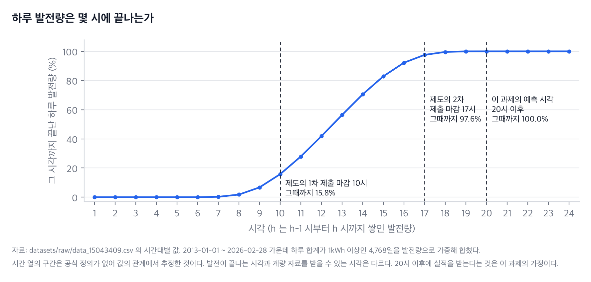

# ② AI 솔루션과 운영 목표

- 평가 항목: 2-1 (설계)
- 담당:
- 상태: 초안 (2026-10-07). 입력의 뜻, 지표, 목표값은 결정 기록 [0002](../decisions/0002-inputs-and-prediction-time.md), [0003](../decisions/0003-capacity-and-error-metrics.md), [0004](../decisions/0004-service-level-objectives.md)의 제안을 따랐고 팀이 아직 확정하지 않았다. 여러 발전소로 넓힐 때의 예측과 목표는 [11절](#11-여러-발전소로-넓힐-때의-예측과-목표-확장-제안)에 따로 적었다

## 통합가이드가 요구하는 것

Pain Point 를 해결하는 핵심 기능, 서빙되는 모델의 역할, 그리고 운영 요구사항(예: 응답 시간 1초 이내, 가용성, 품질 목표 RMSE/MAPE)을 제시한다.

표기(**[사실]**, **[조사]**, **[제안]**, **[현재]**, **[실행]**, **[미확인]**, **[과제]**)의 뜻은 [① 의 표](1-pain-point.md#이-문서의-표기)에 있다.

## 본문

### 1. 한 줄로

**[제안]** 발전소의 최근 20일 발전량과 일사량 예보를 받아 **다음 날 하루 발전량(kWh) 한 값**을 돌려주는 모델을 API 로 서빙한다. 새 모델은 단순한 기준 예측과 견줘 통과한 것만 올리고, 올린 뒤에는 발전소의 출력 수준을 날씨와 떼어 지켜보다가 내려가면 알리고 다시 학습시킨다.

### 2. 세 층이 불편을 나눠 맡는다

[① 의 불편 P1 ~ P5](1-pain-point.md#5-지금-무엇이-불편한가)를 세 층이 나눠 맡는다.

| 층 | 맡는 불편 | 하는 일 | 지금의 상태 |
| --- | --- | --- | --- |
| 서빙 (FastAPI) | P1 예측이 노트북에만 있다, P2 잘못된 입력 | `POST /predict` 로 예측을 주고, `GET /health` 로 상태를 알리고, `POST /data/upload` 로 자료를 받는다. 요청의 길이와 값을 검사해 틀리면 422 로 거절한다 | **[실행]** 서버가 뜨고 검증과 업로드가 동작한다. 예측은 정상 입력에도 500 이다(빈칸). ([V03](evidence/validation.md#v03) ~ [V07](evidence/validation.md#v07)) |
| MLOps (MLflow, 게이트, 컨테이너) | P3 나쁜 모델이 올라간다, P1 | 학습할 때마다 지표와 모델을 기록한다. 게이트를 통과한 모델만 버전으로 등록해 운영으로 올린다. 같은 환경을 컨테이너로 묶는다 | **[실행]** 기록과 게이트의 경로가 동작한다. 통과와 등록은 주가 예시 파일로, 차단은 태양광 파일로 확인했다. 태양광 모델이 등록된 적은 없다. 기준값은 주가의 눈금(4.00)이다. 컨테이너는 빌드에서 멈춘다(빈칸). ([V11](evidence/validation.md#v11), [V12](evidence/validation.md#v12), [V15](evidence/validation.md#v15)) |
| AIOps (감시, 알림, 재학습) | P4 수준 변화를 모른다, P5 정지와 수준 변화를 못 가른다 | 예측과 실제를 쌓아 판정하고, 로그로 알리고, 이어서 학습시켜 게이트로 다시 확인한다 | **[현재]** 코드의 뼈대는 있고 빈칸 때문에 돌지 않는다. 성능 지표로 판정하는 부분은 설계만 있다. ([V13](evidence/validation.md#v13)) |

### 3. 서빙되는 모델이 하는 일

| 항목 | 내용 | 성격 |
| --- | --- | --- |
| 목적 | 발전소 한 곳의 다음 날 하루 발전량을 예측한다 | **[제안]** [0002](../decisions/0002-inputs-and-prediction-time.md). 여러 곳이 되어도 모델 하나는 발전소 한 곳을 맡는다(11절) |
| 입력 | 이어진 20일의 값 두 개씩. 모양은 (20, 2) | **[현재]** `data/features.py` 의 `SEQ_LEN = 20`, `serving_app/lstm_model.py` 의 `N_FEATURES = 2` |
| 첫째 값 | 그날의 하루 발전량. 단위 kWh | **[제안]** 요청의 `close`, 업로드 파일의 `Close` |
| 둘째 값 | **그 다음 날**에 대한 하루 전 일사량 예보의 하루 합계. 단위 MJ/m² | **[제안]** 요청의 `volume`, 업로드 파일의 `Volume` |
| 출력 | 대상일의 하루 발전량 한 값. 단위 kWh | **[제안]** 응답의 `predicted_close` |
| 모델 | LSTM 세 층(32, 32, 16)과 Dense 두 층(16, 1). 입력과 정답을 최소·최대로 0 ~ 1 에 맞춘다 | **[현재]** `serving_app/lstm_model.py`, `data/features.py` 의 `HAICScaler` |
| 학습 | 처음부터 100 epoch. 시간순으로 앞 80% 로 학습하고 뒤 20% 로 평가한다 | **[현재]** `serving_app/train_and_register.py` |

- **[현재]** 필드와 열의 이름은 주가 예측의 것(`close`, `volume`, `predicted_close`) 그대로다. **[제안]** 이름은 두고 뜻과 단위를 바꿔 쓴다. 이름을 바꾸는 것은 발표 뒤의 과제다.
- **[현재]** 요청 스키마는 `close` 가 0 보다 커야 하고 `volume` 이 정수여야 한다. **[실행]** 그래서 예보 값(소수)을 그대로 넣으면 422 로 거절된다([V05](evidence/validation.md#v05)). **[과제]** `close` 는 0 을 받고 `volume` 은 소수를 받게 고친다.

**20일과 둘째 값의 정확한 뜻.** 대상일을 T 라 하면 창은 T-20 일부터 T-1 일까지의 20행이다.

| 창의 행 | T-20 | T-19 | … | T-2 | T-1 | 대상일 T |
| --- | --- | --- | --- | --- | --- | --- |
| 첫째 값: 그날의 발전량 | T-20 의 실적 | T-19 의 실적 | … | T-2 의 실적 | T-1 의 실적 | (맞히려는 값) |
| 둘째 값: 다음 날에 대한 예보 | T-19 의 예보 | T-18 의 예보 | … | T-1 의 예보 | **T 의 예보** | 없음 |

- 창 안의 발전량은 T-20 ~ T-1 일의 것이다. 대상일의 발전량은 들어 있지 않다.
- 창 안의 예보는 T-19 ~ T 일에 대한 것이다. 마지막 행에 대상일의 예보가 들어 있다.
- 20일은 거래일이 아니라 이어진 달력일이다.
- **[실행]** 업로드 파일 `hadong_upload_forecast_jma.csv` 의 1,337행 모두에서 d 일 행의 `Volume` 이 d+1 일에 대한 하루 전 예보 원본과 같았다(차이 0). 날짜가 빠지거나 겹친 곳이 없다. `Volume` 은 같은 행의 발전량보다 다음 행의 발전량과 더 가깝게 움직인다(상관 0.322 대 0.775). ([V18](evidence/validation.md#v18))

### 4. 언제 예측하고 무엇을 언제 받는가

**[제안]** 예측은 **대상일 전날 20시 이후**에 한다([0002](../decisions/0002-inputs-and-prediction-time.md)). 전날의 발전이 모두 끝난 뒤다.

발전 실적: 한국남부발전(공공데이터포털).

| 값 | 언제 받을 수 있는가 | 성격 |
| --- | --- | --- |
| 전날(T-1)의 하루 발전량 | 발전은 20시까지 100.0% 끝난다. 17시까지는 97.6%, 10시까지는 15.8% 다 | **[실행]** 4,768일의 시간대별 값으로 계산했다. 시간 열의 구간은 공식 정의가 없어 추정이다. ([V24](evidence/validation.md#v24)) |
| 그 값을 그 시각에 받는 경로 | 받는다고 가정한다 | **[미확인]** 계량값을 저녁에 받는 경로는 확인되지 않았다. 공개 파일은 1년에 한 번 갱신된다. 발표에서는 저장된 CSV 를 재생한다 |
| 대상일(T)의 일사량 예보 | 전날 12시 30분 ~ 14시 10분 무렵에 공개되는 것으로 보인다. 여유를 두어 15시 이후에 받는다 | **[조사]** 2026-10-06, 10-07 이틀의 표본에서 추정한 값이다. 전날 09시에 시작하는 실행분의 공개 시각은 재지 못했고 다른 실행분 셋의 지연에서 어림했다. 더 늦을 수 있다. 2022 ~ 2026년의 보관 자료가 같은 규칙으로 만들어졌는지는 확인되지 않았다. [T3](../research/merged/T3-weather-input.md) |
| 예보의 출처 | Open-Meteo Previous Runs API, 모델을 지정하지 않은 호출(Best Match) | **[조사]** 표본 대조에서는 일본 기상청의 MSM 과 같았지만 전 기간이 그렇다는 근거는 없다. 파일 이름의 `jma` 는 그 표본에서 온 것이다. [T3](../research/merged/T3-weather-input.md) |
| 대상일의 관측 날씨 | 다음 날 10 ~ 11시 이후 | **[조사]** 그래서 관측은 예측 입력으로 쓸 수 없고 지난 뒤의 감시에만 쓴다. [T3](../research/merged/T3-weather-input.md) |

- **[사실]** 제도의 제출 마감은 전날 10시와 17시다. **[제안]** 20시 이후라는 이 과제의 예측 시점은 그 마감에 맞춘 것이 아니다. 시장 제출은 범위 밖이다.
- **[미확인]** 과거의 예보가 당시 전날 20시 이전에 실제로 공개돼 있었는지가 확인되지 않았으므로, 아래 7절의 오차는 "보관된 하루 전 예보를 넣은 실험의 값"이다. 운영에서 받은 예보로 같은 값이 나온다고 보장하지 않는다.

### 5. 입력에 미래의 값이 섞이지 않는가

예측 시점에 받을 수 없는 값을 넣으면 오차가 실제보다 좋게 나온다. 세 가지를 확인했다.

| 확인한 것 | 결과 | 성격 |
| --- | --- | --- |
| 창에 대상일의 발전량이 들어가는가 | 들어가지 않는다. 정답 행은 창 바로 다음 행이다 | **[현재]** `data/features.py` 101 ~ 103행. **[실행]** 표본 1,317개를 하나씩 보니 모두 정답일이 창의 마지막 날 바로 다음 날이고, 창은 이어진 20일이다. ([V18](evidence/validation.md#v18)) |
| 학습과 평가의 날짜가 겹치는가 | 겹치지 않는다. 학습 정답일 2022-07-22 ~ 2025-06-08(1,053건), 평가 정답일 2025-06-09 ~ 2026-02-27(264건) | **[실행]** ([V18](evidence/validation.md#v18)) |
| 스케일러가 평가 구간의 값을 미리 보는가 | 본다. 스케일러를 파일 전체로 맞춘다. 다만 이 파일에서는 학습 행만으로 맞춰도 최소·최대가 같아 결과에 차이가 없다 | **[현재]** `scripts/train_baseline_v1.py` 68행. **[실행]** ([V18](evidence/validation.md#v18)). **[과제]** 학습 행만으로 맞추게 고친다([③](3-operations-design.md#3-학습과-평가를-나누는-방법과-스케일러)) |

**[조사]** 대상일의 **실제 관측** 일사량을 넣으면 RMSE 가 23kWh 까지 내려간다(공통 898일, [T4](../research/merged/T4-performance-gate.md)). 이 값은 **예보가 완벽하다고 가정한 상한**이다. 예측 시점에 받을 수 없는 값을 썼으므로 이 서비스의 성능으로 쓰지 않는다. 그 구조의 파일(`hadong_upload_forecast_proxy.csv`)은 주 시연에 쓰지 않는다.

### 6. 운영 목표

**[제안]** 네 가지를 목표로 둔다. 값과 정의의 근거는 [0004](../decisions/0004-service-level-objectives.md)에 있다. "지금 잰 값"이 목표를 채웠다는 뜻이 아니다.

| 목표 | 무엇을 어떻게 재는가 | 목표값 | 그 값을 고른 까닭 | 지금 잰 값 | 검증 상태 |
| --- | --- | --- | --- | --- | --- |
| 응답 시간 | 모델이 올라온 뒤의 `POST /predict` 한 건. 요청을 보내 응답을 다 받을 때까지를 50번 이상 재서 95번째 백분위를 본다 | 1초 이하 | 하루에 한 번 사람이 조회하는 서비스다. 통합가이드의 예와 같다. 모델 계산 시간에 견줘 여유가 크다 | 예측 응답은 **재지 못했다**(500). 참고로 모델 한 건의 계산만은 중앙값 32.7ms, 95번째 백분위 73.4ms 였다(주가 예시 파일로 학습한 같은 구조의 모델, 무작위 입력). 엔드포인트의 응답 시간이 아니다 | **미검증.** 예측이 200 을 돌려준 뒤에 잰다. ([V17](evidence/validation.md#v17)) |
| 가용성 | 예측 시간대(매일 20 ~ 24시)에 1분마다 `GET /health` 를 불러, 200 이고 `model_loaded` 가 `true` 인 비율을 한 달 단위로 센다 | 99% 이상 | 서비스를 실제로 쓰는 시간에 맞췄다. 컨테이너 하나에 이중화가 없는 구조로 약속할 수 있는 수준이다 | **없다.** 한 달을 띄워 둔 적이 없다. 검증 중에 부른 `/health` 는 모두 200 이었지만 `model_loaded` 가 계속 `false` 였다 | **미검증.** 짧은 시연으로는 잴 수 없다 |
| 예측 품질 | 같은 시험 기간(180일 이상)에서 모델, 7일 평균, 규칙C 의 RMSE 와 모델의 치우침을 함께 계산한다 | RMSE 가 7일 평균의 80% 이하이고 규칙C 의 105% 이하. 치우침은 ±10% 이내 | 계절이 바뀌어도 뜻이 유지된다. 배포 게이트와 같은 기준이라 목표와 운영이 이어진다([0005](../decisions/0005-deployment-gate.md)) | 직접 학습한 모델(시드 42 한 번): RMSE 41.59kWh. 7일 평균의 58.0%, 규칙C 의 91.9%. 치우침 −6.0% | **오프라인으로 한 번 쟀다.** 서버의 게이트로 확인한 것이 아니다. 게이트 코드는 아직 4.00 이다. ([V30](evidence/validation.md#v30)) |
| 알림까지 걸리는 시간 | 출력 수준이 8 ~ 9% 넘게 내려간 날부터 경고가 로그에 남을 때까지의 일수. 판정은 날마다, 그날까지의 21일로 한다 | 4주 이내 | 내려간 뒤의 날이 21일 창에 어느 정도 차야 임계값을 넘는다. 관측이 하루 늦게 공개된다 | 서버에서 잰 값은 **없다.** 판정 코드가 없다. 계산으로는 14% 를 낮췄을 때 30개 시작일 가운데 28개가, 8.5% 를 낮췄을 때 23개가 28일 안에 임계값을 넘었다(2025년, 인위로 낮춘 값). 조사의 사후 분석에서 2021년의 실제 하락은 19 ~ 24일 뒤에 처음 경고가 켜졌다 | **계산으로만 봤다.** 서버의 판정은 미검증이다. ([V22](evidence/validation.md#v22), [0006](../decisions/0006-monitoring-metric-and-thresholds.md)) |

- 응답 시간: **[실행]** 모델을 처음 불러오는 데 0.89초, 처음 한 건의 계산에 251.5ms 가 걸렸다. 첫 요청에서 모델을 불러오는 방식(lazy)은 첫 요청이 목표를 넘길 수 있다. **[현재]** 컨테이너는 서버가 뜰 때 불러오는 방식(eager)으로 설정돼 있다(`Dockerfile` 의 `LOADING_MODE=eager`).
- 예측 품질: 치우침 −6.0% 는 ±10% 안이지만 경고 기준(±5%)을 넘는다. 낮게 예측하는 쪽이다.
- 주 지표는 RMSE(하루 kWh)이고 합계 오차율과 치우침을 함께 적는다([0003](../decisions/0003-capacity-and-error-metrics.md)). 제도의 오차율 4%, 6% 는 시간대별·용량 대비 값이라 이 목표에 쓰지 않는다.

### 7. 단순한 기준 예측과 견주면

학습한 모델을 쓸 이유가 있는지는 학습이 필요 없는 방법과 같은 날짜에서 견줘야 알 수 있다.

발전 실적: 한국남부발전(공공데이터포털). 일사량 예보: [Weather data by Open-Meteo.com](https://open-meteo.com/).

**[실행]** 시험 구간 2025-06-09 ~ 2026-02-27 의 264일이다. 실습 코드의 분할(뒤 20%)을 그대로 썼다. 이 구간의 하루 평균 발전량은 194.18kWh 이고 3 ~ 5월이 없다. ([V19](evidence/validation.md#v19), [V30](evidence/validation.md#v30))

| 예측 방법 | 쓰는 값 | RMSE (하루 kWh) | 합계 오차율 | 치우침 |
| --- | --- | --- | --- | --- |
| 어제 값 그대로 | 전날의 발전량 | 82.44 | 31.4% | +0.3% |
| 20일 평균 | 직전 20일의 발전량 | 74.03 | 30.3% | +0.8% |
| 7일 평균 | 직전 7일의 발전량 | 71.65 | 28.2% | +0.8% |
| 규칙C | (직전 7일의 발전량 합 ÷ 그 7일에 대한 예보의 합) × 대상일의 예보. 학습 없음 | 45.26 | 16.9% | −0.1% |
| 직접 학습한 실습 LSTM | 최근 20일의 발전량과 예보. 저장소의 학습 코드, 시드 42 한 번 | 41.59 | 16.6% | −6.0% |

읽는 법은 이렇다.

- 예보를 쓰느냐가 오차를 가른다. 예보를 쓰지 않는 세 방법은 72 ~ 82kWh 이고 쓰는 두 방법은 42 ~ 45kWh 다.
- 학습한 모델은 규칙C 보다 RMSE 가 8% 낮지만 치우침은 더 크다. **개선을 LSTM 만의 효과라고 말할 수 없다.**
- **[실행]** 달로 나누면 모델이 늘 앞서지 않는다. 2025-06 에는 모델이 크게 앞섰고(60.3 대 81.8kWh, 22일), 아홉 달 가운데 석 달(2025-11, 2025-12, 2026-01)은 규칙C 가 앞섰다(45.6 대 40.2kWh, 30.2 대 29.6kWh, 28.8 대 24.5kWh).
- 이 값은 **직접 학습한 모델을 서버 없이 다시 평가한 값**이다. 서버가 응답한 예측이 아니다. 시드를 바꾸면 달라진다.

조사 단계의 값은 다음과 같다. 우리 실행 결과가 아니라 참고다.

| 값 | 조건 | 출처 |
| --- | --- | --- |
| 같은 264일에서 시드 42, 43, 44 의 RMSE 가 41.59, 42.22, 44.72kWh. 치우침은 같은 순서로 −6.0%, −4.3%, −9.5% | 실습 절차 그대로. 시드 42 의 값이 우리가 직접 돌린 값과 같다 | **[조사]** [T4](../research/merged/T4-performance-gate.md), 시드별 값은 [`t4_per_seed_P264.csv`](../research/merged/files/T4-performance-gate/t4_per_seed_P264.csv) |
| 같은 264일에서 발전량만 넣은 실습 LSTM 68.66 ± 1.26kWh | 둘째 값 없이 | **[조사]** [T4](../research/merged/T4-performance-gate.md) |
| 공통 898일에서 발전량만 77 ~ 78kWh, 예보를 넣으면 45 ~ 46kWh, 규칙C 47.27kWh | 2023-07-17 ~ 2025-12-30. 봄이 들어 있어 264일 구간과 바로 견줄 수 없다 | **[조사]** [T4](../research/merged/T4-performance-gate.md) |
| 공통 898일에서 대상일의 실제 관측을 넣으면 23kWh | **예보가 완벽하다고 가정한 상한. 예측 시점에 받을 수 없는 값을 썼다** | **[조사]** [T4](../research/merged/T4-performance-gate.md) |

### 8. 할 수 있는 것과 없는 것

| | 내용 | 성격 |
| --- | --- | --- |
| 한다 | 발전소 한 곳의 다음 날 하루 합계 예측 | **[제안]** |
| 한다 | 새 모델의 품질 관리와 버전 기록 | **[제안]** |
| 한다 | 지난 날들의 관측으로 출력 수준을 감시하고 알림 | **[제안]** |
| 하지 않는다 | 시간대별 예측. 제도의 제출값은 시간대별 24칸이다 | 범위 밖 |
| 하지 않는다 | 전력거래소 제출과 정산금 계산 | 범위 밖 |
| 하지 않는다 | 발전 실적과 예보를 날마다 자동으로 받아 오는 것 | 범위 밖. 발표에서는 저장된 CSV 를 올린다 |
| 하지 않는다 | 여러 발전소를 한 번에 다루는 것 | **[현재]** 하지 않는다. 모델, 스케일러, 업로드, 입력 상한이 발전소 한 곳의 것이다. **[제안]** 넓히는 설계와 준비는 11절과 [확장 문서](multi-plant-extension.md)에 있다 |
| 하지 못한다 | 2022-07 이전 구간의 예측. 예보 자료가 없다 | **[사실]** 2021년의 하락은 감시 지표로만 보인다 |
| 하지 못한다 | 고장의 원인을 진단하는 것 | 성능 지표는 "수준이 내려갔다"까지만 말한다 |

**[제안]** 뒤로 미룬 확장은 다음과 같다. 전날 17시의 잠정 합계로 예측해 제도의 2차 마감에 맞추는 것, 필드 이름을 뜻에 맞게 바꾸는 것, 여러 발전소를 다루는 것(11절에 설계와 준비 상태를 적었다), 자료를 자동으로 받아 오는 것.

### 9. 확인하지 못한 것

| 확인하지 못한 것 | 이 문서에서 어떻게 다뤘는가 |
| --- | --- |
| 전날 저녁에 그날의 발전 실적을 받는 경로 | 가정으로 적었다. 저장된 CSV 재생으로 범위를 좁혔다 |
| 과거 예보의 당시 공개 시각과 전 기간의 모델 구성 | "보관된 하루 전 예보를 넣은 실험"이라고 적었다. 운영 성능으로 보장하지 않는다 |
| `POST /predict` 의 응답 시간 | 재지 못했다고 적고 모델 계산 시간만 참고로 실었다 |
| 가용성 | 미측정이라고 적었다 |
| 시드를 바꿨을 때의 우리 모델의 오차 | 직접 돌린 것은 시드 42 한 번이다. 다른 시드는 조사의 값을 참고로만 실었다 |
| 봄(3 ~ 5월)이 들어간 구간에서의 오차 | 시험 구간에 봄이 없다고 적었다 |
| 서버가 실제로 응답한 예측의 오차 | 오프라인 평가라고 적었다. 서버의 결과는 빈칸을 채운 뒤에 얻는다 |

후속 조건은 [`../followups.md`](../followups.md)에 옮겨 적었다.

### 10. 근거

- 입력과 예측 시점: [0002](../decisions/0002-inputs-and-prediction-time.md)
- 지표: [0003](../decisions/0003-capacity-and-error-metrics.md)
- 목표값: [0004](../decisions/0004-service-level-objectives.md)
- 직접 실행한 값: [검증 기록](evidence/validation.md), [`data_checks.txt`](evidence/data_checks.txt), [`offline_model_eval.txt`](evidence/offline_model_eval.txt), [`latency_model.json`](evidence/latency_model.json)
- 그림을 만든 스크립트: [`tools/proposal/make_figures.py`](../../tools/proposal/make_figures.py)
- 여러 발전소의 예측 방식, 식별자, 평가: [0011](../decisions/0011-multi-plant-forecast-and-identity.md), [확장 문서](multi-plant-extension.md), [검증 기록(여러 발전소)](evidence/multi-plant/validation.md)

### 11. 여러 발전소로 넓힐 때의 예측과 목표 (확장 제안)

**[현재]** 서비스는 발전소 한 곳만 다룬다. 이 절은 [① 의 11절](1-pain-point.md#11-여러-발전소를-묶어-운영할-때의-불편-확장-제안)의 불편 P6 ~ P10 을 맡을 기능과 목표를 적는다. 모두 **[제안]** 이고 구현하지 않았다. 근거는 [0011](../decisions/0011-multi-plant-forecast-and-identity.md)이다.

**무엇을 주는가**

| 기능 | 내용 | 맡는 불편 |
| --- | --- | --- |
| 발전소별 예측 | 지금의 모델을 발전소마다 하나씩 둔다. 모델, 스케일러, 입력 상한이 발전소의 것이다. 요청과 응답에 `plant_id` 를 싣는다 | P10 |
| 합계 예측 | 같은 대상일의 발전소별 예측을 더한다. 구성 버전, 포함된 발전소, 빠진 발전소와 그 까닭, 포함된 설비 용량의 비율을 함께 준다. 빠진 곳이 있으면 합계라고 부르지 않는다 | P7, P8 |
| 등록부와 구성 | 발전소의 용량·단위·근거·유효 기간을 등록부에, 묶음의 구성원을 버전과 적용 기간으로 구성표에 적는다 | P6, P9 |
| 자료의 검증과 계보 | 결측을 0 으로 채우지 않고, 단위와 날짜와 중복 등록을 기계로 본다 | P6 |
| 발전소별 게이트와 감시 | 게이트, 기준선, 경보 상태를 발전소마다 따로 둔다. 합계는 따로 본다 | P7 |

- 발전소마다 예측하고 더하는 방식을 골랐다. 합계를 바로 예측하면 한 곳의 변화가 보이지 않고, 구성이 바뀔 때마다 처음부터 다시 학습해야 한다([확장 문서 5절](multi-plant-extension.md#5-예측-방식의-비교)).
- **합계도 하루 합계다.** 제도가 받는 발전기별 시간대별 값이 아니다. 하루 합계를 24칸으로 나눈 값으로 정산용 성능을 말하지 않는다.

**운영 목표.** 6절의 네 목표를 발전소별과 합계로 나눠 적는다. "지금 잰 값"은 목표를 채웠다는 뜻이 아니다.

| 목표 | 무엇을 어떻게 재는가 | 목표값 | 지금 잰 값 | 검증 상태 |
| --- | --- | --- | --- | --- |
| 발전소별 예측 품질 | 발전소마다 같은 시험일(180일 이상)에서 모델, 7일 평균, 규칙C 의 RMSE 와 치우침 | 6절과 같다. 그 발전소의 7일 평균의 80% 이하이고 규칙C 의 105% 이하, 치우침 ±10% 이내 | 하수처리장 한 곳만 모델의 값이 있다(41.59kWh, 7일 평균의 58.0%). 이웃 4곳은 기준 예측의 값만 있다(7일 평균 RMSE 55.03 ~ 360.16kWh) | **한 곳만 오프라인으로 쟀다.** 이웃의 모델은 학습하지 않았다. ([M05](evidence/multi-plant/validation.md#m05)) |
| 합계의 예측 품질 | 모든 구성원이 값을 가진 공통 시험일에서, 예측 합계와 실제 합계의 RMSE 와 치우침 | 합계의 RMSE 가 합계에 대한 7일 평균의 80% 이하, 치우침 ±10% 이내. 승격을 막지 않고 응답의 "검증됨" 표시에 쓴다 | 기준값만 있다. 하동 5곳 합계의 7일 평균 RMSE 는 626.65kWh 이고 그 80% 는 501.3kWh 다(시험 264일). 모델의 합계는 없다 | **미검증.** ([M05](evidence/multi-plant/validation.md#m05)) |
| 커버리지 | 포트폴리오 응답에서 포함된 설비 용량 ÷ 구성 전체의 설비 용량. 빠진 발전소의 수와 까닭 | 목표값을 정하지 않았다. 먼저 잰다 | 없다. 평가 도구는 구성원이 빠지면 합계를 내지 않는다 | **기능만 합성 자료로 확인했다.** ([M02](evidence/multi-plant/validation.md#m02)) |
| 응답 시간 | 발전소 한 곳은 6절과 같다. 포트폴리오 예측은 구성원 수에 비례한다 | 한 곳 1초 이하. 포트폴리오는 구성원 100곳 이하에서 3초 이하 | 한 건의 계산 12.9ms(중앙값, HTTP 제외). 차례로 돌리면 100곳에 약 1.3초(추정) | **미검증.** 포트폴리오 경로가 없다. ([M09](evidence/multi-plant/validation.md#m09)) |
| 알림까지 걸리는 시간 | 6절과 같은 정의를 발전소마다 | 발전소마다 4주 이내 | 하수처리장의 계산만 있다(6절). 다른 발전소에서 같은 임계값이 맞는지 모른다 | **미검증** |

- **개별과 합계를 함께 보는 까닭.** **[실행]** 하동 5곳에서 7일 평균의 합계 RMSE(626.65kWh)는 발전소별 RMSE 를 더한 값(648.35kWh)의 96.7% 였다. 같은 군의 발전소라 오차가 거의 지워지지 않는다. 멀리 떨어진 발전소가 섞이면 더 지워져 합계만 좋아 보일 수 있다. 합계가 좋다는 것으로 발전소별 품질을 말하지 않는다. ([M05](evidence/multi-plant/validation.md#m05))
- **크기가 다른 발전소를 견줄 때.** 합계 오차율(%)과 용량 1kW 당 RMSE 를 쓴다. 발전소 평균(작은 곳도 같은 무게)과 발전량 가중(큰 곳이 무겁다)을 함께 싣는다. 이 값들은 제도의 오차율이 아니다([0003](../decisions/0003-capacity-and-error-metrics.md)).
- **지금 말할 수 있는 범위**는 [확장 문서 7절](multi-plant-extension.md#7-지금의-자료로-평가할-수-있는-범위)에 있다. 여러 발전소에서 유효한 성능을 얻었다고 쓰지 않는다.
