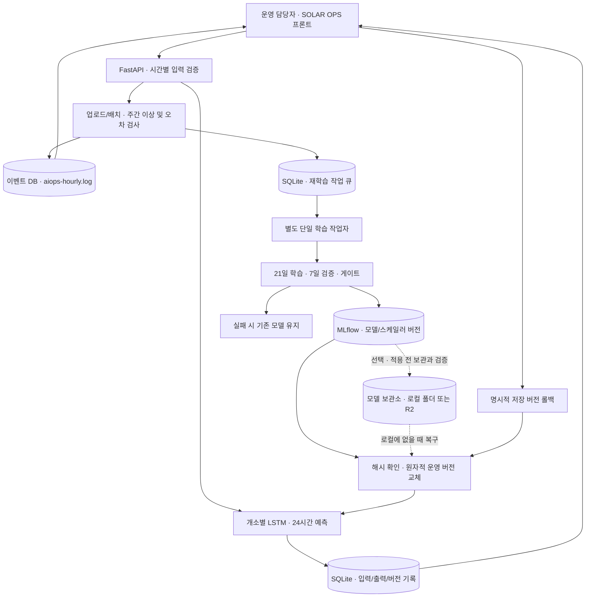

# ④ 아키텍처 구성도

모델 외부 보관 구현은 [모델 저장소 안내](../model-storage.md)에, 들인 이유는 [결정0017](../decisions/0017-optional-model-archive.md)에 있다. 선택 모드에서 재학습 버전의 모델·고정 스케일러·manifest를 운영 적용 전에 보관·검증하고 누락된 로컬 버전을 복구한다. 기본 실행은 보관을 쓰지 않으며 구조를 유지한다. 운영 DB와 MLflow 기록은 보관 대상이 아니고 계속 로컬에 둔다.

| 확인한 것 | 보관소 | 날짜 | 증빙 |
| --- | --- | --- | --- |
| 하동 v3의 복구, 묶음 해시, 24시간 예측 일치 | 실제 R2 | 2026-10-08 | [R2 검증](evidence/r2-local-20261008/verification.json) |
| 합성 자료 업로드 → 재학습 → 게이트 통과 → 보관 → v2 운영 반영, 로컬 v2 삭제 뒤 복구와 24시간 예측 일치, 보관 실패 시 v1 유지 | 로컬 폴더 | 2026-10-09 | [로컬 보관 검증](evidence/model-store-local-20261009/verification.json) |

재학습 직후 실제 R2로 자동 업로드되는 흐름은 저장소에 증빙이 없다. 2026-10-08의 합성 재학습 검증은 모델 등록과 R2를 모의 처리했다. 초기 모델 31개는 Git에 있으므로 자동으로 보관하지 않는다. 모델 없는 이미지 배포와 31개 전체 보관은 검증하지 않았다. 합성 자료의 결과는 기능 확인용이며 예측 성능의 근거가 아니다.

## 통합가이드가 요구하는 것

업로드,학습·MLflow,FastAPI 서빙,예측 기록·로그,드리프트 감지,알림·재학습 트리거의 흐름을 표시한다.

## 실행 단위와 저장 경로

| 요소 | 현재 구현 |
| --- | --- |
| 프론트 | docs/design/solar-ops-v01/hourly-ui.js → publish-runtime.mjs → serving_app/static |
| HTTP·스키마 | serving_app/hourly/app.py,schemas.py |
| 모델 로딩 | hourly/model.py,model_loader.py; 입력24×9→출력24×1 |
| 감시·작업자 | hourly/policy.py,worker.py |
| 버전 관리 | registry.py; native MLflow TensorFlow 등록·재로드 확인 |
| 모델 보관(선택) | model_store.py; SOLAR_MODEL_STORE=disabled(기본)/local/r2; 재학습 버전을 보관·검증한 뒤 운영 교체 |
| 작업·예측·이벤트 | runtime.py; SQLite WAL 및 OS 파일 잠금 |
| 실행기 | scripts/run_backend.py; API1개+작업자1개 |
| 로컬 | 8077; data/runtime-hourly |
| 격리된 제출 시연 | 8078; data/runtime-submission; 합성 제어자료 표기 |
| 컨테이너 | 8099; /runtime 볼륨; 동일 실행기 |

팀 합의 결정0016에 따라 Git에 코드와 승인된 모델·스케일러·manifest·재생 이력을 함께 넣는다. seed ZIP은 선택적 백업 전달 수단이다. 새 환경에서 MLflow를 다시 등록하므로 기존 PC의 절대경로 DB를 복사하지 않는다. Docker 이미지에는 seed를 넣되 운영 DB·업로드·기존 일별 seed·가상환경은 .dockerignore로 제외한다.

재현은 [제출 안내](../submission/README.md), 실제 실행 결과는 [제출 증빙](evidence/submission_20261008/)에서 확인한다. 외부 API 실시간 수집,중앙 MLflow 서버,메시지 브로커,장기 가용성 보장은 범위 밖이다.
