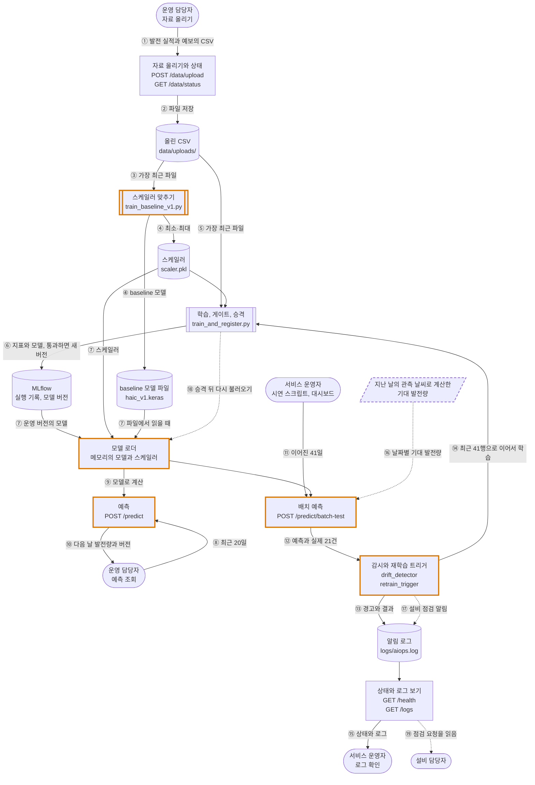
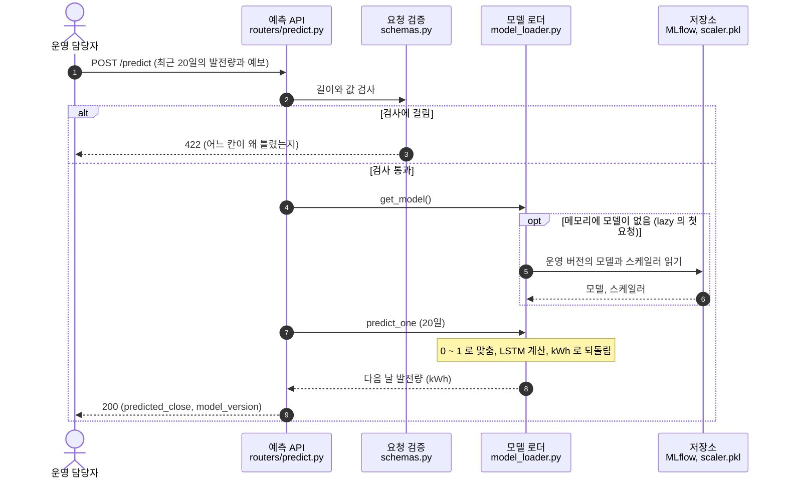
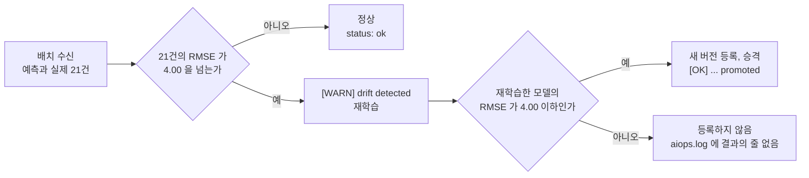
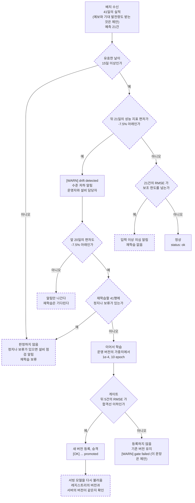
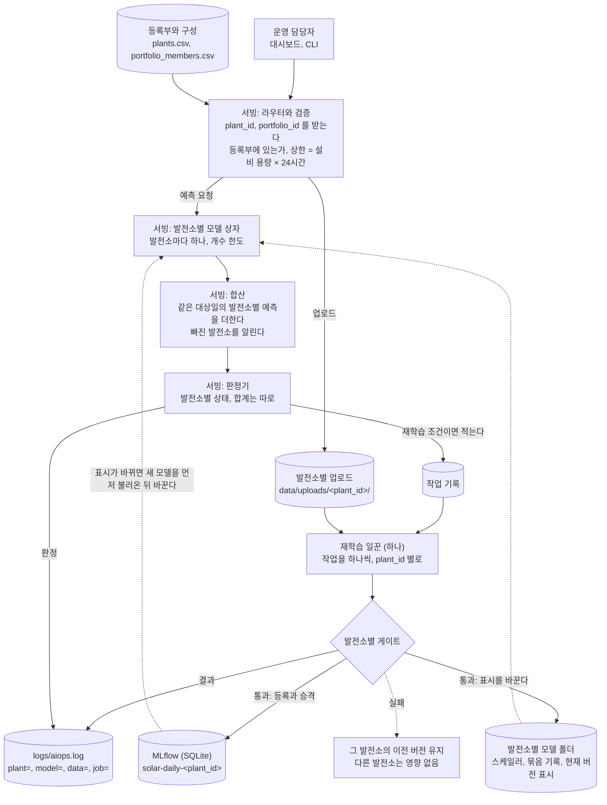

# ④ 아키텍처 구성도

- 평가 항목: 2-2 (구현·발표)
- 담당:
- 상태: 초안 (2026-10-07). 그림의 실선은 커밋 `58d6ff8` 의 코드에 있는 흐름이고 점선은 제안이다. 제안은 결정 기록이 확정되면 구현한다. 여러 발전소를 한 PC 에서 다루는 구조는 [9절](#9-한-pc-에서-여러-발전소를-다루는-구조-확장-제안)에 따로 그렸다

## 통합가이드가 요구하는 것

데이터 업로드, 학습·MLflow 레지스트리, FastAPI 서빙(컨테이너), 예측 기록·로그, 드리프트 감지, 알림·재학습 트리거의 흐름을 팀 서비스명으로 치환해 화살표로 표시한다.

표기(**[사실]**, **[조사]**, **[제안]**, **[현재]**, **[실행]**, **[미확인]**, **[과제]**)의 뜻은 [① 의 표](1-pain-point.md#이-문서의-표기)에 있다.

## 본문

### 1. 업로드에서 재배포까지 한 장으로

서비스의 이름은 아직 정하지 않았다. 이 문서에서는 "태양광 발전량 예측·감시 서비스"라고 부른다.

그림을 읽는 법은 다음과 같다.

- **네모**: 서빙 앱(FastAPI) 안의 부분. 로컬에서는 8077, 컨테이너에서는 8099 포트로 뜬다
- **겹테두리 네모**: 명령줄에서 돌리는 학습 스크립트
- **원통**: 저장소. 모두 로컬 파일이다
- **둥근 상자**: 사람. 선이 엇갈리지 않게, 같은 사람을 하는 일마다 따로 그렸다(운영 담당자 둘, 서비스 운영자 둘)
- **실선 화살표**: 지금의 코드에 있는 흐름
- **점선 화살표**: 제안. 코드에 없다
- **주황색 굵은 테두리**: 코드는 있지만 빈칸(`___`) 때문에 지금은 돌지 않는 상자
- **점선 테두리**: 제안으로 새로 들어오는 것
- 동그라미 번호는 아래 2절의 표와 이어진다

### 2. 화살표마다 무엇이 흐르고 누가 일으키는가

| 번호 | 무엇이 흐르는가 | 누가 일으키는가 | 지금의 상태 |
| --- | --- | --- | --- |
| ① | CSV 파일. 열은 `Date`, `Close`(그날의 발전량, kWh), `Volume`(다음 날에 대한 일사량 예보, MJ/m²). 태양광 파일에는 `Stop` 열도 있지만 서버는 읽지 않는다 | 운영 담당자가 대시보드에서 올린다 | **[실행]** 동작한다. 1,337행이 올라갔다. ([V07](evidence/validation.md#v07)) |
| ② | 받은 글자 그대로 `data/uploads/haic_<초>.csv` 로 저장 | 서버 | **[실행]** 동작한다. 내용은 검사하지 않는다. ([V08](evidence/validation.md#v08)) |
| ③ ④ | 가장 최근 파일의 모든 행 → 두 값의 최소·최대를 `scaler.pkl` 로, 학습한 baseline 모델을 `haic_v1.keras` 로 저장 | 서비스 운영자가 `python scripts/train_baseline_v1.py` 를 실행한다 | **[실행]** 스케일러는 저장된다. 그 뒤 빈칸 1 에서 멈춰 모델 파일은 저장되지 않는다. ([V10](evidence/validation.md#v10)) |
| ⑤ ⑥ | 가장 최근 파일과 스케일러 → 100 epoch 학습 → 시험 구간의 RMSE 와 모델을 MLflow 에 기록. 게이트를 통과하면 새 버전으로 등록해 Production 으로 | 서비스 운영자가 `python serving_app/train_and_register.py` 를 실행한다 | **[실행]** 동작한다. HAIC 예시 파일은 통과(`rmse=2.03`), 태양광 파일은 차단(`rmse=41.59 > 4.0`). ([V11](evidence/validation.md#v11), [V12](evidence/validation.md#v12)) |
| ⑦ | 모델과 스케일러를 메모리로. 모델은 `MODEL_SOURCE=mlflow` 이면 MLflow 의 Production 버전에서, 기본값(`local`)이면 `haic_v1.keras` 에서 읽는다 | 서버. 뜰 때(eager)나 첫 예측 요청 때(lazy) | **[실행]** 돌지 않는다. lazy 는 빈칸 4 에서, MLflow 에서 읽는 길은 빈칸 5 에서 멈춘다. 파일에서 읽는 길은 빈칸이 없지만 읽을 모델 파일이 없다(빈칸 1). ([V14](evidence/validation.md#v14)) |
| ⑧ ⑨ ⑩ | 최근 20일의 두 값 → 메모리의 모델과 스케일러로 계산 → 다음 날 발전량 한 값과 모델 버전 | 운영 담당자, 또는 고객의 다른 프로그램. 저장소 안에는 이 엔드포인트를 부르는 코드가 없다(대시보드도 부르지 않는다) | **[실행]** 요청 검증(422)은 동작한다. 정상 입력에는 500 이다. 빈칸 4 에서 멈추고, 그 뒤로 빈칸 2, 3 이 있다. 모델을 읽으려면 빈칸 1(파일)이나 5(MLflow)도 채워야 한다. ([V04](evidence/validation.md#v04), [V05](evidence/validation.md#v05)) |
| ⑪ ⑫ | 이어진 41일의 값 → 20일씩 잘라 21번 예측 → (예측, 실제) 21건을 감시로 | 서비스 운영자가 `scripts/simulate_drift.py` 나 대시보드의 단추로 보낸다. 날마다 자동으로 도는 것이 아니다 | **[실행]** 500 이다. 빈칸 4 에서 멈췄다. 그 뒤로 빈칸 2, 3, 6 이 있다. ([V06](evidence/validation.md#v06), [V13](evidence/validation.md#v13)) |
| ⑬ | 경고, 재학습 시작, 승격 결과의 문장 | 서버의 감시 코드 | **[현재]** 빈칸 7 ~ 11 로 돌지 않는다. **[실행]** 로그 파일은 0바이트다. ([V09](evidence/validation.md#v09)) |
| ⑭ | 가장 최근 파일의 마지막 41행 → MLflow 의 Production 가중치를 불러 이어서 학습 → 게이트 → ⑥ 과 같은 등록 | 서버의 감시 코드. 배치 요청의 응답 안에서 돈다 | **[현재]** 빈칸 9, 10, 11 로 돌지 않는다. "41행"과 `fine_tune` 을 부르는 줄이 바로 그 빈칸의 자리다. 교재의 지시대로 채웠을 때의 흐름을 그렸다 |
| ⑮ | 모델이 올라왔는지, 로그 파일의 목록과 내용 | 서비스 운영자가 대시보드나 API 로 본다 | **[실행]** 동작한다. ([V03](evidence/validation.md#v03), [V09](evidence/validation.md#v09)) |
| ⑯ | 배치의 날짜마다 기대 발전량. 예보도 요청으로 받는다 | 서비스 운영자가 배치와 함께 보낸다 | **[제안]** 코드에 없다. 지금은 둘째 값을 1,200,000 으로 고정한다. [0006](../decisions/0006-monitoring-metric-and-thresholds.md) |
| ⑰ | "설비 점검 필요, 재학습 보류" 같은 상황별 문장 | 서버의 감시 코드 | **[제안]** 코드에 없다. [0007](../decisions/0007-facility-vs-model-branch-and-alerts.md) |
| ⑱ | 새 버전의 모델을 불러와 메모리의 모델과 바꾼다 | 서버. 승격에 성공한 직후 | **[제안]** 코드에 없다. 지금은 승격해도 메모리의 모델이 그대로다. [0008](../decisions/0008-retraining-and-version-switch.md) |
| ⑲ | 점검을 요청하는 로그 문장 | 설비 담당자가 대시보드의 로그 패널에서 읽는다 | **[제안]** 밖으로 보내는 알림은 없다. 사람이 화면을 열어야 한다 |

- 기대 발전량(그림의 평행사변형)은 대상일의 관측 날씨로 계산한다. 예측에 들어가는 값이 아니라 지난 뒤의 감시에만 쓰는 값이다. 예측용 입력(①)과 흐름이 다르다.
- **[미확인]** 발전 실적과 예보를 날마다 자동으로 받아 오는 화살표는 없다. 사람이 CSV 를 올린다. 실시간 수집은 범위 밖이다.
- 그림을 읽기 쉽게 하려고 넣지 않은 흐름이 셋 있다. 이어서 학습할 때 `fine_tune` 이 MLflow 에서 Production 모델을 읽는 것(`train_and_register.py` 105행), 재학습이 `data/uploads/` 의 최근 파일을 읽는 것(`retrain_trigger.py` 65행), `GET /health` 가 메모리에 모델이 있는지를 보는 것(`routers/health.py` 11행)이다.

### 3. 정상 예측 한 건의 순서

| 단계 | 지금의 상태 |
| --- | --- |
| 1 ~ 3 | **[실행]** 동작한다. 길이, 값의 범위, 빠진 칸, JSON 이 아닌 본문을 422 로 거절한다. ([V05](evidence/validation.md#v05)) |
| 4 | **[실행]** 여기서 멈춘다. `model_loader.py` 167행의 빈칸(`if ___:`)에서 `NameError` 가 나고 500 이 돌아간다. ([V04](evidence/validation.md#v04)) |
| 5 ~ 6 | **[현재]** `MODEL_SOURCE=mlflow` 이면 빈칸 5(스케일러 불러오기, 125행)가 남아 있다. 기본값(`local`)이면 이 단계에 빈칸은 없지만 읽을 모델 파일(`haic_v1.keras`)이 없다. 그 파일은 빈칸 1 뒤에서 저장된다 |
| 7 ~ 8 | **[현재]** 빈칸 2, 3(입력 변환과 출력 복원)이 남아 있다 |
| 9 | **[현재]** `model_version` 은 `"v1-local"` 이나 `"production"` 이라는 고정된 글자다 |

**[제안]** 바꾸려는 것은 세 곳이다. 2단계에서 날짜가 하루씩 이어지는지도 본다. 9단계의 응답에 대상일과 레지스트리의 실제 버전 번호를 싣는다. 5단계는 `MODEL_SOURCE=mlflow` 일 때 그 버전의 번호를 함께 기억한다. ([⑤](5-api-spec.md#9-제안하는-태양광-api))

### 4. 수준 저하에 대응하는 갈래

지금의 코드는 한 줄기다.

- **[현재]** 설비가 멈춘 것과 수준이 바뀐 것을 가르지 않는다. 승격한 뒤 서빙 모델을 바꾸지 않는다. 게이트에서 막히면 경고와 재학습 시작의 두 줄만 `aiops.log` 에 남고 결과의 줄은 남지 않는다(표준 출력에는 `[GATE FAILED]` 가 찍힌다). 빈칸 때문에 이 줄기 전체가 지금은 돌지 않는다.

**[제안]** 제안하는 갈래는 다음과 같다. 점선 테두리는 지금의 코드에 없는 상자다. 실선 테두리(경고, 이어서 학습, 게이트, 등록과 승격, 등록하지 않음)는 코드에 있고 기준값만 바뀐다. 규칙의 값은 [③ 의 5 ~ 7절](3-operations-design.md#5-감시-무엇을-얼마나-모아-어디서-선을-긋는가)에 있다.

- 가르는 기준이 RMSE 에서 성능 지표로 바뀐다(마름모 D). 까닭은 [③ 의 5절](3-operations-design.md#5-감시-무엇을-얼마나-모아-어디서-선을-긋는가)에 있다.
- 알림과 재학습의 조건이 갈린다. 뒤 21일이 내려가 있으면 알리고, 앞 20일까지 내려가 있을 때 재학습한다. 막 내려간 때의 41행에는 내려가기 전의 날이 섞여 있기 때문이다([③ 의 9절](3-operations-design.md#9-재학습)).
- "기존 버전 유지"(K)와 "되돌리기"는 다르다. 되돌리기는 이미 승격한 버전(I 뒤)을 사람이 내리는 일이고 이 그림에 없다([③ 의 10절](3-operations-design.md#10-게이트로-다시-확인하고-실패하면-유지하고-필요하면-되돌린다)).
- 정비로 수준이 돌아온 경우는 이 갈래에 없다. 설비 담당자가 알리면 서비스 운영자가 기준선을 다시 계산하고 재학습을 손으로 건다.

### 5. 상자와 파일

경로는 `project/` 기준이다.

| 그림의 상자 | 파일과 함수 | 읽고 쓰는 저장소 | 지금의 상태 |
| --- | --- | --- | --- |
| 자료 올리기와 상태 | `serving_app/routers/data.py` 의 `upload`, `status`. `data/storage.py` 의 `latest_upload` | `data/uploads/haic_<초>.csv` 를 쓰고 읽는다 | **[실행]** 동작 |
| 예측 | `serving_app/routers/predict.py` 의 `predict`. `serving_app/schemas.py` 의 `DailyPoint`, `PredictRequest`, `PredictResponse` | 없다 | **[실행]** 검증은 동작, 예측은 500 |
| 배치 예측 | `serving_app/routers/predict.py` 의 `batch_test`, `recent_predictions`, `SIMULATED_VOLUME`. `schemas.py` 의 `BatchTestRequest`, `BatchTestResponse` | 서버 메모리의 `recent_predictions`(최근 21건). 서버를 내리면 사라진다 | **[실행]** 500. 빈칸 4 에서 멈췄다. 그 뒤로 빈칸 2, 3, 6 |
| 모델 로더 | `serving_app/model_loader.py` 의 `get_model`, `load_eager`, `_load_from_local`, `_load_from_mlflow`, `LoadedModel.predict_one`, `_model_cache` | `serving_app/models/haic_v1.keras`, `serving_app/models/scaler.pkl`, MLflow 의 `models:/HAIC_Predictor/Production` 을 읽는다 | **[현재]** 빈칸 2, 3, 4, 5 |
| 감시와 재학습 트리거 | `serving_app/monitoring/drift_detector.py` 의 `compute_rmse`, `is_drift`. `serving_app/monitoring/retrain_trigger.py` 의 `check_and_trigger` | `logs/aiops.log` 에 쓴다. `data/uploads/` 의 최근 파일을 읽는다 | **[현재]** 빈칸 7 ~ 11 |
| 상태와 로그 보기 | `serving_app/routers/health.py` 의 `health`. `serving_app/routers/logs.py` 의 `list_logs`, `read_log`. `serving_app/main.py` 의 로그 설정 | `logs/` 를 읽는다 | **[실행]** 동작 |
| 스케일러 맞추기 | `scripts/train_baseline_v1.py` 의 `main`. `data/features.py` 의 `HAICScaler`, `build_sequences`, `train_test_split` | `scaler.pkl` 과 `haic_v1.keras` 를 쓴다 | **[실행]** 스케일러만 쓰고 빈칸 1 에서 멈춘다 |
| 학습, 게이트, 승격 | `serving_app/train_and_register.py` 의 `train_and_register`, `fine_tune`, `_register_if_gate_passed`, `RMSE_GATE`. `serving_app/lstm_model.py` 의 `build_model` | `mlflow.db`(실행 기록과 레지스트리), `mlruns/`(모델 파일) | **[실행]** 처음부터 학습하는 길과 게이트의 두 갈래(통과, 차단)는 동작. `fine_tune` 은 돌려 보지 못했다. 부르는 자리가 빈칸 10 이다 |
| 대시보드 | `serving_app/static/index.html` | 없다. API 를 부른다 | **[실행]** 열린다. **[현재]** 배치 단추는 무작위 가격을 만들어 보낸다 |
| 시연 스크립트 | `scripts/simulate_drift.py` | `data/uploads/` 의 최근 파일을 읽어 평균을 구한다 | **[실행]** 500 을 받고 멈춘다 |
| 컨테이너 | `serving_app/Dockerfile`, `serving_app/docker-compose.yml` | 이미지 안의 `/app` 에 위의 파일이 모두 들어간다 | **[실행]** 빌드가 빈칸 1 에서 실패한다 |
| 기대 발전량 | [`datasets/hadong_daily_full.csv`](../../datasets/hadong_daily_full.csv)의 `pi_expected_kwh` 열(2025-12-31 까지) | 서버가 읽지 않는다 | **[제안]** 배치 요청으로 넘긴다 |

### 6. HAIC 스켈레톤에서 바꿀 곳과 그대로 둘 곳

**[현재]** 지금까지 `project/` 에서 바꾼 것은 없다. 커밋 `58d6ff8` 의 `project/` 는 받은 스켈레톤 그대로다. 빈칸 11곳(코드 14줄, `___` 16개)이 남아 있고 주가 예측의 표현이 그대로 있다(`project/README.md` 까지 넣어 `HAIC` 43회, `종가` 25회, `달러` 23회). ([V02](evidence/validation.md#v02))

**[제안]** 아래는 바꾸려는 곳이다. 먼저 빈칸을 HAIC 실습의 답으로 채우고, 그 위에 태양광용 수정을 따로 올린다.

| 파일 | 바꿀 것 | 그대로 둘 것 |
| --- | --- | --- |
| `data/features.py` | 주석의 "거래일"과 "달러". 스케일러를 학습 행만으로 맞추는 방법 | `SEQ_LEN = 20`, 창을 만드는 방식, 시간순 분할 |
| `serving_app/schemas.py` | `close` 는 0 이상과 상한, `volume` 은 소수와 상한, 날짜. 배치 요청에 예보·날짜·기대 발전량. 응답에 대상일과 판정 내용 | 길이 20 의 검사, 필드 이름 |
| `serving_app/lstm_model.py` | 없다 | 모델 구조, `N_FEATURES = 2` |
| `serving_app/model_loader.py` | 빈칸 2 ~ 5. 승격 뒤 다시 불러오는 함수. 실제 버전 번호 | lazy 와 eager 의 구조 |
| `serving_app/train_and_register.py` | `RMSE_GATE` 를 상대 기준으로. 치우침. 합격선과 기준선의 저장. 승격할 때 이전 버전을 Archived 로 | 학습 설정(100 epoch, 1e-4, 10 epoch), MLflow 에 기록하는 방식 |
| `serving_app/routers/predict.py` | 빈칸 6. `SIMULATED_VOLUME` 대신 받은 값. 최근 기록에 날짜와 기대 발전량 | `/predict` 의 흐름 |
| `serving_app/routers/data.py` | 숫자, 빈 값, 날짜, 범위의 검사. 겹치지 않는 파일 이름 | UTF-8, 열 이름, 41행 이상의 검사 |
| `serving_app/routers/health.py` | 올라와 있는 버전 | 나머지 |
| `serving_app/routers/logs.py` | 없다 | 전부 |
| `serving_app/monitoring/drift_detector.py` | 빈칸 7, 8. 성능 지표의 판정, 정지와 보류의 규칙, `RMSE_THRESHOLD` 를 보조 한도로 | `WINDOW_SIZE = 21`, `compute_rmse` |
| `serving_app/monitoring/retrain_trigger.py` | 빈칸 9 ~ 11. 보류의 갈래, 겹쳐 도는 것을 막는 장치, 새 로그 문장, 승격 뒤 다시 불러오기 | 기존 로그 세 문장의 글자 |
| `serving_app/static/index.html` | 제목과 안내문의 HAIC 표현, `RMSE_THRESHOLD`, `DEFAULT_BASE_PRICE`, 배치를 만드는 부분, 단위 표기(`$`) | 화면의 짜임 |
| `scripts/train_baseline_v1.py` | 빈칸 1. 게이트 문구(`$4.00`) | 나머지 |
| `scripts/simulate_drift.py` | 무작위 가격 대신 실제 41행. 주입은 발전량에만 0.86. 예보와 기대 발전량을 함께 보낸다 | `--target local\|container\|both` |
| `serving_app/Dockerfile` | 빌드할 때 넣는 자료(`data/sample_haic_prices.csv`)를 태양광 파일로 | 포트 8099, `MODEL_SOURCE=mlflow`, `LOADING_MODE=eager` |

- 모델의 이름 `HAIC_Predictor`, 저장 파일의 이름 `haic_<초>.csv` 와 `haic_v1.keras` 를 바꿀지는 정하지 않았다. 로그 문장과 여러 코드 파일(`train_and_register.py`, `model_loader.py`, `train_baseline_v1.py`, `routers/data.py`, `retrain_trigger.py`)이 이 이름을 쓴다. 바꾸면 함께 고칠 곳이 많다.
- 고칠 때 함께 맞출 묶음은 [`AGENTS.md`](../../AGENTS.md)의 표에 있다.

### 7. 어디서 도는가

| 항목 | 내용 | 성격 |
| --- | --- | --- |
| 로컬 서버 | `uvicorn serving_app.main:app --port 8077`. `project/` 에서 실행한다 | **[실행]** 뜬다. ([V03](evidence/validation.md#v03)) |
| 컨테이너 | 포트 8099. 컨테이너 하나. 이미지를 만들 때 스케일러 맞추기와 학습·등록까지 안에서 끝낸다 | **[실행]** `docker compose config` 는 서비스 하나(`serving-app`), 포트 8099 를 보여 준다. 빌드는 8단계 가운데 마지막에서 빈칸 1 때문에 실패했다. 이미지가 만들어지지 않았다(`docker images` 로 확인). ([V15](evidence/validation.md#v15)) |
| 둘을 함께 | 로컬 8077 과 컨테이너 8099 를 동시에 띄워 같은 배치를 보낼 수 있게 나뉘어 있다 | **[현재]** `scripts/simulate_drift.py --target both`. 실행해 보지 못했다 |
| MLflow | 따로 띄운 서버가 없다. 작업 폴더의 `mlflow.db`(sqlite)와 `mlruns/` 에 쓴다 | **[실행]** 학습을 돌리자 두 곳에 기록됐다. 검증용 사본의 폴더를 열어 확인했다. `mlflow.db` 의 내용은 레지스트리 기록으로 남겼고 `mlruns/` 의 목록은 증빙으로 남기지 않았다. ([V11](evidence/validation.md#v11)) |
| 컨테이너 안의 MLflow | 이미지 안의 `/app` 에 따로 있다. 로컬의 레지스트리와 이어져 있지 않다 | **[현재]** 로컬에서 올린 버전은 컨테이너에 보이지 않고 그 반대도 같다 |
| 모델을 읽는 곳 | 로컬 서버의 기본은 파일(`MODEL_SOURCE=local`), 컨테이너는 MLflow(`MODEL_SOURCE=mlflow`) | **[현재]** `model_loader.py` 131행, `Dockerfile` 34행 |
| 범위 밖 | MLflow 서버, Prometheus, Grafana, Kubernetes, 컨테이너의 이중화 | 교재의 실습 범위가 아니다 |

- **[현재]** 재학습으로 올라간 모델과 쌓인 로그는 컨테이너 안에만 있다. 컨테이너를 지우면 사라진다. 볼륨을 붙이지 않았다(`docker-compose.yml`).
- **[미확인]** 컨테이너가 뜬 뒤의 동작(8099 의 `/health`, `/docs`, 예측)은 확인하지 못했다. 빌드가 통과해야 볼 수 있다.

### 8. 확인하지 못한 것

| 확인하지 못한 것 | 이 문서에서 어떻게 다뤘는가 |
| --- | --- |
| ⑦, ⑨, ⑫ ~ ⑭ 의 흐름이 실제로 도는지 | 코드에 있으나 돌지 않는 상자로 그렸다(주황색 테두리) |
| ⑯ ~ ⑲ 의 흐름 | 제안으로 그렸다(점선) |
| 컨테이너의 실행 | 빌드 실패까지만 적었다 |
| 승격 뒤 서빙 모델이 바뀌지 않는다는 것 | 코드를 읽어 적었다. 서버에서 재현하지 못했다 |

후속 조건은 [`../followups.md`](../followups.md)에 옮겨 적었다.

### 9. 한 PC 에서 여러 발전소를 다루는 구조 (확장 제안)

**[현재]** 1 ~ 8절의 그림은 발전소 한 곳의 흐름이다. 이 절은 발전소가 여럿일 때 상자와 파일이 어떻게 나뉘는지를 그린다. 모두 **[제안]** 이고 구현하지 않았다. 프로세스의 구성, 재학습 작업의 순서, 규모의 산정은 [한 PC 운영 문서](single-pc-operation.md)에 있다.

바뀌는 것은 세 가지다. **무엇이든 발전소별로 나눈다.** 업로드 폴더, 스케일러와 모델, 메모리의 모델 상자, 감시 상태가 발전소마다 하나씩이다. **합계는 서빙이 더한다.** 합계용 모델을 따로 두지 않는다. **재학습은 서빙 프로세스 밖에서 한 번에 하나씩 돈다.**

| 상자나 파일 | 지금 (발전소 한 곳) | 넓힌 뒤 | 고칠 곳 |
| --- | --- | --- | --- |
| 등록부와 구성 | 없다. 용량이 코드의 상수에 있다 | `plants.csv`, `portfolio_members.csv` 를 읽는다 | 새 모듈. 등록부는 [`datasets/plants/`](../../datasets/plants/) |
| 업로드 폴더 | `data/uploads/` 하나. 가장 최근 파일을 고른다 | 발전소별 폴더. 발전소를 주어 고른다 | `data/storage.py`, `serving_app/routers/data.py` |
| 스케일러와 모델 | 파일 하나씩, 레지스트리의 이름 하나 | 발전소별 폴더와 이름. 묶음 기록으로 짝을 확인한다 | `serving_app/model_loader.py`, `serving_app/train_and_register.py`, `scripts/train_baseline_v1.py` |
| 모델 상자 | 하나 | 발전소별, 개수 한도 | `serving_app/model_loader.py` |
| 합산 | 없다 | 서빙이 같은 대상일의 예측을 더하고 누락을 알린다 | 새 라우터 |
| 판정기 | 연결 하나, 발전소 구분 없음 | 발전소별 상태. 합계는 따로 | `serving_app/aiops_adapter.py`, AIOps 의 판정기 |
| 재학습 | 요청 안에서 돈다 | 작업 기록과 일꾼 하나 | `serving_app/monitoring/retrain_trigger.py`, 새 작업 모듈 |
| 로그 | 문장에 발전소가 없다 | 식별자를 싣는다 | `serving_app/monitoring/retrain_trigger.py`, `serving_app/static/index.html` 의 안내문 |

- **[실행]** 이 구조의 크기를 어림하는 값은 발전소 한 곳으로 쟀다. 학습 한 번이 18 ~ 22초, 재학습이 4.4초, 메모리의 모델 하나가 4.6MB, 다른 프로세스가 학습하는 동안의 예측 실패가 0건이다. 조사에 쓴 PC 의 값이다. ([M09](evidence/multi-plant/validation.md#m09))
- **[미확인]** 여러 발전소를 실제로 올린 상태의 메모리와 응답 시간, 컨테이너에서의 동작은 재지 않았다.
- 범위는 7절과 같다. MLflow 서버, Prometheus, Grafana, Kubernetes, 메시지 브로커는 들이지 않는다.
