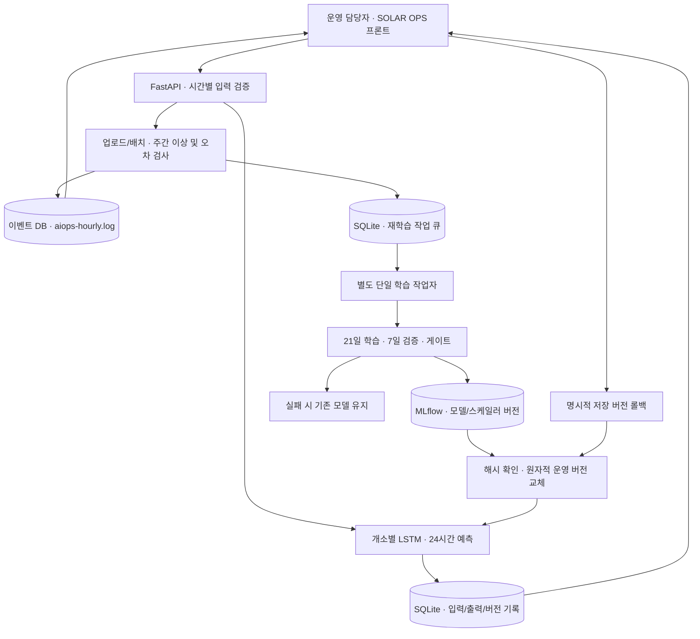

# ④ 아키텍처 구성도

## 통합가이드가 요구하는 것

업로드,학습·MLflow,FastAPI 서빙,예측 기록·로그,드리프트 감지,알림·재학습 트리거의 흐름을 표시한다.

## 실행 단위와 저장 경로

| 요소 | 현재 구현 |
| --- | --- |
| 프론트 | docs/design/solar-ops-v01/hourly-ui.js → publish-runtime.mjs → serving_app/static |
| HTTP·스키마 | serving_app/hourly/app.py,schemas.py |
| 모델 로딩 | hourly/model.py,model_loader.py; 입력24×9→출력24×1 |
| 감시·작업자 | hourly/policy.py,worker.py |
| 버전 관리 | registry.py; native MLflow TensorFlow 등록·재로드 확인 |
| 작업·예측·이벤트 | runtime.py; SQLite WAL 및 OS 파일 잠금 |
| 실행기 | scripts/run_backend.py; API1개+작업자1개 |
| 로컬 | 8077; data/runtime-hourly |
| 격리된 제출 시연 | 8078; data/runtime-submission; 합성 제어자료 표기 |
| 컨테이너 | 8099; /runtime 볼륨; 동일 실행기 |

Git에는 코드를 넣고 모델은 SHA가 포함된 별도seed ZIP으로 전달한다. 새 환경에서 MLflow를 다시 등록하므로 기존 PC의 절대경로 DB를 복사하지 않는다. Docker 이미지에는 seed를 넣되 운영 DB·업로드·기존 일별 seed·가상환경은 .dockerignore로 제외한다.

재현은 [제출 안내](../submission/README.md), 실제 실행 결과는 [제출 증빙](evidence/submission_20261008/)에서 확인한다. 외부 API 실시간 수집,중앙 MLflow 서버,메시지 브로커,장기 가용성 보장은 범위 밖이다.
