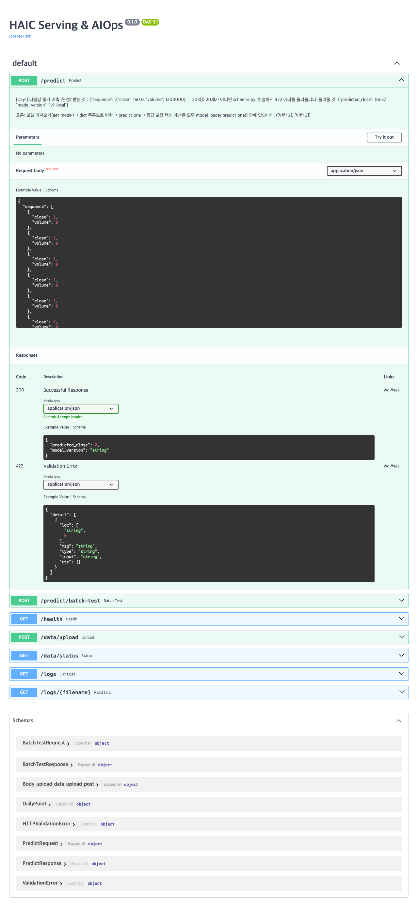

# ⑤ API 명세

- 평가 항목: 2-2 (구현·발표)
- 담당: 본인 (`fastapi` 브랜치, 백엔드 API)
- 상태: FastAPI 공통 검증·오류 처리 보완 (2026-10-07). 아래 최신 변경표가 현재 계약이다. 기존 본문 1~8절은 `58d6ff8` 당시의 실행 기록으로 보존하며 현재 응답과 구분한다. 9절의 태양광 단건·업로드 규격은 #6에서 적용했고 배치 규격은 후속 작업이다

## 현재 태양광 API 계약 — #6 (2026-10-07)

사용자가 9절의 입력 계약 적용을 승인했다. 단건 예측과 업로드는 아래를 따른다. 배치 입력과 AIOps는 다음 이슈에서 호출부와 함께 연결한다.

| API | 현재 계약 |
| --- | --- |
| `POST /predict` | `sequence` 정확히 20개. 각 점에 `date`(YYYY-MM-DD), `close`(숫자 0~1,320kWh), `volume`(숫자 0~45MJ/m²)가 필수다. 날짜는 하루씩 이어져야 한다. `volume`은 **다음 날** 예보이며 소수를 그대로 받는다. 알 수 없는 필드는 422 |
| 단건 응답 | `predicted_close`(kWh, 음수는 0으로 제한 후 소수 둘째 자리), `target_date`(마지막 날짜 다음 날), `model_version`(모델 제공자의 버전). 날짜와 사후 관측값은 모델 피처에 넣지 않는다 |
| 오류 | 검증 실패 422. 모델·스케일러 미준비 또는 비유한 예측 결과 503. 음수·범위 초과·비유한 입력·날짜 누락·중복·역순·빠진 날은 거절한다 |
| `POST /data/upload` | 기존 UTF-8·필수 열·최소 41행 검사에 같은 값 범위와 연속 달력일 검사를 적용한다. 실패는 400. 태양광 예보 업로드 파일을 소수 손실 없이 저장한다 |
| `GET /health` | `model_source` 추가: 캐시 모델의 `local`/`mlflow`, 미로딩이면 null. `model_version`도 캐시 모델 기준이다. 실제 레지스트리 버전·승격 교체는 MLOps 담당 |
| `POST /predict/batch-test` | 아직 HAIC의 `prices` 요청 계약. 태양광 모델에 연결하는 것은 후속 배치 이슈가 끝난 뒤다 |

검증은 [21개 API 테스트](evidence/fastapi-solar/api-tests.txt), [응답](evidence/fastapi-solar/http-results.json), [OpenAPI](evidence/fastapi-solar/openapi.json)에 있다. 200 예측은 고정 대체 모델로 API 경로를 검사한 결과이며 실제 모델의 예측 성능이 아니다. 요청 예시는 아래 9절의 20행을 그대로 사용할 수 있다.

## 공통 오류 처리 변경 이력 — #5 (2026-10-07)

아래 표는 #5 시점의 기록이다. 현재 태양광 단건·업로드 계약은 위 표가 우선한다.

정답 빈칸 11개는 `347af06`에서 채웠다. 아래 응답은 모델·AIOps를 격리한 FastAPI TestClient 검사로 확인했다. **실제 학습 모델의 예측 성공이나 품질 검증을 뜻하지 않는다.** 기존 `58d6ff8` 증빙은 덮어쓰지 않았다.

| API | 현재 계약 / 바뀐 점 |
| --- | --- |
| `POST /predict`, `POST /predict/batch-test` | HAIC 입력·정상 응답 모양은 유지. 로컬 모델 또는 스케일러 파일이 없으면 503 `{"detail":"예측 모델 또는 스케일러가 준비되지 않았습니다. 모델 준비 후 다시 요청하세요."}`. 틀린 길이는 여전히 422 |
| `GET /health` | `model_version` 추가. 미로딩이면 `{"status":"ok","model_loaded":false,"model_version":null,"loading_mode":"lazy"}`. 모델이 올라오면 로더의 `version`을 그대로 표시한다. 레지스트리의 실제 버전 번호 처리는 MLOps 후속 작업 |
| `POST /data/upload` | UTF-8 및 BOM 허용. 필수 열 `Date, Close, Volume`, 중복 헤더·잘못된 열 수 검사. 최소 41행. `Date`는 `YYYY-MM-DD`, 중복 없는 오름차순. `Close`, `Volume`은 빈 값이 아닌 유한한 0 이상 숫자. 위반 시 400 `{"detail":"원인"}` |
| 업로드 저장 | 응답 키 `filename`, `rows`는 유지. 파일명은 충돌하지 않는 `haic_<uuid>.csv`. 임시 파일에 모두 쓴 뒤 CSV로 공개하므로 학습 측은 완성된 파일만 읽는다 |
| `GET /data/status` | 파일이 없으면 기존처럼 `{"exists":false}`. 기존 업로드가 새 검증에 실패하면 409 `{"detail":"최근 업로드 파일이 유효하지 않습니다. 올바른 CSV를 다시 업로드하세요: 원인"}` |
| 로그·대시보드·시뮬레이션 호출 | 기존 URL·요청은 유지. 대시보드는 응답 객체를 표시하므로 추가 `model_version`과 JSON 오류에 호환된다. 시뮬레이션의 `prices` 요청·배치 응답은 이번 변경에서 바뀌지 않았다 |

현재 업로드는 HAIC 거래일의 간격을 허용한다. 태양광의 하루 간격·발전량 1,320kWh 상한·예보 45MJ/m² 상한과 날짜 필수 예측 요청은 [0002](../decisions/0002-inputs-and-prediction-time.md) API 규격을 다음 이슈에서 적용한다. 학습·배포 게이트·드리프트 판정·재학습 변경은 팀원 담당이다.

검증: [15개 API 검사](evidence/fastapi/api-tests.txt), [응답 증빙](evidence/fastapi/http-results.json), [최신 OpenAPI](evidence/fastapi/openapi.json), [체크리스트와 인수인계](../fastapi-handoff.md). 8077 포트가 사용 중이어서 별도 서버의 네트워크 검증은 미실행했다. 응답 증빙은 앱 내부 ASGI 호출 결과다.

## 통합가이드가 요구하는 것

추론·헬스체크·업로드·배치 테스트·로그 조회 등 실제 호출되는 엔드포인트 목록(Method, URL, Request/Response 예시, 422 등 에러 응답)을 정리한다. Swagger UI 에서 확인한 내용을 옮기면 된다.

표기(**[사실]**, **[조사]**, **[제안]**, **[현재]**, **[실행]**, **[미확인]**, **[과제]**)의 뜻은 [① 의 표](1-pain-point.md#이-문서의-표기)에 있다.

## 초기 실행 기록과 설계안 (커밋 58d6ff8 기준)

### 1. 엔드포인트 목록

**[실행]** 2026-10-07 에 로컬 서버(`http://127.0.0.1:8077`)를 띄워 호출했다. 서버가 낸 OpenAPI 문서([`openapi.json`](evidence/openapi.json))의 경로 7개가 코드의 라우터와 같았다. 요청과 응답은 건마다 [`evidence/http/`](evidence/http/)에 그대로 남겼다. ([V03](evidence/validation.md#v03))

| Method | URL | 하는 일 | 지금 호출하면 |
| --- | --- | --- | --- |
| POST | `/predict` | 최근 20일의 값을 받아 다음 날 값 하나를 예측한다 | 틀린 입력은 422. **정상 입력은 500** (빈칸) |
| POST | `/predict/batch-test` | 이어진 값(21개 이상)을 받아 20개씩 잘라 여러 번 예측하고 드리프트를 판정한다 | 틀린 입력은 422. **정상 입력은 500** (빈칸) |
| GET | `/health` | 서버의 상태와 모델이 올라왔는지를 알린다 | 200 |
| POST | `/data/upload` | 학습에 쓸 CSV 를 올린다 | 200, 틀린 파일은 400 |
| GET | `/data/status` | 가장 최근에 올린 파일의 행 수와 기간을 알린다 | 200. 숫자가 아닌 값이 든 파일이 올라가 있으면 500 |
| GET | `/logs` | 로그 파일의 목록 | 200 |
| GET | `/logs/{filename}` | 로그 파일의 내용 | 200, 없는 파일은 404 |
| GET | `/` | 대시보드 화면 | 200 |
| GET | `/docs`, `/openapi.json` | API 문서 화면(Swagger UI)과 그 원본 | 200 |



**[실행]** 서버의 `/docs` 를 헤드리스 Chrome 으로 열어 `POST /predict` 를 펼친 화면이다. 제목이 "HAIC Serving & AIOps"이고 설명이 "다음날 종가 예측"이다. 태양광으로 바꾸기 전의 상태다. ([V26](evidence/validation.md#v26))

이 문서의 필드 이름(`close`, `volume`, `predicted_close`, `prices`)은 주가 예측의 것 그대로다. **[제안]** 이름은 두고 뜻을 바꿔 읽는다([0002](../decisions/0002-inputs-and-prediction-time.md)).

| 필드 | 지금 코드의 뜻 | 태양광에서의 뜻 | 단위 |
| --- | --- | --- | --- |
| `close`, `prices` 의 값 | 그날의 종가 | 그날의 하루 발전량 | kWh |
| `volume` | 그날의 거래량 | **다음 날**에 대한 하루 전 일사량 예보의 하루 합계 | MJ/m² |
| `predicted_close`, `predictions` 의 값 | 다음 날 종가 | 다음 날의 하루 발전량 | kWh |

### 2. POST /predict

| 항목 | 내용 |
| --- | --- |
| 목적 | 최근 20일의 값으로 다음 날의 값 하나를 예측한다 |
| 요청의 Content-Type | `application/json` |
| 응답의 Content-Type | `application/json` |
| 코드 | [`routers/predict.py`](../../project/serving_app/routers/predict.py) 33 ~ 47행, [`schemas.py`](../../project/serving_app/schemas.py) 15 ~ 31행, [`model_loader.py`](../../project/serving_app/model_loader.py) 의 `get_model`, `predict_one` |
| 부수 효과 | lazy 방식이면 첫 요청에서 모델을 메모리에 올린다. 그 밖에는 없다 |

**요청 필드** **[현재]**

| 필드 | 타입 | 필수 | 제약 | 뜻 (태양광) | 단위 |
| --- | --- | --- | --- | --- | --- |
| `sequence` | 배열 | 예 | 정확히 20개. 오래된 날에서 최근 날 순서 | 최근 20일 | |
| `sequence[].close` | 실수 | 예 | 0 초과 | 그날의 하루 발전량 | kWh |
| `sequence[].volume` | 정수 | 예 | 0 이상 | 다음 날에 대한 일사량 예보 | MJ/m² |

**요청 예시** **[실행]** 실제로 보낸 본문이다. 업로드 파일의 마지막 20행(2026-02-08 ~ 02-27)에서 만들었다. 지금의 스키마가 `volume` 을 정수로만 받아서 예보 값을 반올림했다. 반올림은 스키마를 통과시키려는 것이고 권하는 사용법이 아니다.

```json
{
  "sequence": [
    {"close": 292.674, "volume": 16},
    {"close": 265.146, "volume": 4},
    {"close": 45.42, "volume": 15},
    {"close": 231.726, "volume": 16},
    {"close": 262.698, "volume": 15},
    {"close": 249.714, "volume": 13},
    {"close": 169.11, "volume": 16},
    {"close": 243.468, "volume": 15},
    {"close": 189.516, "volume": 17},
    {"close": 273.84, "volume": 17},
    {"close": 268.452, "volume": 17},
    {"close": 278.286, "volume": 17},
    {"close": 268.326, "volume": 17},
    {"close": 265.8, "volume": 15},
    {"close": 214.044, "volume": 17},
    {"close": 265.386, "volume": 1},
    {"close": 11.532, "volume": 17},
    {"close": 247.932, "volume": 15},
    {"close": 80.244, "volume": 10},
    {"close": 94.848, "volume": 18}
  ]
}
```

**정상 응답** 스키마는 다음 두 필드다(OpenAPI 의 `PredictResponse`).

| 필드 | 타입 | 뜻 |
| --- | --- | --- |
| `predicted_close` | 실수 | 다음 날의 값. 소수 둘째 자리로 반올림한다 |
| `model_version` | 문자열 | **[현재]** `"v1-local"`(파일에서 읽은 모델)이나 `"production"`(MLflow 에서 읽은 모델). 고정된 글자라 버전이 바뀌어도 같다 |

**[실행]** 지금은 200 이 나오지 않는다. 위 본문을 보내면 이렇게 돌아온다. ([V04](evidence/validation.md#v04))

```text
HTTP/1.1 500 Internal Server Error
content-type: text/plain; charset=utf-8

Internal Server Error
```

서버 로그의 원인은 `model_loader.py` 167행의 빈칸(빈칸 4)이다(`NameError: name '___' is not defined`). 학습을 돌린 뒤에도, `MODEL_SOURCE=mlflow` 로 띄워도 같았다. 이 빈칸을 채워도 그 뒤로 빈칸 2, 3 이 있고, 읽을 모델도 있어야 한다(기본 설정은 빈칸 1 뒤에서 저장되는 파일을, MLflow 설정은 빈칸 5 를 거친다). 그래서 **실제 200 응답의 예시는 아직 없다.** 빈칸을 채운 뒤 실행 결과로 채운다. 증빙: [`predict_valid_current_schema.json`](evidence/http/predict_valid_current_schema.json), [`01_server_local_lazy.log`](evidence/logs/01_server_local_lazy.log).

**오류 응답** **[실행]** 여덟 가지 틀린 입력을 보냈다. 모두 422 이고 본문은 `{"detail": [...]}` 이다. ([V05](evidence/validation.md#v05))

| 보낸 것 | 상태 | `type` | `loc` | `msg` | 증빙 |
| --- | --- | --- | --- | --- | --- |
| 19개 | 422 | `too_short` | `["body", "sequence"]` | `List should have at least 20 items after validation, not 19` | [`predict_19_items.json`](evidence/http/predict_19_items.json) |
| 21개 | 422 | `too_long` | `["body", "sequence"]` | `List should have at most 20 items after validation, not 21` | [`predict_21_items.json`](evidence/http/predict_21_items.json) |
| 마지막 `close` 가 0 | 422 | `greater_than` | `["body", "sequence", 19, "close"]` | `Input should be greater than 0` | [`predict_close_zero.json`](evidence/http/predict_close_zero.json) |
| `volume` 이 소수(예보 값 그대로) | 422 | `int_from_float` | `["body", "sequence", 0, "volume"]` 부터 소수인 칸마다 | `Input should be a valid integer, got a number with a fractional part` | [`predict_volume_float.json`](evidence/http/predict_volume_float.json) |
| 첫 `volume` 이 −1 | 422 | `greater_than_equal` | `["body", "sequence", 0, "volume"]` | `Input should be greater than or equal to 0` | [`predict_volume_negative.json`](evidence/http/predict_volume_negative.json) |
| 첫 점에 `volume` 이 없음 | 422 | `missing` | `["body", "sequence", 0, "volume"]` | `Field required` | [`predict_field_missing.json`](evidence/http/predict_field_missing.json) |
| 본문이 `{}` | 422 | `missing` | `["body", "sequence"]` | `Field required` | [`predict_empty_object.json`](evidence/http/predict_empty_object.json) |
| 본문이 JSON 이 아님 | 422 | `json_invalid` | `["body", 0]` | `JSON decode error` | [`predict_body_not_json.json`](evidence/http/predict_body_not_json.json) |

마지막 `close` 를 0 으로 보냈을 때의 응답 전체다.

```json
{
  "detail": [
    {
      "type": "greater_than",
      "loc": ["body", "sequence", 19, "close"],
      "msg": "Input should be greater than 0",
      "input": 0.0,
      "ctx": {"gt": 0.0}
    }
  ]
}
```

첫 `volume` 을 −1 로 보냈을 때의 응답 전체다.

```json
{
  "detail": [
    {
      "type": "greater_than_equal",
      "loc": ["body", "sequence", 0, "volume"],
      "msg": "Input should be greater than or equal to 0",
      "input": -1,
      "ctx": {"ge": 0}
    }
  ]
}
```

- `loc` 의 숫자는 배열에서 몇 번째 점인지다(0 부터 센다).
- 길이가 틀린 응답에는 보낸 배열 전체가 `input` 으로 되돌아온다. 길어서 여기에는 옮기지 않았고 증빙 파일에 있다.
- `GET /predict` 는 405 가 아니라 404 `{"detail": "Not Found"}` 다. `/` 에 정적 파일을 붙여 둔 탓에(`main.py` 43행) GET 요청이 그쪽으로 넘어가는 것으로 보인다. ([`predict_get_not_allowed.json`](evidence/http/predict_get_not_allowed.json))

### 3. POST /predict/batch-test

| 항목 | 내용 |
| --- | --- |
| 목적 | 이어진 값을 20개씩 잘라 여러 번 예측하고, 예측과 실제를 견줘 드리프트를 판정한다. 시연과 감시에 쓴다 |
| 요청의 Content-Type | `application/json` |
| 응답의 Content-Type | `application/json` |
| 코드 | [`routers/predict.py`](../../project/serving_app/routers/predict.py) 50 ~ 98행, [`schemas.py`](../../project/serving_app/schemas.py) 34 ~ 43행, [`retrain_trigger.py`](../../project/serving_app/monitoring/retrain_trigger.py) 의 `check_and_trigger` |

**요청 필드** **[현재]**

| 필드 | 타입 | 필수 | 제약 | 뜻 (태양광) | 단위 |
| --- | --- | --- | --- | --- | --- |
| `prices` | 실수의 배열 | 예 | 21개 이상. 상한은 없다 | 이어진 날의 하루 발전량. 41개를 보내면 예측이 21건 나와 판정에 필요한 수가 찬다 | kWh |

- **[현재]** 둘째 값은 받지 않는다. 서버가 모든 날의 둘째 값을 1,200,000 으로 채운다(`SIMULATED_VOLUME`, `routers/predict.py` 30행).
- **[실행]** 이 고정값은 예보를 넣어 학습한 모델에 쓸 수 없다. 직접 학습한 모델로 재 보니 21건의 예측이 모두 276.4kWh 로 같았고 RMSE 가 111.1kWh 였다(실제 예보를 넣으면 45.1kWh). ([V30](evidence/validation.md#v30))

**요청 예시** **[실행]** 실제로 보낸 본문이다. 업로드 파일의 마지막 41행(2026-01-18 ~ 02-27)의 발전량이다.

```json
{
  "prices": [
    188.166, 60.54, 223.914, 259.65, 265.596, 159.708, 255.36, 235.2, 103.56, 249.828,
    220.452, 228.354, 147.474, 242.406, 260.22, 241.176, 261.138, 247.98, 224.136, 181.662,
    281.724, 292.674, 265.146, 45.42, 231.726, 262.698, 249.714, 169.11, 243.468, 189.516,
    273.84, 268.452, 278.286, 268.326, 265.8, 214.044, 265.386, 11.532, 247.932, 80.244,
    94.848
  ]
}
```

**정상 응답** 스키마는 다음과 같다(OpenAPI 의 `BatchTestResponse` 와 코드).

| 필드 | 타입 | 뜻 |
| --- | --- | --- |
| `predictions` | 실수의 배열 | 예측값. 개수는 보낸 값의 수 − 20 |
| `drift_check` | 객체 | **[현재]** 드리프트가 아니면 `{"status": "ok"}`. 드리프트이면 `{"status": "retrain_triggered", "promoted": true 또는 false, "rmse": 재학습한 모델의 RMSE}` |

**[실행]** 지금은 200 이 나오지 않는다. 위 본문에 500 `Internal Server Error` 가 돌아온다. `/predict` 와 같은 빈칸 4 에서 멈춘다. 그 뒤로 빈칸 2, 3(`model_loader.py` 74, 88행)과 빈칸 6(`routers/predict.py` 85, 88행)이 더 있다. 실제 200 응답의 예시는 아직 없다. ([V06](evidence/validation.md#v06), [`batch_41_values.json`](evidence/http/batch_41_values.json))

**오류 응답** **[실행]**

| 보낸 것 | 상태 | `type` | `loc` | `msg` | 증빙 |
| --- | --- | --- | --- | --- | --- |
| 20개 | 422 | `too_short` | `["body", "prices"]` | `List should have at least 21 items after validation, not 20` | [`batch_20_values.json`](evidence/http/batch_20_values.json) |
| 숫자가 아닌 글자들 | 422 | `float_parsing` | `["body", "prices", 0]` 부터 칸마다 | `Input should be a valid number, unable to parse string as a number` | [`batch_wrong_type.json`](evidence/http/batch_wrong_type.json) |

**부수 효과** **[현재]** 코드를 읽어 적었다. 빈칸 때문에 실행으로 확인하지 못했다.

- 서버 메모리의 최근 예측 기록(`recent_predictions`)에 새 예측을 더하고 마지막 21건만 남긴다.
- 드리프트로 판정되면 `logs/aiops.log` 에 경고를 쓰고, 가장 최근에 올린 파일로 재학습을 돌리고, 게이트를 통과하면 MLflow 에 새 버전을 등록한다.
- 재학습은 이 요청의 응답 안에서 돈다. 끝날 때까지 응답이 오지 않는다.
- 보낸 배치가 아니라 **가장 최근에 올린 파일**이 재학습 자료다.

### 4. GET /health

| 항목 | 내용 |
| --- | --- |
| 목적 | 서버가 떠 있는지, 모델이 메모리에 올라왔는지를 알린다 |
| 요청 | 본문과 매개변수가 없다 |
| 응답의 Content-Type | `application/json` |
| 코드 | [`routers/health.py`](../../project/serving_app/routers/health.py) 9 ~ 16행 |
| 부수 효과 | 없다 |

**응답** **[실행]**

```json
{"status": "ok", "model_loaded": false, "loading_mode": "lazy"}
```

| 필드 | 타입 | 뜻 |
| --- | --- | --- |
| `status` | 문자열 | 늘 `"ok"` 다. 코드에 고정된 값이다 |
| `model_loaded` | 불리언 | 메모리에 모델이 있으면 `true` |
| `loading_mode` | 문자열 | 환경 변수 `LOADING_MODE` 의 값. 기본은 `"lazy"` |

- **[실행]** `status` 가 `"ok"` 라고 예측이 되는 것은 아니다. 이 응답이 나오는 동안 `/predict` 는 500 이었고 `model_loaded` 는 학습을 돌린 뒤에도 `false` 였다. 그래서 가용성을 잴 때는 `model_loaded` 까지 본다([②](2-solution-and-goals.md#6-운영-목표)). ([`health_before.json`](evidence/http/health_before.json), [`health_after_training.json`](evidence/http/health_after_training.json))
- 오류 응답은 정의돼 있지 않다.
- **[실행]** 응답 시간은 50번의 중앙값이 0.52ms 였다. ([V17](evidence/validation.md#v17))

### 5. POST /data/upload

| 항목 | 내용 |
| --- | --- |
| 목적 | 학습과 재학습에 쓸 CSV 를 올린다 |
| 요청의 Content-Type | `multipart/form-data` |
| 응답의 Content-Type | `application/json` |
| 코드 | [`routers/data.py`](../../project/serving_app/routers/data.py) 27 ~ 47행 |

**요청 필드** **[현재]**

| 필드 | 타입 | 필수 | 제약 |
| --- | --- | --- | --- |
| `file` | 파일 | 예 | UTF-8 로 저장한 CSV. `Date`, `Close`, `Volume` 열이 있어야 한다(다른 열이 더 있어도 된다). 41행 이상 |

**호출 예** `project/` 에서 실행한다.

```bash
curl -F "file=@../datasets/hadong_upload_forecast_jma.csv" http://127.0.0.1:8077/data/upload
```

**응답** **[실행]** 태양광 업로드 파일(1,337행)을 올린 결과다. ([V07](evidence/validation.md#v07), [`upload_hadong_forecast.json`](evidence/http/upload_hadong_forecast.json))

```json
{"filename": "haic_1791354033.csv", "rows": 1337}
```

| 필드 | 타입 | 뜻 |
| --- | --- | --- |
| `filename` | 문자열 | 서버가 붙인 이름. `haic_` 뒤의 숫자는 올린 시각(초)이다 |
| `rows` | 정수 | 머리 줄을 뺀 행 수 |

**오류 응답** **[실행]**

| 보낸 것 | 상태 | 응답 본문 | 증빙 |
| --- | --- | --- | --- |
| CP949 로 저장된 원본 실적 파일 | 400 | `{"detail": "UTF-8로 인코딩된 CSV 파일만 업로드할 수 있습니다."}` | [`upload_cp949.json`](evidence/http/upload_cp949.json) |
| 세 열이 없는 분석용 파일 | 400 | `{"detail": "CSV에 ['Close', 'Date', 'Volume'] 컬럼이 모두 있어야 합니다."}` | [`upload_missing_columns.json`](evidence/http/upload_missing_columns.json) |
| 40행짜리 파일 | 400 | `{"detail": "최소 41행 이상의 데이터가 필요합니다."}` | [`upload_40_rows.json`](evidence/http/upload_40_rows.json) |
| `file` 없이 호출 | 422 | `{"detail": [{"type": "missing", "loc": ["body", "file"], "msg": "Field required", "input": null}]}` | [`upload_no_file.json`](evidence/http/upload_no_file.json) |

**거르지 못하는 것** **[실행]** 아래 파일은 모두 200 으로 올라갔다. ([V08](evidence/validation.md#v08))

| 보낸 것 | 올린 뒤 | 증빙 |
| --- | --- | --- |
| 날짜가 최근에서 과거 순서 | `/data/status` 의 `start_date` 가 `2026-02-27`, `end_date` 가 `2025-12-30` | [`upload_dates_reversed.json`](evidence/http/upload_dates_reversed.json), [`data_status_after_dates_reversed.json`](evidence/http/data_status_after_dates_reversed.json) |
| 날짜 여섯이 빠지고 한 날짜가 두 번(60행에서 5행을 빼고, 한 행의 날짜를 앞 행과 같게 바꿨다) | 55행으로 받아들여진다 | [`upload_dates_gap_duplicate.json`](evidence/http/upload_dates_gap_duplicate.json), [`data_status_after_dates_gap_duplicate.json`](evidence/http/data_status_after_dates_gap_duplicate.json) |
| 발전량 −10 이 든 행 | `/data/status` 의 `min_close` 가 `-10.0` | [`upload_negative_values.json`](evidence/http/upload_negative_values.json), [`data_status_after_negative_values.json`](evidence/http/data_status_after_negative_values.json) |
| 발전량 칸이 `abc` | **`/data/status` 가 500** | [`upload_non_numeric.json`](evidence/http/upload_non_numeric.json), [`data_status_after_non_numeric.json`](evidence/http/data_status_after_non_numeric.json) |
| 발전량 칸이 비어 있음 | **`/data/status` 가 500** | [`upload_empty_value.json`](evidence/http/upload_empty_value.json), [`data_status_after_empty_value.json`](evidence/http/data_status_after_empty_value.json) |

**부수 효과**

- **[실행]** `data/uploads/haic_<초>.csv` 가 생긴다(레지스트리 기록의 `uploads` 목록에 남아 있다). **[현재]** 받은 글자를 그대로 저장한다(`routers/data.py` 44 ~ 45행).
- **[현재]** 그 뒤의 학습, 재학습, 상태 조회, 시연 스크립트가 모두 "가장 최근에 올린 파일"을 쓴다. 틀린 파일을 올리면 그 파일이 학습 자료가 된다.
- **[현재]** 파일은 계속 쌓인다. 지우는 API 가 없다. 같은 초에 두 번 올리면 이름이 같아 앞의 파일을 덮어쓴다.

### 6. GET /data/status

| 항목 | 내용 |
| --- | --- |
| 목적 | 가장 최근에 올린 파일이 무엇인지 알린다 |
| 요청 | 본문과 매개변수가 없다 |
| 응답의 Content-Type | `application/json` |
| 코드 | [`routers/data.py`](../../project/serving_app/routers/data.py) 50 ~ 67행, [`data/storage.py`](../../project/data/storage.py) 의 `latest_upload` |
| 부수 효과 | 없다 |

**응답** **[실행]** 올린 파일이 없을 때다. ([`data_status_empty.json`](evidence/http/data_status_empty.json))

```json
{"exists": false}
```

태양광 업로드 파일을 올린 뒤다. ([`data_status_hadong.json`](evidence/http/data_status_hadong.json))

```json
{
  "exists": true,
  "filename": "haic_1791354033.csv",
  "rows": 1337,
  "start_date": "2022-07-02",
  "end_date": "2026-02-27",
  "min_close": 5.886,
  "max_close": 338.832
}
```

| 필드 | 타입 | 뜻 |
| --- | --- | --- |
| `exists` | 불리언 | 올린 파일이 있는지 |
| `filename` | 문자열 | 가장 최근 파일의 이름 |
| `rows` | 정수 | 행 수 |
| `start_date`, `end_date` | 문자열 | 첫 행과 마지막 행의 `Date`. 가장 이른 날과 늦은 날을 찾는 것이 아니다 |
| `min_close`, `max_close` | 실수 | `Close` 의 최소와 최대. 태양광에서는 하루 발전량(kWh) |

**오류 응답** **[실행]** 가장 최근 파일에 숫자로 바꿀 수 없는 값이 있으면 500 `Internal Server Error` 다. 서버 로그에는 `ValueError: could not convert string to float: 'abc'` 가 남는다. ([`data_status_after_non_numeric.json`](evidence/http/data_status_after_non_numeric.json), [`10_server_upload_gaps.log`](evidence/logs/10_server_upload_gaps.log))

`end_date` 는 재학습 자료의 끝 날짜다. 시연에서 배치의 날짜와 맞는지 이 값으로 확인한다([⑥](6-demo.md)).

### 7. GET /logs 와 GET /logs/{filename}

| 항목 | 내용 |
| --- | --- |
| 목적 | 감시와 재학습이 남긴 로그를 본다. 지금의 알림 창구다 |
| 요청 | `filename` 은 경로의 일부다. 폴더가 섞이지 않은 파일 이름만 받는다 |
| 응답의 Content-Type | `application/json` |
| 코드 | [`routers/logs.py`](../../project/serving_app/routers/logs.py) 20 ~ 44행, [`main.py`](../../project/serving_app/main.py) 25 ~ 33행(로그 설정) |
| 부수 효과 | 없다. 읽기만 한다 |

**`GET /logs` 의 응답** **[실행]** ([`logs_list_before.json`](evidence/http/logs_list_before.json))

```json
[{"name": "aiops.log", "size": 0}]
```

**`GET /logs/aiops.log` 의 응답** **[실행]** ([`logs_read_aiops.json`](evidence/http/logs_read_aiops.json))

```json
{"name": "aiops.log", "content": ""}
```

| 필드 | 타입 | 뜻 |
| --- | --- | --- |
| `name` | 문자열 | 파일 이름 |
| `size` | 정수 | 바이트 수 |
| `content` | 문자열 | 파일의 내용 전체 |

- **[실행]** 로그가 비어 있다(0바이트). 학습을 돌리고 배치를 보낸 뒤에도 같았다. 경고를 쓰는 경로가 빈칸 때문에 한 번도 돌지 않았다. ([V09](evidence/validation.md#v09), [V13](evidence/validation.md#v13))
- **[현재]** 로그가 쌓이면 한 줄의 모양은 `<날짜와 시각> [WARNING] [WARN] drift detected - triggering retrain` 이다(`main.py` 31행의 형식 `%(asctime)s [%(levelname)s] %(message)s`). 실제로 쌓인 줄의 예시는 아직 없다.

**오류 응답**

| 보낸 것 | 상태 | 응답 본문 | 성격 |
| --- | --- | --- | --- |
| 없는 파일 이름 | 404 | `{"detail": "로그 파일을 찾을 수 없습니다"}` | **[실행]** [`logs_read_missing.json`](evidence/http/logs_read_missing.json) |
| 폴더가 섞인 이름 | 400 | `{"detail": "잘못된 파일명입니다"}` | **[현재]** 코드에 있다(`routers/logs.py` 35 ~ 36행). 호출로 확인하지 못했다. 이름에 `/` 가 들어가면 경로 자체가 맞지 않아 이 검사에 닿지 않는 것으로 보인다 |

### 8. GET / 와 그 밖

| 주소 | 응답 | 성격 |
| --- | --- | --- |
| `GET /` | 대시보드 HTML(`text/html`, 16,933자). 브라우저 탭의 제목은 "AIOps · HAIC 재학습 파이프라인", 화면 위의 이름은 "AIOps · HAIC" | **[실행]** [`root_dashboard.json`](evidence/http/root_dashboard.json), [화면](evidence/screens/01_dashboard_current.png) |
| `GET /docs` | Swagger UI | **[실행]** [화면](evidence/screens/02_swagger_docs_current.png) |
| `GET /openapi.json` | OpenAPI 3.1.0 문서. 제목 "HAIC Serving & AIOps", 버전 0.1.0 | **[실행]** [`openapi.json`](evidence/openapi.json) |
| 없는 주소 | 404 `{"detail": "Not Found"}` | **[실행]** [`not_found.json`](evidence/http/not_found.json) |

- **[현재]** 대시보드가 부르는 API 는 `POST /data/upload`, `POST /predict/batch-test`, `GET /logs`, `GET /logs/{filename}` 넷이다. `/predict`, `/health`, `/data/status` 는 부르지 않는다(`static/index.html`).
- **[현재]** 대시보드의 배치 단추는 브라우저에서 165 를 기준으로 한 무작위 가격 41개를 만들어 보낸다. 올린 파일의 값을 보내는 것이 아니다.
- **[현재]** 화면 오른쪽 위의 "MODEL_SOURCE=mlflow 기준"은 고정된 글자다. 서버의 실제 설정을 읽어 보여 주는 것이 아니다.

### 9. 제안하는 태양광 API

**[제안]** 이 절의 내용은 **아직 구현되지 않았다.** 지금의 서버에 보내면 아래에 적은 대로 동작하지 않는다. 결정 기록 [0002](../decisions/0002-inputs-and-prediction-time.md), [0006](../decisions/0006-monitoring-metric-and-thresholds.md), [0007](../decisions/0007-facility-vs-model-branch-and-alerts.md), [0008](../decisions/0008-retraining-and-version-switch.md)이 확정되면 구현하고, 그때 실행 결과로 이 절을 다시 쓴다.

**지금의 API 와 달라지는 곳**

| 엔드포인트 | 지금 | 제안 | 까닭 |
| --- | --- | --- | --- |
| `POST /predict` 요청 | `close` 는 0 초과 | 0 이상 1,320 이하 | 발전량이 0 인 날이 있다. 상한은 단위 실수를 거른다 |
| | `volume` 은 0 이상의 정수 | 0 이상 45 이하의 실수 | 예보는 소수다 |
| | 날짜가 없다 | 점마다 `date`(`YYYY-MM-DD`). 20일이 하루씩 이어져야 한다 | 빠진 날과 순서를 검사한다 |
| `POST /predict` 응답 | `model_version` 이 고정된 글자 | 레지스트리의 버전 번호(예: `"v2"`) | 버전이 바뀐 것을 응답으로 알 수 있다 |
| | 대상일이 없다 | `target_date`. 마지막 날짜의 다음 날 | 어느 날의 예측인지 분명히 한다 |
| | 음수 예측이 그대로 나갈 수 있다 | 0 아래는 0 으로 자른다 | 발전량은 음수가 될 수 없다 |
| `POST /predict/batch-test` 요청 | `prices` 만 받는다. 둘째 값은 1,200,000 으로 고정 | `dates`, `prices`, `volumes`, `expected` 를 같은 길이로 받는다 | 실제 예보로 예측하고, 기대 발전량으로 성능 지표를 계산한다 |
| `POST /predict/batch-test` 응답 | `drift_check.status` 가 `ok` 나 `retrain_triggered` | `ok`, `drift_alerted`, `retrain_triggered`, `facility_check`, `skipped`, `input_anomaly`. 성능 지표, 기준선, 편차, 유효한 날의 수를 함께 | 판정의 근거를 응답에서 본다 |
| `GET /health` | 모델이 올라왔는지만 | 올라와 있는 버전과 모델을 읽은 곳도 | 레지스트리와 서버의 버전을 견준다 |
| `POST /data/upload` | 인코딩, 열, 행 수만 본다 | 숫자, 빈 값, 날짜의 순서와 연속성, 값의 범위도 본다 | [③ 의 2절](3-operations-design.md#2-입력-검증) |

**제안하는 `POST /predict` 의 요청 필드**

| 필드 | 타입 | 필수 | 제약 | 뜻 | 단위 |
| --- | --- | --- | --- | --- | --- |
| `sequence` | 배열 | 예 | 정확히 20개. 날짜가 하루씩 이어진 오름차순 | 대상일 직전의 20일 | |
| `sequence[].date` | 문자열 | 예 | `YYYY-MM-DD` | 그 행의 날짜 | |
| `sequence[].close` | 실수 | 예 | 0 이상 1,320 이하 | 그날의 하루 발전량 | kWh |
| `sequence[].volume` | 실수 | 예 | 0 이상 45 이하 | **그 다음 날**에 대한 하루 전 일사량 예보의 하루 합계 | MJ/m² |

**제안하는 요청 본문의 모양.** 값은 업로드 파일의 마지막 20행 그대로다. 대상일은 2026-02-28 이 된다.

```json
{
  "sequence": [
    {"date": "2026-02-08", "close": 292.674, "volume": 15.6852},
    {"date": "2026-02-09", "close": 265.146, "volume": 4.1544},
    {"date": "2026-02-10", "close": 45.42, "volume": 15.1344},
    {"date": "2026-02-11", "close": 231.726, "volume": 16.4304},
    {"date": "2026-02-12", "close": 262.698, "volume": 15.2424},
    {"date": "2026-02-13", "close": 249.714, "volume": 13.158},
    {"date": "2026-02-14", "close": 169.11, "volume": 16.1424},
    {"date": "2026-02-15", "close": 243.468, "volume": 14.7564},
    {"date": "2026-02-16", "close": 189.516, "volume": 16.9704},
    {"date": "2026-02-17", "close": 273.84, "volume": 16.9812},
    {"date": "2026-02-18", "close": 268.452, "volume": 17.2368},
    {"date": "2026-02-19", "close": 278.286, "volume": 17.0604},
    {"date": "2026-02-20", "close": 268.326, "volume": 16.9272},
    {"date": "2026-02-21", "close": 265.8, "volume": 15.408},
    {"date": "2026-02-22", "close": 214.044, "volume": 16.6248},
    {"date": "2026-02-23", "close": 265.386, "volume": 0.99},
    {"date": "2026-02-24", "close": 11.532, "volume": 16.74},
    {"date": "2026-02-25", "close": 247.932, "volume": 14.598},
    {"date": "2026-02-26", "close": 80.244, "volume": 9.5004},
    {"date": "2026-02-27", "close": 94.848, "volume": 18.3816}
  ]
}
```

- 둘째 값이 "다음 날"의 것임을 이 예에서 볼 수 있다. 2026-02-23 행의 `volume` 0.99 는 02-24 에 대한 예보이고, 02-24 의 실제 발전량이 11.5kWh 로 낮았다.
- **[실행]** 이 본문을 그대로 **지금의 서버**에 보냈다. 422 가 났다. 스무 칸의 `volume` 이 모두 소수라서 `int_from_float` 오류가 스무 개 돌아왔다. `date` 는 지금의 스키마에 없는 필드이고, 그에 대한 오류는 없었다. ([`predict_with_date_and_float.json`](evidence/http_mlflow_lazy/predict_with_date_and_float.json))

**제안하는 `POST /predict` 의 응답 필드.** 값의 예시는 구현한 뒤 실행 결과로 채운다.

| 필드 | 타입 | 뜻 |
| --- | --- | --- |
| `predicted_close` | 실수 | 대상일의 하루 발전량(kWh). 0 이상 |
| `target_date` | 문자열 | 대상일 |
| `model_version` | 문자열 | 레지스트리의 버전 번호 |

**제안하는 `POST /predict/batch-test` 의 요청 필드**

| 필드 | 타입 | 필수 | 제약 | 뜻 | 단위 |
| --- | --- | --- | --- | --- | --- |
| `dates` | 문자열의 배열 | 예 | 21개 이상. 하루씩 이어진 오름차순 | 행의 날짜 | |
| `prices` | 실수의 배열 | 예 | `dates` 와 같은 길이. 0 이상 1,320 이하 | 그날의 하루 발전량 | kWh |
| `volumes` | 실수의 배열 | 예 | 같은 길이. 0 이상 45 이하 | 그 다음 날에 대한 일사량 예보 | MJ/m² |
| `expected` | 실수나 null 의 배열 | 예 | 같은 길이. 관측이 없는 날은 null | 그날의 관측 날씨로 계산한 기대 발전량. **지난 뒤에만 받을 수 있는 값이고 예측에는 넣지 않는다** | kWh |

**제안하는 `drift_check` 의 필드**

| 필드 | 타입 | 뜻 |
| --- | --- | --- |
| `status` | 문자열 | `ok`(정상), `drift_alerted`(뒤 21일이 내려가 수준 저하를 알림. 앞 20일은 아직 아니라 재학습은 기다림), `retrain_triggered`(41행 전체가 내려간 수준이라 재학습함), `facility_check`(정지나 보류가 있어 점검을 알리고 재학습을 미룸), `skipped`(유효한 날이 모자라 판정하지 않음), `input_anomaly`(보조 한도를 넘어 입력 이상을 의심함) |
| `pi` | 실수나 null | 뒤 21일의 성능 지표 |
| `baseline` | 실수 | 고정해 둔 기준선 |
| `deviation_pct` | 실수나 null | 뒤 21일의 편차(%). 알림의 기준 |
| `head_deviation_pct` | 실수나 null | 앞 20일의 편차(%). 이것도 임계값 아래일 때 재학습한다 |
| `valid_days`, `outage_days`, `hold_days` | 정수 | 대상 21일 가운데 유효한 날, 정지인 날, 보류인 날 |
| `rmse21` | 실수 | 21건의 RMSE(kWh) |
| `promoted` | 불리언 | 재학습한 모델이 올라갔는지. 재학습했을 때만 |
| `rmse` | 실수 | 재학습한 모델의 게이트 RMSE. 재학습했을 때만 |
| `model_version` | 문자열 | 이 응답을 만든 뒤 서버가 쓰는 버전 |

**[과제]** 요청과 응답의 모양을 바꾸면 스키마, 라우터, 대시보드, 시연 스크립트를 함께 고친다([`AGENTS.md`](../../AGENTS.md)의 "요청과 응답의 모양" 묶음).

### 10. 코드와 문서를 대조한 결과, 확인하지 못한 것

| 대조한 것 | 결과 | 성격 |
| --- | --- | --- |
| 코드의 라우터와 서버가 낸 OpenAPI 의 경로 | 7개가 같다. `GET /` 는 정적 파일이라 OpenAPI 에 없다 | **[실행]** [V03](evidence/validation.md#v03) |
| OpenAPI 에 적힌 응답 코드와 실제 | OpenAPI 에는 200 과 422 만 있다. 실제로는 400(업로드), 404(로그), 500(예측, 상태 조회)이 더 나온다 | **[실행]** |
| 스키마의 제약과 실제 거절 | 길이 20, `close` 0 초과, `volume` 0 이상의 정수, `prices` 21개 이상이 OpenAPI 와 실제 응답에서 같다 | **[실행]** [V05](evidence/validation.md#v05), [V06](evidence/validation.md#v06) |
| 스키마의 설명 글 | "해당 거래일 종가", "해당 거래일 거래량", "최근 20거래일 시퀀스". 주가 예측의 말이다 | **[현재]** |

| 확인하지 못한 것 | 이 문서에서 어떻게 다뤘는가 |
| --- | --- |
| `/predict` 와 `/predict/batch-test` 의 200 응답 | 스키마만 적었다. 값의 예시를 지어 넣지 않았다 |
| `drift_check` 의 실제 내용, 로그에 쌓이는 줄 | 코드를 읽어 적고 "지금"으로 표시했다 |
| `/logs/{filename}` 의 400 | 코드에 있다고만 적었다 |
| 컨테이너(8099)에서의 호출 | 하지 못했다. 이미지가 만들어지지 않는다([⑥ 의 장면 6](6-demo.md#장면-6-컨테이너로-띄우고-호출한다)) |
| 9절의 제안 | 구현되지 않았다고 적었다 |

후속 조건은 [`../followups.md`](../followups.md)에 옮겨 적었다.
