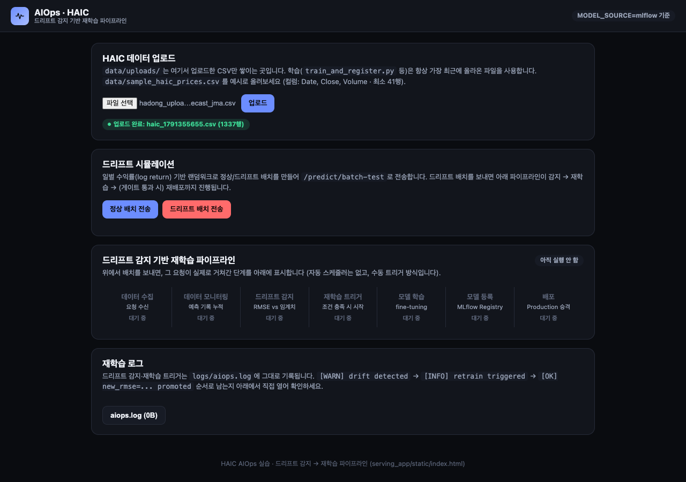
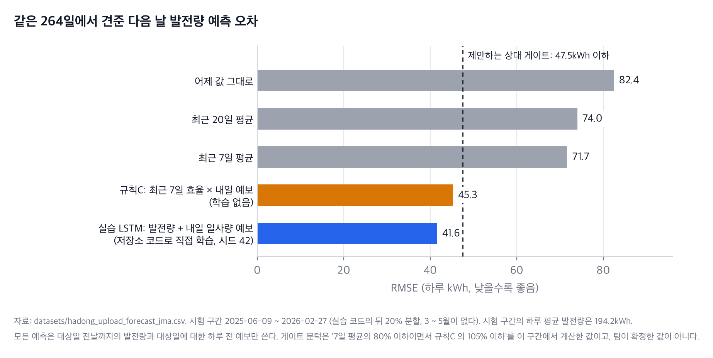
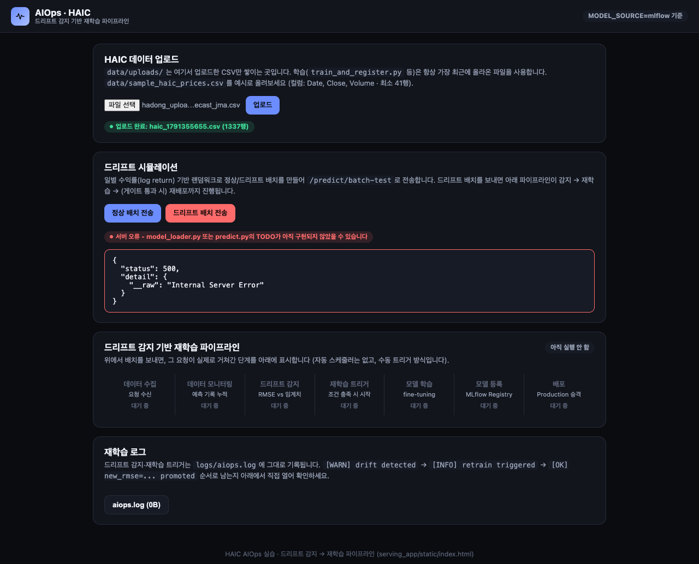
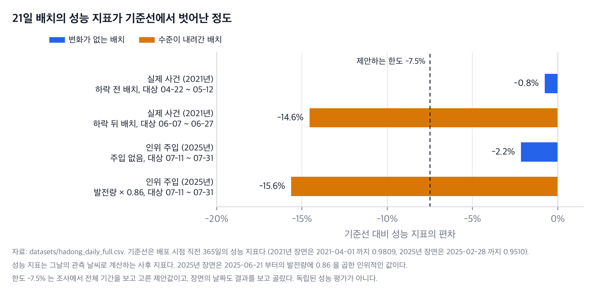
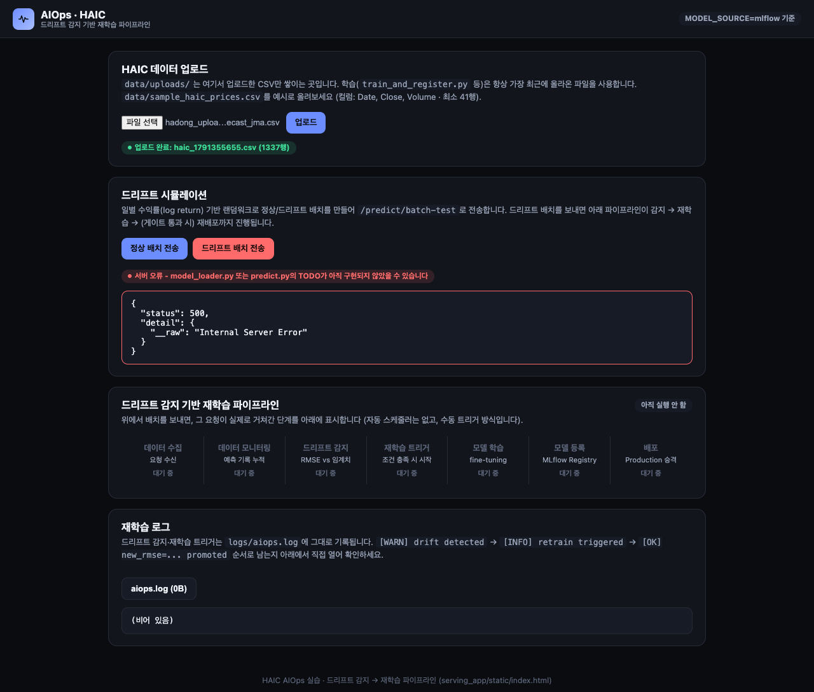

# ⑥ 동작 화면 스냅샷

- 평가 항목: 2-2 (구현·발표)
- 담당:
- 상태: 초안 (2026-10-07). 지금의 코드(커밋 `58d6ff8`)로 돌릴 수 있는 장면까지만 실제 결과가 있다. 나머지는 돌리지 못한 까닭과 다시 돌릴 조건을 적었다

## 통합가이드가 요구하는 것

모델 버전 전환 전/후 응답, 컨테이너 실행 화면, 드리프트 주입 → 알림 → 재학습 트리거 로그 등 요청 전/후 상태 변화가 드러나는 실제 동작 화면을 캡처·시연한다.

표기(**[사실]**, **[조사]**, **[제안]**, **[현재]**, **[실행]**, **[미확인]**, **[과제]**)의 뜻은 [① 의 표](1-pain-point.md#이-문서의-표기)에 있다.

## 본문

### 이 문서를 읽는 법

- **실제 결과만 결과로 적었다.** 이 문서의 화면은 모두 떠 있는 서버를 브라우저(헤드리스 Chrome)로 열어 찍은 것이다. 꾸며 만든 화면은 없다. 돌리지 못한 장면에는 화면이 없고, 없다고 적었다.
- **단추는 사람이 누른 것이 아니다.** 단추가 부르는 함수(`uploadFile()`, `sendBatch(...)`, `openLogFile(...)`)를 브라우저 안에서 실행한 뒤의 화면을 찍었다. 아래에서 "단추를 실행한 뒤"라고 적은 것이 그 뜻이다. 그때의 서버 로그는 [`11_server_capture.log`](evidence/logs/11_server_capture.log)에 있다.
- **지금의 코드는 끝까지 돌지 않는다.** 스켈레톤의 빈칸 11곳이 남아 있어 예측, 배치 판정, 재학습, 컨테이너 빌드가 멈춘다. 이 문서의 "실제 결과"에는 그 멈춘 모습이 그대로 들어 있다. 빈칸을 몰래 채워 돌리지 않았다.
- **어디서 돌렸는가.** 커밋 `58d6ff8` 의 `project/` 를 임시 폴더에 그대로 복사해, 그 사본의 `project/` 를 작업 디렉터리로 두고 돌렸다. 저장소 안에 모델 파일이나 업로드 파일 같은 실행 산출물을 남기지 않으려는 것이다. 저장소에 `project/.venv` 가 아직 없어서 파이썬은 개인 실습 폴더의 가상환경(Python 3.11.15, 패키지 버전이 `requirements.txt` 와 모두 같음)을 썼다. ([V01](evidence/validation.md#v01))
- **조사의 수치는 결과 자리에 넣지 않았다.** 참고로 적을 때는 "조사"라고 밝혔다.
- 장면의 구성과 날짜는 [결정 기록 0009](../decisions/0009-demo-plan.md)의 제안을 따랐다.

### 한눈에

| 장면 | 무엇을 보이는가 | 상태 | 실제 결과 (2026-10-07) |
| --- | --- | --- | --- |
| [1](#장면-1-자료를-올리고-상태를-본다) | 업로드와 상태 조회 | **실행함** | 200. 1,337행, 2022-07-02 ~ 2026-02-27 |
| [2](#장면-2-정상-예측과-422) | 정상 예측과 422 | **일부만** | 422 는 여덟 가지 모두 확인. 정상 예측은 500 |
| [3](#장면-3-학습-지표와-게이트-통과) | 학습 지표와 게이트 통과 | **일부만** | 주가 예시 파일은 통과(`rmse=2.03`, 버전 1). 태양광용 게이트는 코드에 없다 |
| [4](#장면-4-게이트에서-막히면-기존-production-을-유지한다) | 게이트 실패 때 기존 버전 유지 | **실행함** | `[GATE FAILED] rmse=41.59 > 4.0`. 레지스트리는 버전 1 그대로. 다만 막힌 까닭이 눈금이다 |
| [5](#장면-5-승격-전과-후의-서빙-버전) | 승격 전후의 서빙 버전 | **돌리지 못함** | 예측이 500 이라 응답을 견줄 수 없다. 레지스트리의 동작만 따로 확인했다 |
| [6](#장면-6-컨테이너로-띄우고-호출한다) | 컨테이너 실행과 호출 | **실행함 (실패)** | 이미지 빌드가 마지막 단계에서 빈칸 1 로 실패. 컨테이너가 뜨지 않았다 |
| [7](#장면-7-변화가-없는-배치와-인위로-낮춘-배치) | 정상 배치와 주입 배치 | **서버는 돌리지 못함** | 배치 요청이 500. 판정에 쓸 값은 따로 계산했다(−2.2% 대 −15.6%) |
| [8](#장면-8-경고-재학습-게이트의-로그) | 경고 → 재학습 → 게이트의 로그 | **돌리지 못함** | `aiops.log` 가 0바이트다 |
| [9](#장면-9-재학습-뒤의-서빙-모델) | 재학습 뒤의 서빙 모델 | **돌리지 못함** | |
| [10](#장면-10-설비-이상이면-재학습을-미룬다) | 설비 이상 때 재학습 보류 | **제안** | 코드에 없다. 조건에 드는 날은 계산으로 확인했다(2025-03-31, 비율 0.48) |
| [11](#장면-11-실제로-있었던-하락을-지난-자료로-본다) | 2021년의 실제 하락을 사후 감시로 | **실행함 (계산)** | 하락 전 −0.8%, 하락 뒤 −14.6% |

통합가이드가 남기라고 한 화면 여덟 가지의 상태다.

| # | 화면 | 파일 | 남겼는가 |
| --- | --- | --- | --- |
| 1 | 업로드 완료와 `/data/status` | [`03_dashboard_after_upload.png`](evidence/screens/03_dashboard_after_upload.png), [`data_status_hadong.json`](evidence/http/data_status_hadong.json) | 남겼다 |
| 2 | `/predict` 정상 응답과 422 응답 | [`predict_19_items.json`](evidence/http/predict_19_items.json) 등 여덟 건, [`predict_valid_current_schema.json`](evidence/http/predict_valid_current_schema.json) | 422 는 남겼다. 정상 응답은 없다(500) |
| 3 | 게이트 통과 로그와 MLflow 에 기록된 지표 | [`03_train_register_haic.log`](evidence/logs/03_train_register_haic.log), [`registry_1-after-haic-train.json`](evidence/registry/registry_1-after-haic-train.json) | 주가 예시 파일의 것만 남겼다 |
| 4 | 모델 버전 전환 전과 후의 `/predict` 응답 | | 없다 |
| 5 | 컨테이너 실행 화면과 컨테이너의 `/docs` | [`09_docker_build.log`](evidence/logs/09_docker_build.log) | 빌드 실패의 로그만 남겼다. 실행 화면은 없다 |
| 6 | 정상 배치와 드리프트 배치의 판정 결과 | [`04_dashboard_normal_batch.png`](evidence/screens/04_dashboard_normal_batch.png), [`06_simulate_drift.log`](evidence/logs/06_simulate_drift.log) | 오류 화면만 남겼다. 판정 결과는 없다 |
| 7 | `aiops.log` 에 경고, 재학습, 결과가 쌓인 화면 | [`06_dashboard_log_panel.png`](evidence/screens/06_dashboard_log_panel.png) | 비어 있는 로그의 화면만 남겼다 |
| 8 | 재학습 뒤 `/predict` 가 어느 버전으로 응답하는지 | | 없다 |

### 장면 1. 자료를 올리고 상태를 본다

| 항목 | 내용 |
| --- | --- |
| 상태 | **[실행]** 실행함 |
| 사전 조건 | 로컬 서버가 떠 있다(8077) |
| 입력 | [`datasets/hadong_upload_forecast_jma.csv`](../../datasets/hadong_upload_forecast_jma.csv). 1,337행, 2022-07-02 ~ 2026-02-27. `Close` 는 그날의 발전량(kWh), `Volume` 은 다음 날에 대한 일사량 예보(MJ/m²) |
| 실행 | 서버: `project/` 에서 `uvicorn serving_app.main:app --host 127.0.0.1 --port 8077`. 요청: 저장소 루트에서 `python tools/proposal/http_checks.py --base http://127.0.0.1:8077 --out docs/proposal/evidence/http --phase upload-hadong`. 화면: `python tools/proposal/capture_screens.py --upload datasets/hadong_upload_forecast_jma.csv ...` |
| 기대 결과 | 업로드가 200 이고 행 수가 1,337. 상태 조회의 기간이 2022-07-02 ~ 2026-02-27 |
| 실제 결과 | 업로드 200 `{"filename": "haic_1791354033.csv", "rows": 1337}`. 상태 조회 200, `start_date` 2022-07-02, `end_date` 2026-02-27, `min_close` 5.886, `max_close` 338.832 |
| 성공 기준 | 행 수와 기간이 올린 파일과 같다 → **채웠다** |
| 증빙 | [`upload_hadong_forecast.json`](evidence/http/upload_hadong_forecast.json), [`data_status_hadong.json`](evidence/http/data_status_hadong.json), 아래 화면. ([V07](evidence/validation.md#v07), [V26](evidence/validation.md#v26)) |



대시보드의 "파일 선택"에 태양광 파일을 넣고 "업로드" 단추를 실행한 뒤의 화면이다. 초록색 표시가 "업로드 완료: haic_1791355655.csv (1337행)"이다(화면을 찍으려고 한 번 더 올린 것이라 위의 응답과 파일 이름의 숫자가 다르다). 화면의 제목과 안내문은 "HAIC 데이터 업로드", "sample_haic_prices.csv 를 예시로"다. 태양광으로 바꾸기 전의 말이다.

거절되는 파일과 걸러지지 않는 파일도 보냈다. CP949, 열이 없는 파일, 40행짜리는 400 으로 거절된다. 날짜가 거꾸로이거나 빠진 파일, 음수나 글자가 든 파일은 200 으로 올라간다. ([⑤ 의 5절](5-api-spec.md#5-post-dataupload), [V08](evidence/validation.md#v08))

### 장면 2. 정상 예측과 422

| 항목 | 내용 |
| --- | --- |
| 상태 | **[실행]** 일부만. 422 는 확인했고 정상 예측은 500 이다 |
| 사전 조건 | 서버가 떠 있다. 정상 예측에는 모델과 스케일러가 있어야 한다 |
| 입력 | 정상 입력: 업로드 파일의 마지막 20행(2026-02-08 ~ 02-27). 지금의 스키마에 맞추려고 예보 값을 정수로 반올림했다. 틀린 입력: 같은 20행에서 한 가지씩만 바꿨다(19개, 21개, 마지막 발전량 0, 예보를 소수 그대로, 첫 예보 −1, 첫 점의 예보 빠짐, 빈 객체, JSON 이 아닌 글자) |
| 실행 | `python tools/proposal/http_checks.py ... --phase pre` |
| 기대 결과 | 정상 입력에 200 과 다음 날 발전량(kWh), 모델 버전. 틀린 입력에 422 와 어느 칸이 왜 틀렸는지 |
| 실제 결과 | 틀린 입력 여덟 가지 모두 422. `loc` 과 `msg` 는 [⑤ 의 2절](5-api-spec.md#2-post-predict)에 옮겼다. **정상 입력은 500 `Internal Server Error`.** 서버 로그: `model_loader.py`, line 167, `if ___:`, `NameError: name '___' is not defined` |
| 성공 기준 | (가) 틀린 입력을 422 로 거절하고 틀린 칸을 알려 준다 → **채웠다**. (나) 정상 입력에 200 과 0 이상의 kWh 값을 준다 → **못 채웠다** |
| 다시 돌릴 조건 | 빈칸 2, 3, 4 를 채우고 모델을 읽을 수 있게 한 뒤. 기본 설정(`MODEL_SOURCE=local`)은 baseline 모델 파일이 있어야 하므로 빈칸 1 도, MLflow 에서 읽으려면 빈칸 5 도 채운다. 예보를 소수로 넣으려면 스키마도 고친 뒤 |
| 증빙 | [`evidence/http/`](evidence/http/) 의 `predict_*.json`, [`01_server_local_lazy.log`](evidence/logs/01_server_local_lazy.log). ([V04](evidence/validation.md#v04), [V05](evidence/validation.md#v05)) |

마지막 발전량을 0 으로 보냈을 때의 실제 응답이다.

```json
{
  "detail": [
    {
      "type": "greater_than",
      "loc": ["body", "sequence", 19, "close"],
      "msg": "Input should be greater than 0",
      "input": 0.0,
      "ctx": {"gt": 0.0}
    }
  ]
}
```

이 거절은 태양광에서는 고쳐야 할 동작이다. 발전량이 0 인 날이 실제로 있다([③ 의 2절](3-operations-design.md#2-입력-검증)).

정상 응답의 화면은 없다. API 문서 화면에서 `POST /predict` 를 펼친 모습은 [⑤ 의 1절](5-api-spec.md#1-엔드포인트-목록)에 있다.

### 장면 3. 학습 지표와 게이트 통과

| 항목 | 내용 |
| --- | --- |
| 상태 | **[실행]** 일부만. 게이트를 통과하는 경로는 주가 예시 파일로 확인했다. 태양광용 게이트는 코드에 없다 |
| 사전 조건 | 파일이 올라가 있다. 스케일러가 있다 |
| 입력 | (가) 스켈레톤에 들어 있던 `project/data/sample_haic_prices.csv`(756행, 주가 예시). (나) 태양광 업로드 파일 |
| 실행 | `project/` 에서 `python scripts/train_baseline_v1.py`, 이어서 `python serving_app/train_and_register.py` |
| 기대 결과 | 스케일러와 baseline 모델이 저장된다. 학습의 RMSE 가 MLflow 에 기록된다. 게이트를 통과하면 새 버전이 Production 이 된다 |
| 실제 결과 (가) | baseline 스크립트: `scaler fit on 756행 -> serving_app/models/scaler.pkl` 을 찍고 99행의 빈칸에서 `NameError` 로 멈췄다. 스케일러만 저장됐다. 학습·등록 스크립트: `[GATE PASSED] rmse=2.03 -> HAIC_Predictor v1 promoted to Production`. MLflow 의 실행 기록에 `rmse` 2.0278, `mode` scratch, `epochs` 100. 레지스트리에 버전 1 이 Production |
| 실제 결과 (나) | 태양광 파일로는 통과하지 못한다(장면 4). 제안하는 상대 게이트로 따로 계산하면 직접 학습한 모델의 RMSE 41.59kWh 가 합격선 47.53kWh 아래다. 이것은 **서버의 게이트가 낸 결과가 아니라 오프라인 계산**이다 |
| 성공 기준 | 태양광 파일로 학습한 모델이 상대 게이트를 통과해 버전으로 등록되고, 통과의 근거(모델, 7일 평균, 규칙C 의 RMSE 와 치우침)가 기록에 남는다 → **못 채웠다** |
| 다시 돌릴 조건 | 빈칸 1 을 채우고 게이트를 상대 기준으로 바꾼 뒤([0005](../decisions/0005-deployment-gate.md)) |
| 증빙 | [`02_train_baseline_haic.log`](evidence/logs/02_train_baseline_haic.log), [`03_train_register_haic.log`](evidence/logs/03_train_register_haic.log), [`registry_1-after-haic-train.json`](evidence/registry/registry_1-after-haic-train.json), [`offline_model_eval.txt`](evidence/offline_model_eval.txt). ([V10](evidence/validation.md#v10), [V11](evidence/validation.md#v11), [V30](evidence/validation.md#v30)) |

같은 264일에서 견준 오차다. 막대의 값과 조건은 [② 의 7절](2-solution-and-goals.md#7-단순한-기준-예측과-견주면)에 있다.



발전 실적: 한국남부발전(공공데이터포털). 일사량 예보: [Weather data by Open-Meteo.com](https://open-meteo.com/).

화면에 적을 말: "시험 구간에 3 ~ 5월 없음", "하루 합계의 RMSE 이고 시장의 오차율이 아님", "시드 42 한 번", "서버가 아니라 오프라인으로 잰 값".

### 장면 4. 게이트에서 막히면 기존 Production 을 유지한다

| 항목 | 내용 |
| --- | --- |
| 상태 | **[실행]** 실행함. 다만 읽을 때 조심할 점이 있다 |
| 사전 조건 | 레지스트리에 버전 1 이 Production 으로 있다(장면 3 의 주가 모델). 태양광 파일이 올라가 있고 스케일러가 그 파일로 맞춰져 있다 |
| 입력 | 태양광 업로드 파일. 시드 42, 100 epoch |
| 실행 | `project/` 에서 `python serving_app/train_and_register.py`. 앞뒤로 `python <저장소>/tools/proposal/registry_dump.py` |
| 기대 결과 | 지금 코드의 합격선은 4.00 이다. 태양광 모델의 RMSE 는 수십 kWh 라 막힌다. 새 버전이 생기지 않고 버전 1 이 Production 으로 남는다 |
| 실제 결과 | `[GATE FAILED] rmse=41.59 > 4.0 -> 배포 차단, 기존 Production 유지`. 종료 코드 0. 약 21초. 레지스트리: 실행 기록은 둘(2.0278, 41.5888), 모델 버전은 여전히 하나, Production 은 버전 1 |
| 성공 기준 | 게이트에서 막힌 뒤의 Production 버전 번호가 막히기 전과 같다 → **채웠다** (레지스트리 수준) |
| 증빙 | [`05_train_register_hadong.log`](evidence/logs/05_train_register_hadong.log), [`registry_2-after-hadong-baseline.json`](evidence/registry/registry_2-after-hadong-baseline.json), [`registry_3-after-hadong-train.json`](evidence/registry/registry_3-after-hadong-train.json). ([V12](evidence/validation.md#v12)) |

조심할 점은 세 가지다.

- **막힌 까닭이 모델이 나빠서가 아니다.** 합격선이 주가의 눈금이다. 4.00 은 이 구간의 하루 평균 발전량(194kWh)의 2% 다. 직접 학습한 모델(41.59kWh)도, 같은 날의 기준 예측 넷(45.26 ~ 82.44kWh)도 열 배 넘게 벗어나 있어 통과할 모델을 기대할 수 없다. 이 장면이 보이는 것은 "막히면 등록하지 않고 기존 버전을 둔다"는 **동작**까지다. "나쁜 모델을 가려낸다"는 것은 상대 게이트를 만든 뒤에 보일 수 있다.
- **서버가 버전 1 로 계속 답하는지는 확인하지 못했다.** 예측이 500 이다. 확인한 것은 레지스트리다.
- **이 상태는 그대로 서빙하면 안 되는 조합이다.** 남아 있는 버전 1 은 주가로 학습한 모델이고 스케일러는 태양광 값으로 바뀌어 있다. 검증하려고 일부러 만든 상황이지만, 운영에서 같은 일이 생길 수 있다는 것을 보여 준다([③ 의 3절](3-operations-design.md#3-학습과-평가를-나누는-방법과-스케일러)).

### 장면 5. 승격 전과 후의 서빙 버전

| 항목 | 내용 |
| --- | --- |
| 상태 | **돌리지 못함.** 레지스트리의 동작만 따로 확인했다 |
| 사전 조건 | 서버가 MLflow 의 운영 버전으로 예측한다. 새 버전이 게이트를 통과한다 |
| 입력 | 같은 20일의 요청을 승격 전과 후에 한 번씩 |
| 실행 (계획) | `MODEL_SOURCE=mlflow` 로 서버를 띄운다 → `POST /predict`, `GET /health` → 새 모델을 승격한다 → 같은 요청을 다시 보낸다 → `registry_dump.py` 로 레지스트리의 Production 버전을 적는다 |
| 기대 결과 | 승격 전후의 응답에서 버전 번호와 예측값이 다르다. 레지스트리의 Production 버전, `/health` 가 알리는 버전, `/predict` 의 버전이 서로 같다 |
| 실제 결과 | **없다.** `MODEL_SOURCE=mlflow` 로 띄우면 eager 에서는 서버가 뜨지 못하고(종료 코드 3, `model_loader.py` 125행의 빈칸) lazy 에서는 `/predict` 가 500 이다 |
| 성공 기준 | 레지스트리의 Production 버전 = 서버가 불러온 버전이고, 그 번호가 승격 전과 다르다 → **확인하지 못했다** |
| 다시 돌릴 조건 | 빈칸 2 ~ 5 를 채우고, 승격 뒤 서빙 모델을 다시 불러오고 실제 버전 번호를 싣게 고친 뒤([0008](../decisions/0008-retraining-and-version-switch.md)) |
| 증빙 | [`07_server_mlflow_eager.log`](evidence/logs/07_server_mlflow_eager.log), [`08_server_mlflow_lazy.log`](evidence/logs/08_server_mlflow_lazy.log), 다시 돌려 요청과 응답을 남긴 [`http_mlflow_lazy/`](evidence/http_mlflow_lazy/)와 [`12_server_mlflow_lazy_recheck.log`](evidence/logs/12_server_mlflow_lazy_recheck.log), [`registry_semantics.json`](evidence/registry/registry_semantics.json). ([V14](evidence/validation.md#v14), [V16](evidence/validation.md#v16)) |

이 장면을 응답의 `model_version` 만으로 판단하면 안 되는 까닭이 있다.

- **[현재]** `model_version` 은 `"v1-local"` 이나 `"production"` 이라는 고정된 글자다. 버전이 바뀌어도 응답이 같다. ([V02](evidence/validation.md#v02))
- **[현재]** 승격한 뒤 메모리의 모델을 바꾸는 코드가 없다. 승격 로그가 찍혀도 서버는 이전 모델로 답할 수 있다. 코드를 읽어 확인한 것이고 서버에서 재현하지는 못했다.

따로 확인한 것은 레지스트리의 동작이다. **[실행]** 앱이 승격할 때 부르는 두 호출을 같은 인자로 직접 불렀다. ([V16](evidence/validation.md#v16))

| 단계 | 버전과 단계 | `models:/HAIC_Predictor/Production` 이 가리키는 버전 |
| --- | --- | --- |
| 처음 | 버전 1 Production | 1 |
| 버전 2 를 등록하고 Production 으로 올린 뒤 | 버전 1 Production, 버전 2 Production | 2 |
| 버전 2 를 Archived 로 내린 뒤(손으로 되돌리기) | 버전 1 Production, 버전 2 Archived | 1 |

앱의 재학습을 돌린 결과가 아니다. "가리키는 버전"은 MLflow 가 이 주소를 풀 때 쓰는 조회(`get_latest_versions`)로 본 것이고, 주소로 모델을 불러와 확인한 것은 아니다. 승격해도 이전 버전이 Production 에 남는다는 것과, 내리면 이전 버전으로 돌아간다는 것을 MLflow 수준에서 본 것이다.

### 장면 6. 컨테이너로 띄우고 호출한다

| 항목 | 내용 |
| --- | --- |
| 상태 | **[실행]** 실행함. 빌드가 실패했다 |
| 사전 조건 | Docker 가 떠 있다(29.6.2). 커밋 `58d6ff8` 의 `project/` 를 그대로 임시 폴더에 풀었다 |
| 입력 | `serving_app/Dockerfile`, `serving_app/docker-compose.yml`. 이미지를 만들 때 스켈레톤의 주가 예시 파일(`data/sample_haic_prices.csv`)로 학습한다 |
| 실행 | `project/` 에서 `docker compose -f serving_app/docker-compose.yml config`, 이어서 `docker build --progress=plain -f serving_app/Dockerfile -t solar-aiops-verify:58d6ff8 .` (compose 가 쓰는 것과 같은 Dockerfile 과 같은 폴더다) |
| 기대 결과 | 이미지가 만들어지고, 컨테이너의 8099 에서 `/health` 가 `model_loaded: true`, `/docs` 가 열린다 |
| 실제 결과 | compose 설정: 서비스 `serving-app` 하나, 포트 8099. 빌드: 여덟 단계 가운데 일곱은 통과(패키지 설치에 119초). **마지막 단계에서 실패.** `scaler fit on 756행` 을 찍은 뒤 `train_baseline_v1.py`, line 99, `model.fit(___, ___, ...)`, `NameError: name '___' is not defined`. 종료 코드 1. 이미지가 만들어지지 않았다(빌드 뒤 `docker images` 에 그 이름이 없다) |
| 성공 기준 | 컨테이너의 `/health` 가 `model_loaded: true` 이고 `/predict` 가 200 이다 → **못 채웠다** |
| 다시 돌릴 조건 | 빈칸 1 ~ 5 를 채운 뒤 |
| 증빙 | [`09_docker_build.log`](evidence/logs/09_docker_build.log), [`environment.txt`](evidence/environment.txt). ([V15](evidence/validation.md#v15)) |

- 컨테이너의 실행 화면과 컨테이너의 `/docs` 화면은 없다. 뜨지 않았다.
- **[현재]** 빈칸을 채워 빌드가 통과해도 컨테이너는 **주가 예시 파일로 학습한 모델**을 서빙한다. 태양광 시연에 쓰려면 Dockerfile 이 넣는 자료를 태양광 파일로 바꿔야 한다. 컨테이너 안의 MLflow 는 로컬의 것과 따로다. ([④ 의 7절](4-architecture.md#7-어디서-도는가))

### 장면 7. 변화가 없는 배치와 인위로 낮춘 배치

| 항목 | 내용 |
| --- | --- |
| 상태 | **서버는 돌리지 못함.** 판정에 쓸 값은 오프라인으로 계산했다 |
| 사전 조건 | 서버가 배치를 받아 예측한다. 기준선이 저장돼 있다 |
| 입력 | 변화가 없는 배치: 예보 업로드 파일의 2025-06-21 ~ 07-31(41행). 대상은 07-11 ~ 07-31 의 21일. 낮춘 배치: 같은 41행의 발전량에만 0.86 을 곱한다(14% 하락). 예보는 그대로 둔다. 기대 발전량: [`hadong_daily_full.csv`](../../datasets/hadong_daily_full.csv)의 같은 날짜. 기준선: 2025-02-28 까지 365일의 성능 지표 0.950992 |
| 실행 (계획) | 시연용 사본을 올린다 → `python scripts/simulate_drift.py` (실제 행을 보내도록 고친 뒤) |
| 기대 결과 | 변화가 없는 배치는 `status: ok`. 낮춘 배치는 수준 저하로 판정된다 |
| 실제 결과 (지금의 코드) | `python scripts/simulate_drift.py` 는 `[1] 기준 통계: mean=189.80, std=80.02` 를 찍고 정상 배치를 보내다가 `requests.exceptions.HTTPError: 500 Server Error ... /predict/batch-test` 로 멈췄다. 종료 코드 1. 대시보드의 "정상 배치 전송" 단추도 같은 500 을 받는다(아래 화면) |
| 실제 결과 (오프라인 계산) | 뒤 21일(판정 구간)의 성능 지표 편차: 변화 없음 **−2.2%**, 낮춘 배치 **−15.6%**. 임계값 −7.5% 의 양쪽으로 갈린다. 앞 20일(입력 구간)의 편차: 변화 없음 −2.8%, 낮춘 배치 −16.3%. 낮춘 배치는 알림의 조건과 재학습을 거는 조건을 모두 채운다. 21건 RMSE(직접 학습한 모델): 변화 없음 45.1kWh, 낮춘 배치 **34.5kWh**. RMSE 로는 갈리지 않는다 |
| 성공 기준 | 서버의 응답에서 두 배치의 판정이 갈린다 → **확인하지 못했다** |
| 다시 돌릴 조건 | 빈칸 2 ~ 4, 6 ~ 8 을 채우고(드리프트로 판정되는 배치는 9 ~ 11 도), 배치 요청과 판정을 성능 지표로 바꾼 뒤([0006](../decisions/0006-monitoring-metric-and-thresholds.md)) |
| 증빙 | [`06_simulate_drift.log`](evidence/logs/06_simulate_drift.log), [`batch_41_values.json`](evidence/http/batch_41_values.json), [`data_checks.txt`](evidence/data_checks.txt) E, [`offline_model_eval.txt`](evidence/offline_model_eval.txt). ([V13](evidence/validation.md#v13), [V21](evidence/validation.md#v21), [V30](evidence/validation.md#v30)) |



"정상 배치 전송" 단추를 실행한 뒤의 실제 화면이다. 빨간 표시가 "서버 오류 - model_loader.py 또는 predict.py의 TODO가 아직 구현되지 않았을 수 있습니다"이고 응답이 `"status": 500` 이다. 아래의 파이프라인 그림은 "아직 실행 안 함"에 머물러 있다. "드리프트 배치 전송" 단추를 실행해도 같은 화면이다([`05_dashboard_drift_batch.png`](evidence/screens/05_dashboard_drift_batch.png), 두 그림이 같다).

판정에 쓸 값을 따로 계산한 그림이다.



발전 실적: 한국남부발전(공공데이터포털). 날씨 관측: 기상청 종관기상관측(ASOS) 광양(266).

읽을 때 조심할 점은 다음과 같다.

- **맨 아래 막대(× 0.86)는 인위로 낮춘 값이다.** 실제로 일어난 일이 아니다. 그 위의 "주입 없음" 막대는 같은 날짜의 실제 값이다. 날짜(2025-06-21)는 조사에서 결과를 보고 골랐다. 이 구간의 결과를 독립된 성능 평가로 쓰지 않는다.
- 성능 지표는 대상일의 관측으로 계산하는 사후 값이다. 예측 시점에는 받을 수 없다.
- RMSE 의 값은 업로드 파일 전체로 학습한 모델(학습 정답일 2025-06-08 까지)의 것이다. [0009](../decisions/0009-demo-plan.md)가 재학습 장면에 쓰자고 한 모델(학습 정답일 2025-02-28 까지)과 다른 모델이다. 그 모델은 아직 학습하지 않았다.
- **[현재]** 대시보드의 배치 단추와 `simulate_drift.py` 는 무작위 가격을 만들어 보내고 서버는 둘째 값을 1,200,000 으로 채운다. 빈칸을 채워도 이대로는 태양광 시연이 되지 않는다. **[실행]** 그 고정값을 넣으면 21건의 예측이 모두 276.4kWh 가 된다. ([V30](evidence/validation.md#v30))

화면에 적을 말: "발전량을 14% 낮춘 인위적인 값", "날짜는 결과를 보고 고름", "기준선은 2025-02-28 까지 365일로 고정", "성능 지표는 지난 뒤에 계산하는 값".

### 장면 8. 경고, 재학습, 게이트의 로그

| 항목 | 내용 |
| --- | --- |
| 상태 | **돌리지 못함** |
| 사전 조건 | 장면 7 의 낮춘 배치가 수준 저하로 판정된다 |
| 입력 | 장면 7 의 낮춘 배치. 재학습 자료는 가장 최근에 올린 파일의 마지막 41행이므로, **2025-07-31 에서 자르고 발전량에 0.86 을 곱한 사본**을 먼저 올린다 |
| 실행 (계획) | `GET /data/status` 로 `end_date` 가 2025-07-31 인지 확인한다 → 낮춘 배치를 보낸다 → `GET /logs/aiops.log` |
| 기대 결과 | 로그에 `[WARN] drift detected - triggering retrain` → `[INFO] retrain triggered (window=last_21_days)` → `[OK] new_rmse=... - production promoted: HAIC_Predictor v...` 가 차례로 쌓인다. 게이트에서 막히면 셋째 줄 대신 실패의 줄이 남는다 |
| 실제 결과 | **없다.** 학습을 돌리고 배치를 보낸 뒤에도 `aiops.log` 는 0바이트다. 배치 요청이 판정에 닿기 전에 500 으로 끝난다 |
| 성공 기준 | 세 줄이 순서대로 남고, 시각이 배치를 보낸 시각과 맞는다. 또는 게이트 실패의 줄이 남고 레지스트리의 버전이 그대로다 → **확인하지 못했다** |
| 다시 돌릴 조건 | 빈칸 2 ~ 4, 6 ~ 11 을 채운 뒤 |
| 증빙 | [`logs_read_aiops_after.json`](evidence/http/logs_read_aiops_after.json), 아래 화면. ([V09](evidence/validation.md#v09), [V13](evidence/validation.md#v13)) |



대시보드의 "재학습 로그"에서 `aiops.log (0B)` 단추를 실행한 뒤의 실제 화면이다. 내용이 "(비어 있음)"이다.

- **[실행]** 날짜를 맞출 수 있다는 것은 확인했다. 2025-07-31 에서 자른 파일의 마지막 41행은 2025-06-21 ~ 07-31 로 배치와 같다. ([V21](evidence/validation.md#v21))
- **[현재]** 게이트에서 막혔을 때는 경고와 재학습 시작의 두 줄만 `aiops.log` 에 남고 결과의 줄이 남지 않는다([③ 의 8절](3-operations-design.md#8-알림)). 서버의 표준 출력에는 `[GATE FAILED]` 가 찍히고 응답에는 `promoted: false` 가 실린다. 막히는 장면을 로그로 보이려면 그 줄을 더해야 한다.
- 게이트에서 막히는 것도 유효한 장면이다. **[조사]** 조사에서 재학습 게이트(합격선 45kWh)의 통과율은 주입 없음 65.9%, 14% 하락 주입 75.2% 였다([T5](../research/merged/T5-drift-demo.md)). 고른 날짜에서 통과한다는 보장이 없다.

### 장면 9. 재학습 뒤의 서빙 모델

| 항목 | 내용 |
| --- | --- |
| 상태 | **돌리지 못함** |
| 사전 조건 | 장면 8 에서 재학습한 모델이 게이트를 통과해 승격됐다 |
| 입력 | 재학습에 쓰지 않은 2025-08-01 ~ 08-21 의 21일. 재학습 전의 모델과 뒤의 모델로 같은 날을 예측한다 |
| 실행 (계획) | 승격 전후에 `GET /health` 와 `POST /predict` 를 부른다 → 레지스트리의 Production 버전을 적는다 → 두 모델의 21일 RMSE 와 치우침을 견준다 |
| 기대 결과 | 서버의 버전이 레지스트리의 새 버전과 같다. 재학습 뒤의 치우침이 0 에 가까워진다 |
| 실제 결과 | **없다** |
| 성공 기준 | (가) 레지스트리의 Production 버전 = 서버가 불러온 버전. (나) 그 번호가 재학습 전과 다르다. (다) 2025-08-01 ~ 08-21 의 치우침이 재학습 전보다 0 에 가깝다 → **확인하지 못했다** |
| 다시 돌릴 조건 | 장면 5 와 장면 8 이 돈 뒤 |

- (다)는 채우지 못할 수 있고 그것도 결과다. **[조사]** 조사에서 이 날짜의 재학습 전후는 치우침이 시드별 +10, +19, +6% 에서 0, −2, +3% 로, RMSE 가 38.9kWh 에서 31.1kWh 였다. 다른 모델(학습 정답일 2025-02-28 까지)의 저장된 결과이고 우리 서버의 값이 아니다. 14% 하락 주입 전체에서 RMSE 가 줄어든 시작일은 시드에 따라 46.5 ~ 72.1% 였다. ([T5](../research/merged/T5-drift-demo.md))
- **[실행]** 직접 학습한 모델(학습 정답일 2025-06-08 까지)은 낮춘 배치에서 치우침이 이미 +2.2% 였다. 이 모델로 재학습하면 나아질 여지가 작다. 재학습 장면에는 [0009](../decisions/0009-demo-plan.md)의 제안대로 학습이 2025-02-28 에서 끝나는 모델을 따로 준비해야 한다. ([V30](evidence/validation.md#v30))
- 버전이 실제로 바뀐 것을 확인할 수 없으면 "새 모델로 서빙한다"고 말하지 않는다.

### 장면 10. 설비 이상이면 재학습을 미룬다

| 항목 | 내용 |
| --- | --- |
| 상태 | **[제안]** 코드에 없다. 조건에 드는 날만 계산으로 확인했다 |
| 사전 조건 | 정지와 보류의 규칙, 점검 알림의 갈래가 구현돼 있다([0007](../decisions/0007-facility-vs-model-branch-and-alerts.md)) |
| 입력 (가) | 실제 자료의 하루: 2025-03-31. 실제 141.5kWh, 기대 296.2kWh |
| 입력 (나) | 인위로 만든 배치: 2025-06-21 부터 발전량에 0.70 을 곱한다(30% 하락) |
| 기대 결과 | (가) 하루 점검 알림이 로그에 남는다. (나) 대상 21일이 모두 보류가 되어 판정하지 않고, "설비 점검 필요, 재학습 보류"가 로그에 남는다. 재학습은 돌지 않고 레지스트리의 버전이 그대로다 |
| 실제 결과 (계산) | (가) 비율 0.48. 하루 점검 알림의 조건(기대 80kWh 이상, 실제가 50% 미만)에 든다. 정지와 보류는 아니다. (나) 대상 21일 가운데 유효한 날이 0일, 보류가 21일이다. **서버에서 돌린 결과가 아니다** |
| 성공 기준 | 로그에 점검 알림이 남고, 재학습의 줄이 없고, 레지스트리의 버전이 그대로다 → **확인하지 못했다** |
| 다시 돌릴 조건 | 갈래를 구현한 뒤 |
| 증빙 | [`data_checks.txt`](evidence/data_checks.txt) E, F. ([V21](evidence/validation.md#v21), [V23](evidence/validation.md#v23)) |

- **[미확인]** 2025-03-31 에 설비에 무슨 일이 있었는지는 모른다. "설비 이상 후보"이지 고장이라고 확인된 날이 아니다.
- 성능 지표와 기대 발전량은 지난 뒤에 계산하는 값이다.

화면에 적을 말: (가)에는 "설비 이상 후보, 점검 필요", "사후 관측으로 본 값이고 원인은 확정하지 않음". 이 날은 정지도 보류도 아니라서 재학습과 무관하다. (나)에는 "발전량을 30% 낮춘 인위적인 값", "설비 점검 필요, 재학습 보류".

### 장면 11. 실제로 있었던 하락을 지난 자료로 본다

| 항목 | 내용 |
| --- | --- |
| 상태 | **[실행]** 실행함. 서버가 아니라 계산이다 |
| 사전 조건 | 없다 |
| 입력 | [`datasets/hadong_daily_full.csv`](../../datasets/hadong_daily_full.csv). 기준선: 2021-04-01 까지 365일. 하락 전 배치의 대상 2021-04-22 ~ 05-12, 하락 뒤 배치의 대상 2021-06-07 ~ 06-27 |
| 실행 | `python tools/proposal/data_checks.py`, `python tools/proposal/make_figures.py` |
| 기대 결과 | 하락 전 배치는 임계값 안, 하락 뒤 배치는 임계값 밖 |
| 실제 결과 | 기준선 0.9809. 하락 전 0.9735(유효한 날 20일), 편차 **−0.8%**. 하락 뒤 0.8382(21일), 편차 **−14.6%**. 앞뒤 365일로는 0.9817 에서 0.8985 로 −8.5% |
| 성공 기준 | 두 배치가 −7.5% 의 양쪽으로 갈린다 → **채웠다** |
| 증빙 | [`data_checks.txt`](evidence/data_checks.txt) D. ([V20](evidence/validation.md#v20)) |


발전 실적: 한국남부발전(공공데이터포털). 날씨 관측: 기상청 종관기상관측(ASOS) 광양(266).

- 이 장면은 **실제 사건의 사후 분석**이다. 장면 7 의 인위 주입과 다르다.
- **예측 모델을 돌린 장면이 아니다.** 2021년에는 일사량 예보 자료가 없어 예보를 넣는 모델을 돌릴 수 없다.
- **[미확인]** 하락의 원인은 모른다. 날짜도 2021-05-13 ~ 05-22 사이라는 것까지만 안다.
- 임계값과 날짜를 같은 자료에서 보고 골랐다. 이 결과를 "이 규칙의 감지 성능"으로 쓰지 않는다.

화면에 적을 말: "실제 사건의 사후 감시", "대상일의 관측을 쓰는 값이라 예측 시점에는 받을 수 없음", "예측 모델을 돌린 장면이 아님", "원인 미확인".

### 빈칸을 채운 뒤 다시 찍는 순서

장면 2, 3, 5 ~ 9 는 코드가 준비되면 같은 도구로 다시 돌린다. 서버를 내리기 전에 증빙을 먼저 남긴다.

1. `project/` 에서 가상환경을 만들고 서버를 띄운다.
2. 저장소 루트에서 `python tools/proposal/http_checks.py --base http://127.0.0.1:8077 --out docs/proposal/evidence/http --phase pre` 부터 차례로 돌린다. 요청과 응답이 파일로 남는다. 환경은 `python tools/proposal/record_environment.py` 로 다시 적는다.
3. 학습을 돌릴 때마다 `project/` 에서 `python ../tools/proposal/registry_dump.py --label <단계 이름> --out ../docs/proposal/evidence/registry` 로 레지스트리의 상태를 남긴다.
4. `python tools/proposal/capture_screens.py --base http://127.0.0.1:8077 --out docs/proposal/evidence/screens --upload <올릴 파일>` 로 화면 일곱 장을 다시 찍는다.
5. 컨테이너는 `--base http://127.0.0.1:8099` 로 같은 일을 한다.
6. 이 문서의 "실제 결과"와 [검증 기록](evidence/validation.md)을 새 결과로 고친다. 조사의 수치를 결과 자리에 넣지 않는다.

도구의 설명은 [`tools/proposal/README.md`](../../tools/proposal/README.md)에 있다.
