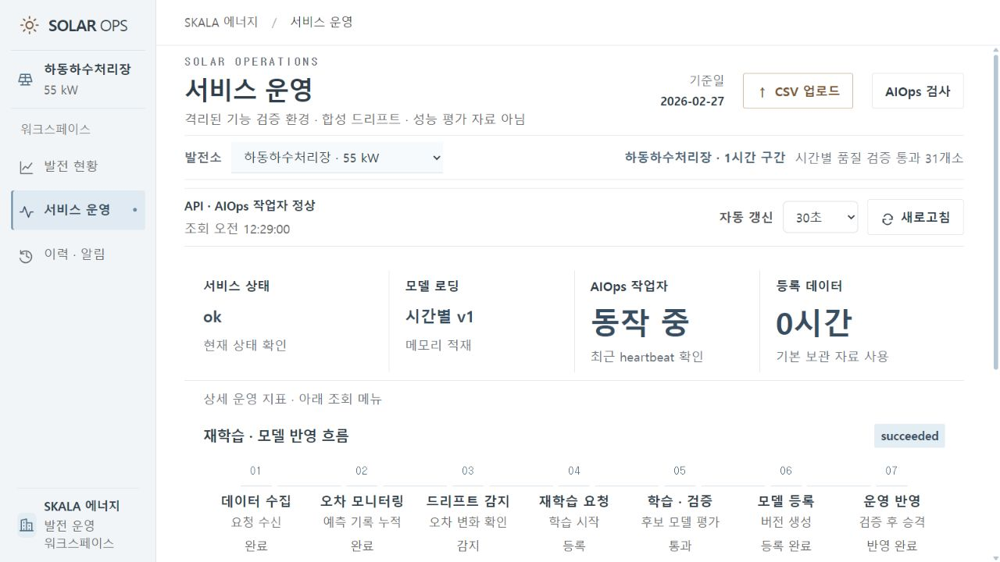
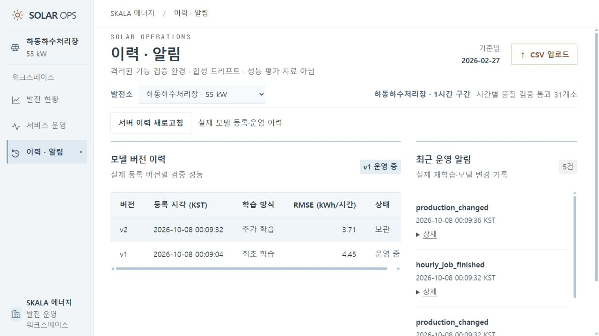

# ⑥ 동작 화면과 전후 증빙

## 통합가이드가 요구하는 것

모델 버전 전환 전/후 응답,컨테이너 실행,드리프트 주입→알림→재학습 트리거 등 요청 전후 상태 변화를 실제 실행으로 제시한다.

## 시연 환경

운영 서버8077은 실제 보관 자료를 사용한다. 별도8078 서버는 data/runtime-submission에서 동작하며 **합성 드리프트 기능 검증**이라고 표시한다. 실제 모델을 학습·등록하지만 시연의 합성 RMSE는 예측 성능으로 발표하지 않는다. 31개 시간별 모델의 독립 성능은 [별도 평가](evidence/hourly_20261007/README.md)를 사용한다.

## 실행 순서와 증빙

| 순서 | 동작 | 직접 얻은 근거 |
| --- | --- | --- |
| 1 | 31개소 조회·하동24시간 예측 | [health](evidence/submission_20261008/local/health.json), [단건 응답](evidence/submission_20261008/local/before.json) |
| 2 | 잘못된23시간 입력 거절 | [422 응답](evidence/submission_20261008/local/invalid-422.json) |
| 3 | 합성 실적 저하 주입·드리프트 큐 등록 | [배치 판정](evidence/submission_20261008/local/drift.json) |
| 4 | 별도 작업자의 실제 LSTM 재학습·게이트 통과 | [작업 결과](evidence/submission_20261008/local/job.json), [MLflow 버전](evidence/submission_20261008/local/registry-history.json) |
| 5 | 동일 요청의 v1→v2 응답 | [전](evidence/submission_20261008/local/before.json), [후](evidence/submission_20261008/local/after.json) |
| 6 | 경고·작업 결과 로그 확인 | [알림](evidence/submission_20261008/local/alerts.json), [작업자 로그](evidence/submission_20261008/local/worker-log.json) |
| 7 | v1 롤백·원래 예측 복구 | [롤백](evidence/submission_20261008/local/rollback.json), [복구 응답](evidence/submission_20261008/local/restored.json) |
| 8 | 재시작 후 예측 기록 유지 | [영속성 검증](evidence/submission_20261008/local/restart-persistence.json) |
| 9 | 실제 Docker 빌드·API·작업자·재시작 | [컨테이너 검증 기록](../submission/README.md#컨테이너-검증) |

화면·추가 캡처는 [제출 증빙 폴더](evidence/submission_20261008/)에 있다. JSON의 prediction_id로 GET /predictions/{id}를 조회하면 당시 입력과24개 출력,모델 버전을 재확인할 수 있다. GET /predictions는 선택 개소의 최근 기록을 반환한다.

재현 명령은 project/에서 `python ../tools/submission/exercise_http.py --base http://127.0.0.1:8078 --out ../docs/proposal/evidence/submission_20261008/local`이다. 이 도구는 demo_mode=true 환경에서만 합성 드리프트를 전송한다. 새seed로 시작한 격리 상태에서 수행한다. 기존 시연에 반복 실행하면 학습 기간 중복 방지 정책에 걸릴 수 있다.

## 실제 프론트 확인

합성 기능 검증 환경임을 표시한 화면에서 완료된 작업과 버전 이력을 조회했다. v2는 합성 자료의 추가 학습 버전이며, v1의 2025년 독립 성능과 비교하는 수치가 아니다.

[예측 저장 이력 화면](evidence/submission_20261008/frontend-predictions.png)에서도 실제 SQLite 기록을 조회했다.

2026-10-08 추가: 발전 현황의 인센티브 참고 평가 패널에서 시간별 예측오차율, 4%·6% 충족률, 평가 대상·제외 시간, 예상 인센티브 모의 금액을 조회한다. 24/72/168시간 선택과 계수 1.0/0.5 시나리오를 지원한다. 계산 조건은 결정 0015와 API 명세를 따른다. 단일 예측·과거 재생 기반이며 실제 지급액 판정이 아니다.

## 합성 드리프트 생성과 한계

`tools/submission/exercise_http.py`는 696시간의 실적을 `min(설비용량, 예보 일사량 × 훈련 기준선 계수) × 0.5`로 대체한다. 실제 실적을 단순히 절반으로 낮춘 자료가 아니다. 날짜는 2027-07-11부터 연속 29일로 이동해 기존 모델의 train_end 이후가 되도록 한다. 현재 seed는 보관 자료 전체를 학습했으므로 원래 보관 자료는 학습 중복 방지 검사에 걸린다. 아직 확보하지 않은 실제 신규 기간의 재학습 효과를 입증한 시연이 아니다.

정답을 입력 일사량의 단순 함수로 만든 시험이므로 학습·게이트 통과에 유리하다. 이는 큐·워커·등록·교체·롤백·영속성의 기능 검증이며 현실 드리프트 복구 성능의 증거가 아니다. SOLAR_DEMO_MODE는 서버의 표시용 설정이며 합성 여부를 판별·차단하는 보안 장치가 아니다. 시험 도구는 demo_mode 확인을 명시적인 실행 오류로 처리하고, 별도 상태 디렉터리/볼륨에서만 실행한다.

롤백 뒤 같은 배치를 다시 보내면 이미 완료된 작업 상태를 반환하며 새 작업을 만들지 않는다. 화면은 과거 작업의 성공과 현재 운영 버전을 구분한다.
