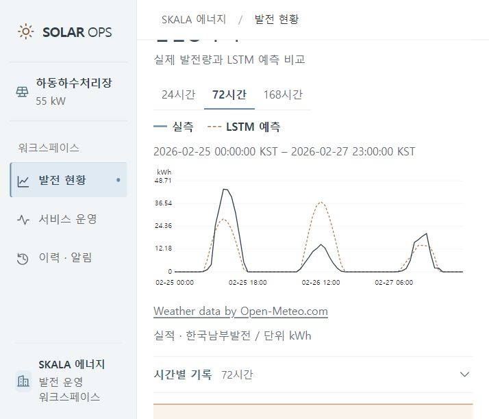

# ⑥ 동작 화면과 전후 증빙

## 통합가이드가 요구하는 것

모델 버전 전환 전/후 응답,컨테이너 실행,드리프트 주입→알림→재학습 트리거 등 요청 전후 상태 변화를 실제 실행으로 제시한다.

## 시연 환경

운영 서버8077은 실제 보관 자료를 사용한다. 별도8078 서버는 data/runtime-submission에서 동작하며 **합성 드리프트 기능 검증**이라고 표시한다. 실제 모델을 학습·등록하지만 시연의 합성 RMSE는 예측 성능으로 발표하지 않는다. 31개 시간별 모델의 독립 성능은 [별도 평가](evidence/hourly_20261007/README.md)를 사용한다.

## 실행 순서와 증빙

| 순서 | 동작 | 직접 얻은 근거 |
| --- | --- | --- |
| 1 | 31개소 조회·하동24시간 예측 | [health](evidence/submission_20261008/local/health.json), [단건 응답](evidence/submission_20261008/local/before.json) |
| 2 | 잘못된23시간 입력 거절 | [422 응답](evidence/submission_20261008/local/invalid-422.json) |
| 3 | 합성 실적 저하 주입·드리프트 큐 등록 | [배치 판정](evidence/submission_20261008/local/drift.json) |
| 4 | 별도 작업자의 실제 LSTM 재학습·게이트 통과 | [작업 결과](evidence/submission_20261008/local/job.json), [MLflow 버전](evidence/submission_20261008/local/registry-history.json) |
| 5 | 동일 요청의 v1→v2 응답 | [전](evidence/submission_20261008/local/before.json), [후](evidence/submission_20261008/local/after.json) |
| 6 | 경고·작업 결과 로그 확인 | [알림](evidence/submission_20261008/local/alerts.json), [작업자 로그](evidence/submission_20261008/local/worker-log.json) |
| 7 | v1 롤백·원래 예측 복구 | [롤백](evidence/submission_20261008/local/rollback.json), [복구 응답](evidence/submission_20261008/local/restored.json) |
| 8 | 재시작 후 예측 기록 유지 | [영속성 검증](evidence/submission_20261008/local/restart-persistence.json) |
| 9 | 실제 Docker 빌드·API·작업자·재시작 | [컨테이너 검증 기록](../submission/README.md#컨테이너-검증) |

화면·추가 캡처는 [제출 증빙 폴더](evidence/submission_20261008/)에 있다. JSON의 prediction_id로 GET /predictions/{id}를 조회하면 당시 입력과24개 출력,모델 버전을 재확인할 수 있다. GET /predictions는 선택 개소의 최근 기록을 반환한다.

재현 명령은 project/에서 `python ../tools/submission/exercise_http.py --base http://127.0.0.1:8078 --out ../docs/proposal/evidence/submission_20261008/local`이다. 이 도구는 demo_mode=true 환경에서만 합성 드리프트를 전송한다. 새seed로 시작한 격리 상태에서 수행한다. 기존 시연에 반복 실행하면 학습 기간 중복 방지 정책에 걸릴 수 있다.
