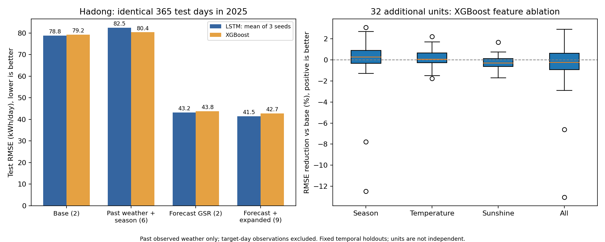

# 예측 입력 변수 추가 실험

실행일: 2026-10-07. 서빙 모델·스케일러는 변경하지 않았다.

실행 결과: 과거 관측 변수만 늘린 LSTM은 RMSE 78.81 → 82.47kWh/일로 악화됐다. 일사량 예보를 쓰면 43.19, 과거 정보와 일사량·일조시간·구름량 예보를 함께 쓰면 41.48kWh/일이었다. 기본 대비 47.36% 감소이며 일사량 예보 조합 대비 추가 개선은 3.95%다.

이 수치는 시드 3개의 평균 예측에 대한 오차다. 이 실험에서는 대상일 사전 예보의 효과가 가장 컸다. 과거 기온·일조시간·계절을 모두 추가한 다지역 XGBoost는 32개 중 13개 호기에서 개선됐고, 감소율 중앙값은 -0.23%로 일관된 이득이 없었다. 모든 발전소의 변수를 일괄 확대하기보다 별도 검증 구간에서 선택하는 편이 적절하다.

날짜별 14일 블록 부트스트랩에서 하동 LSTM의 확장 예보 조합과 일사량 예보 조합 간 RMSE 차이의 95% 구간은 약 -3.18~-0.14kWh/일이었다. 이번 고정 분할에서의 차이이며 다른 연도·지역이나 재학습 성능을 보증하지 않는다.

## 하동: 동일한 2025년 365일 평가

학습 정답: 2022-07-22~2024-06-30. 검증: 2024-07-01~2024-12-31. 시험: 2025-01-01~2025-12-31. 20일 입력. 검증 구간으로 XGBoost 반복 수/LSTM 체크포인트를 선택했고 재학습 없이 같은 시험일에 비교했다. 스케일·결측 대체는 학습 구간에서만 계산했다.

| 모델·변수 | RMSE (kWh/일) | MAE (kWh/일) |
| --- | ---: | ---: |
| forecast_expanded_lstm_mean3 | 41.483 | 32.069 |
| forecast_expanded_lstm_seed44 | 41.604 | 33.181 |
| forecast_expanded_lstm_seed43 | 41.834 | 31.508 |
| forecast_expanded_lstm_seed42 | 42.070 | 32.411 |
| forecast_lstm_seed43 | 42.326 | 33.081 |
| forecast_expanded_xgb | 42.714 | 35.401 |
| forecast_lstm_mean3 | 43.186 | 34.320 |
| forecast_xgb | 43.819 | 35.921 |
| forecast_lstm_seed44 | 43.880 | 34.341 |
| forecast_lstm_seed42 | 44.624 | 36.519 |
| base_lstm_seed44 | 78.701 | 64.968 |
| base_lstm_seed42 | 78.752 | 64.905 |
| base_lstm_mean3 | 78.810 | 65.282 |
| temperature_xgb | 78.992 | 65.850 |
| base_lstm_seed43 | 79.158 | 66.161 |
| sunshine_xgb | 79.165 | 65.974 |
| base_xgb | 79.237 | 65.810 |
| calendar_xgb | 80.071 | 66.803 |
| expanded_xgb | 80.364 | 67.013 |
| expanded_lstm_seed42 | 81.823 | 70.210 |
| expanded_lstm_seed44 | 82.105 | 69.670 |
| expanded_lstm_mean3 | 82.466 | 71.071 |
| mean7_naive | 83.453 | 65.335 |
| expanded_lstm_seed43 | 84.236 | 73.942 |
| persistence_naive | 96.323 | 69.827 |

`lstm_mean3`는 시드 42·43·44 예측의 평균이다. 시드별 오차는 lstm_seed_metrics.csv에 있다.

## 추가 32개 호기: XGBoost 내 변수 비교

| 추가 변수 | 개선 호기 / 전체 | RMSE 감소율 중앙값 |
| --- | ---: | ---: |
| calendar | 21 / 32 | 0.27% |
| temperature | 18 / 32 | 0.07% |
| sunshine | 11 / 32 | -0.29% |
| expanded | 13 / 32 | -0.23% |

감소율이 양수면 개선이다. 각 호기의 기준 모델과 같은 시험일로 비교했다. 호기별 시험 연도는 다를 수 있고, 같은 지역의 호기는 독립 표본이 아니다. 연속 930일 이상인 가장 최근 구간을 선택하고 최대 1,825일을 사용했다. 마지막 365일 시험, 그 전 180일 검증, 나머지 학습이다. 짧거나 보류된 호기는 제외했고 목록은 protocol.json에 있다.

## 변수와 한계

- base: 과거 발전량 + 하루 전 관측 일사량. calendar: 연중 날짜 sin/cos 추가. temperature/sunshine: 각각 하루 전 최고기온/일조시간 추가. expanded: 모두 추가.
- forecast: 과거 발전량 + 대상일에 대한 하루 전 일사량 예보. forecast_expanded: expanded + 일사량·일조시간·구름량 예보. 예보 기온은 보유 자료에 없어 실험하지 않았다.
- 모든 모델은 입력 마지막 날까지 실제 발전량이 관측된 다음 날 1일 예측이다. 한 번에 1년 전체를 예측한 결과가 아니다.
- 실제 대상일 관측 날씨는 사용하지 않았다. 과거 예보의 정확한 공개 시각은 저장소의 가정을 따르며 별도로 시각 증빙을 검증하지 않았다.
- LSTM은 동일한 3층 구조, 학습률 0.001, 80 epoch 예산, 시드 3개로 비교했다. 충분한 최적화나 모든 하이퍼파라미터 조합의 최적값을 보증하지 않는다.
- XGBoost는 20일 창을 펼쳐 같은 설정으로 학습했다. LSTM과의 승패보다 각 학습기 안에서 변수의 효과를 해석한다.
- 날씨 결측/관측소 대리값과 설비 상태 변화가 포함된다. 일사량 예보의 효과와 지역 일반화는 구분한다. 결과를 보고 시험 구간에 맞춰 재선택하지 않았다.
- protocol.json(조건·출처 해시), predictions/(날짜별 예측), histories/(학습 곡선), paired_bootstrap.json(하동 LSTM 차이 구간), audit.json(검증)을 함께 확인한다.

