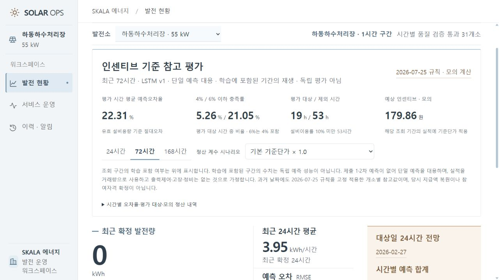

# PR #12 리뷰 보완 검증

2026-10-08. 공식 전력시장운영규칙 2026.7.25 PDF 569쪽(파일 페이지) 별표2 Ⅴ에서 4% 이하 4원/kWh, 4% 초과 6% 이하 3원/kWh, 6% 초과 0원을 확인했다. 원문: https://www.kpx.or.kr/boardDownload.es?bid=0030&list_no=77795&seq=4 . 이는 과거 데이터에 현행 프로필을 적용한 모의 비교이며 과거 실제 정산 복원이 아니다.

- 수치 경계·평가 제외·두 차수 절대오차 평균 테스트 8개 통과.
- 기존 작업의 queued/running/succeeded/rejected/failed 상태 반환과 중복 방지, 같은 종료시각 다른 입력 거절 테스트 통과.
- 학습 포함/혼합/이후 기간과 선택 기간별 중복 시간 수 테스트 통과.
- Node 회귀 테스트 15개 통과, Python 컴파일과 문서 링크 검사 통과.
- 실제 localhost API에서 새 규칙 프로필과 학습 포함 24시간 확인. 브라우저 72시간 조회에 학습 포함 경고·4/6% 카드 표시, 콘솔 오류 없음.

이전 incentives_20261008 폴더는 구 6/8% 규칙의 보관 증빙으로 유지한다. 최신 결과로 인용하지 않는다. Docker 추가 시험은 같은 배치를 롤백 뒤 재전송해 succeeded 상태와 동일 작업 ID를 확인한다. 실행 성공 여부는 PR에 연결한 최신 Actions 결과를 따른다.
