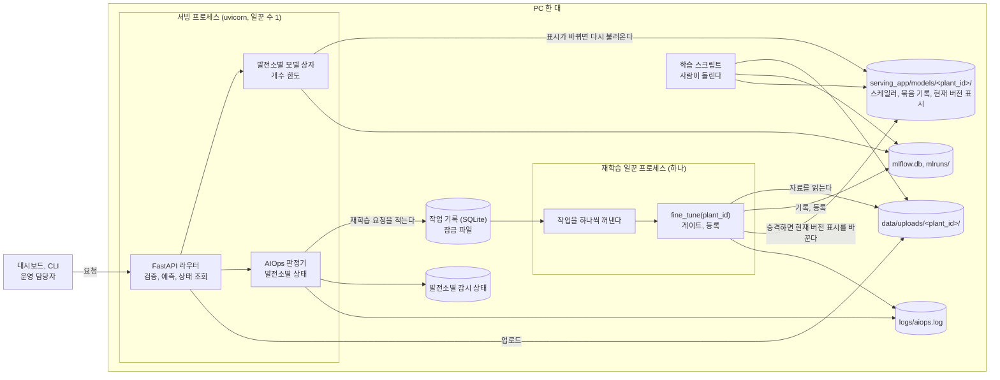
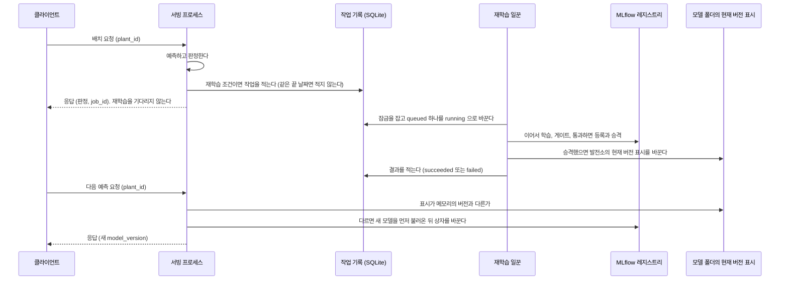

# 한 PC 에서 여러 발전소를 운영하는 구조

> 상태: **제안과 측정** (2026-10-07). FastAPI, 학습, MLflow, AIOps 를 모두 PC 한 대에서 돌린다는 전제의 설계다. 구조는 결정 기록 [0012](../decisions/0012-single-pc-retrain-jobs.md)의 **제안**이고, 숫자는 조사에 쓴 PC 에서 직접 잰 값이다. 백엔드를 실제로 돌릴 PC 에서는 같은 도구로 다시 잰다.

범위는 교재의 것을 그대로 둔다. MLflow 는 로컬 SQLite 이고 컨테이너는 하나다. Kubernetes, 따로 띄우는 MLflow 서버, Prometheus·Grafana, 메시지 브로커는 들이지 않는다. 배경은 [`multi-plant-extension.md`](multi-plant-extension.md)에 있다.

## 1. 실행 단위와 연결

### 1.1 지금의 구조

**[현재]** 프로세스는 하나다. `uvicorn` 이 띄운 FastAPI 프로세스가 요청을 받고, 모델을 메모리에 두고, 판정기를 부르고, 재학습까지 그 안에서 돌린다. 학습 스크립트는 사람이 다른 터미널에서 돌린다.

| 무엇 | 어디에 있는가 | 다시 띄우면 |
| --- | --- | --- |
| 올린 자료 | `data/uploads/haic_<uuid>.csv` | 남는다 |
| 스케일러와 로컬 모델 | `serving_app/models/scaler.pkl`, `haic_v1.keras` | 남는다 |
| MLflow 의 기록과 모델 | `mlflow.db`(SQLite), `mlruns/` | 남는다 |
| 알림 로그 | `logs/aiops.log` | 남는다 |
| 메모리의 모델 상자 | `model_loader._model_cache` (프로세스의 변수) | **사라진다.** 다시 불러온다 |
| 판정기의 연결 | `aiops_adapter._evaluator` (프로세스의 변수) | **사라진다.** 시작할 때 다시 연결한다 |
| 재학습의 진행 | 없다. 요청을 처리하는 동안 그 안에서 돈다 | 돌던 재학습은 흔적 없이 끊긴다 |

경로는 모두 `project/` 를 작업 디렉터리로 둔 상대 경로다.

### 1.2 제안하는 구조

**[제안]** 프로세스를 둘로 나눈다. 요청을 받는 서빙 프로세스와, 재학습을 한 번에 하나씩 돌리는 일꾼 프로세스다. 둘은 메모리를 나누지 않으므로 **파일로만** 이어진다.

| 실행 단위 | 하는 일 | 몇 개 |
| --- | --- | --- |
| 서빙 프로세스 | 요청의 검증과 예측, 업로드, 상태 조회, 발전소별 판정. 재학습은 하지 않고 작업으로 적기만 한다 | 1 (`uvicorn` 의 일꾼 수 1) |
| 재학습 일꾼 | 작업 기록에서 하나씩 꺼내 재학습, 게이트, 등록을 한다 | 1 |
| 학습 스크립트 | 처음 학습과 새 발전소의 학습. 사람이 돌린다 | 필요할 때 |
| 컨테이너(8099) | 같은 코드를 이미지 하나로 띄운 것. 로컬과 파일을 나누지 않는다(6절) | 1 |

## 2. 재학습을 요청에서 떼어 한 번에 하나씩

### 2.1 견준 방법

| 방법 | 얻는 것 | 잃는 것 |
| --- | --- | --- |
| (가) 지금처럼 요청 안에서 바로 돈다 | 코드가 가장 단순하다 | 배치 요청이 재학습만큼 길어진다. 두 요청이 같은 발전소를 함께 재학습할 수 있다. 다시 띄우면 흔적이 없다 |
| (나) 같은 프로세스의 배경 작업(FastAPI `BackgroundTasks`)과 프로세스 안의 잠금 | 응답이 바로 나간다. 고칠 곳이 적다 | 대기 중인 작업이 메모리에 있어 다시 띄우면 사라진다. 학습이 서빙과 같은 프로세스의 메모리와 CPU 를 쓴다. 일꾼 수를 늘리면 잠금이 프로세스마다 따로다 |
| (다) 작업 기록(SQLite)과 일꾼 프로세스 하나 | 대기와 결과가 파일에 남는다. 학습이 죽어도 서빙이 죽지 않는다. 프로세스가 여럿이어도 잠금 파일 하나로 겹침을 막는다 | 프로세스가 하나 는다. 승격을 서빙에 알리는 길이 따로 필요하다 |
| (라) 메시지 브로커와 작업 큐 | 여러 PC 로 넓힐 수 있다 | 한 PC 의 범위를 넘는다. 들이지 않는다 |

**[제안]** (다)를 고른다. 발표까지 시간이 없으면 (나)를 임시로 쓰되 일꾼 수 1 을 지키고 "다시 띄우면 대기 작업이 사라진다"를 적는다.

### 2.2 작업 기록과 중복 방지

**[제안]** 작업 기록은 MLflow 의 DB 와 다른 SQLite 파일에 둔다. MLflow 의 표를 건드리지 않으려는 것이다.

| 칸 | 뜻 |
| --- | --- |
| `job_id` | 작업의 번호. 로그의 `job=` 에 싣는다 |
| `plant_id`, `kind` | 대상 발전소와 작업의 종류(`fine_tune`, `base_train`) |
| `data_sha`, `data_end_date` | 재학습에 쓸 자료의 해시와 끝 날짜 |
| `status` | `queued` → `running` → `succeeded` / `failed` / `skipped` |
| `requested_at`, `started_at`, `finished_at` | 시각 |
| `result` | 게이트의 값, 승격 여부, 새 버전, 실패한 까닭 |

- **같은 재학습을 두 번 돌리지 않는다.** `(plant_id, kind, data_end_date)` 를 유일하게 둔다. 같은 끝 날짜의 요청이 또 오면 새 작업을 만들지 않고 있는 작업의 상태를 돌려준다([0008](../decisions/0008-retraining-and-version-switch.md)의 "같은 끝 날짜로는 다시 재학습하지 않는다"를 발전소별로 옮긴 것이다).
- **한 번에 하나만 돈다.** 일꾼은 잠금 파일을 잡은 채로만 작업을 꺼낸다. 일꾼을 실수로 둘 띄워도 하나만 돈다. 발전소가 달라도 겹쳐 돌리지 않는다. 한 PC 의 CPU 와 메모리를 서빙에 남겨 두려는 것이다.
- **다시 띄운 뒤의 복구.** 일꾼이 시작할 때 `running` 으로 남은 작업을 `failed`(까닭: 중단됨)로 바꾸고 다시 `queued` 로 넣는다. 서빙 프로세스는 시작할 때 발전소별 감시 상태를 파일에서 읽는다.
- **일부의 실패가 번지지 않는다.** 한 작업이 실패하면 그 작업만 `failed` 가 되고 다음 작업으로 넘어간다. 한 발전소의 모델을 불러오지 못하면 그 발전소의 요청만 503 이고 다른 발전소는 그대로 답한다. 포트폴리오 응답에서는 그 발전소가 "빠진 발전소"로 나온다.

### 2.3 승격과 서버의 모델 상자

- **[현재]** 승격해도 서빙 프로세스의 상자는 그대로다. 서버를 다시 띄워야 새 모델로 답한다([③ 의 11절](3-operations-design.md#11-승격한-뒤-서빙-모델을-바꾼다)).
- **[제안]** 일꾼과 서빙은 프로세스가 달라 변수를 나눌 수 없다. 일꾼이 승격한 뒤 발전소 폴더의 "현재 버전 표시" 파일을 바꾸고, 서빙은 그 발전소의 요청을 받을 때 표시와 메모리의 버전을 견준다. 다르면 새 모델을 **먼저 불러온 뒤** 상자를 바꾼다. 불러오지 못하면 이전 모델로 답하고 로그에 남긴다([0008](../decisions/0008-retraining-and-version-switch.md)).
- **[제안]** 확인은 레지스트리의 Production 버전과 `/plants/{plant_id}/status` 의 버전이 같은지로 한다. 로그의 승격 문장만으로 "새 모델로 서빙한다"고 말하지 않는다.

## 3. 이 PC 에서 잰 값

**[실행]** `tools/multi_plant/single_pc_probe.py` 로 쟀다. [M09](evidence/multi-plant/validation.md#m09) 발전소 한 곳(하동하수처리장, 업로드 1,337행)의 값이다. **여러 발전소를 실제로 돌려 잰 값이 아니다.**

| 항목 | 값 |
| --- | --- |
| PC | Apple M5, 코어 10개, 메모리 16GB, 디스크 여유 634GB, macOS(Darwin 25.5.0, arm64). 조사에 쓴 PC 다 |
| 소프트웨어 | Python 3.11.15, tensorflow 2.21.0, mlflow 3.16.0. `requirements.txt` 와 같다 |
| 코드 | 커밋 `9ad93b1` 의 `project/` 를 임시 폴더에 푼 사본 |

| 무엇을 쟀는가 | 값 | 비고 |
| --- | --- | --- |
| 처음 학습 한 번(`train_baseline_v1.py`, 100 epoch) | 18.0초, 최대 메모리 581MB | 스케일러와 로컬 모델(0.23MB)이 생긴다 |
| MLflow 학습 한 번(`train_and_register.py`, 100 epoch) | 22.0초, 최대 메모리 696MB, 디스크 1.07MB 증가 | 지금의 게이트(4.00)에서 막혔다(RMSE 41.59). 시간만 본다 |
| 재학습 한 번(`fine_tune`, 최근 41행, 10 epoch) | 4.4초(세 번: 4.36, 4.35, 4.46) | 측정 프로세스 안에서만 게이트를 열고 쟀다. 통과는 품질의 근거가 아니다 |
| 서빙 프로세스의 메모리 | TensorFlow 를 올리면 489MB. 첫 모델에 28MB, 그 뒤 모델 하나마다 **4.6MB** | 모델을 1, 2, 4, 8개 올리고 한 번씩 예측한 뒤의 값 |
| 예측 한 건의 계산 시간(한가할 때) | 중앙값 12.9ms, 95번째 백분위 13.7ms, 실패 0 / 200건 | **HTTP 를 거치지 않은 모델 계산 시간이다.** 엔드포인트의 응답 시간이 아니다 |
| 같은 값(다른 프로세스가 학습하는 동안) | 중앙값 14.4ms, 95번째 백분위 16.1ms, 최대 109ms, 실패 0 / 1,540건 | 제안하는 구조에 해당한다 |
| 같은 값(같은 프로세스의 다른 스레드가 학습하는 동안) | 중앙값 15.3ms, 95번째 백분위 21.9ms, 최대 102ms, 실패 0 / 1,299건 | 지금의 구조에 해당한다 |
| 두 프로세스가 같은 `mlflow.db` 에 동시에 기록 | 30건씩 60건 모두 성공, 1.5초 | 학습의 등록과 겹친 경우는 재지 않았다 |

읽을 때 주의할 점은 다음과 같다.

- 학습 중에도 예측은 실패하지 않았다. 느려진 정도는 다른 프로세스일 때 95번째 백분위가 13.7ms 에서 16.1ms, 같은 프로세스일 때 21.9ms 다. 프로세스를 나누는 쪽이 덜 느려진다.
- 이 값들은 코어 10개인 PC 에서 학습 하나와 예측 한 줄이 함께 돈 경우다. 코어가 적은 PC 에서는 더 느려질 수 있다.
- 기획서의 다른 측정([② 의 6절](2-solution-and-goals.md#6-운영-목표))은 레지스트리에서 불러온 HAIC 모델에 무작위 입력을 넣어 중앙값 32.7ms 였다. 모델과 불러오는 길이 달라 값이 다르다. 여러 발전소의 응답 시간은 구현한 뒤에 엔드포인트로 다시 잰다.

## 4. 규모 산정식

**발전소의 수(P), 날짜의 수(D), 피처의 수(F)** 로 센다. 설비 용량으로는 세지 않는다. 20MW 묶음은 발전기 한 기일 수도 있고 55kW 짜리 수백 곳일 수도 있어서, 용량만으로는 자료의 크기도 계산량도 정해지지 않는다.

기호: P 는 발전소 수, D 는 발전소 한 곳의 날짜 수, F 는 피처 수(지금 2), L 은 창의 길이(20)다. "잰 값"은 3절의 값이고, 그 밖은 **추정**이다.

| 무엇 | 식 | P=1, D=1,337 (잰 값) | P=5, D=1,337 (추정) | P=100, D=1,337 (추정) |
| --- | --- | --- | --- | --- |
| 하루 자료의 행 | P × D | 1,337 | 6,685 | 133,700 |
| 시간대별 자료의 행 | P × D × 24 | 32,088 | 160,440 | 3,208,800 |
| 창의 수 | P × (D − L) | 1,317 | 6,585 | 131,700 |
| 한 발전소의 학습 입력(float32) | (D − L) × L × F × 4바이트 | 0.2MB | 0.2MB (발전소별로 하나씩 올린다) | 0.2MB |
| 처음 학습의 시간(차례로) | P × (18.0 + 22.0)초 | 40초 | 3분 20초 | 약 67분 |
| 재학습의 시간(차례로, 모두 걸렸을 때) | P × 4.4초 | 4.4초 | 22초 | 약 7분 |
| 서빙 프로세스의 메모리 | 489 + 28 + 4.6 × (P − 1) MB | 517MB | 약 536MB | 약 973MB |
| 학습 하나의 최대 메모리 | 발전소 수와 무관(차례로 돈다) | 696MB | 696MB | 696MB |
| 학습 한 번의 디스크 | 1.07MB × 학습 횟수 | 1.1MB | 5.4MB(한 번씩) | 107MB(한 번씩) |
| 포트폴리오 예측의 계산 시간(차례로) | P × 12.9ms | 13ms | 약 65ms | 약 1.3초 |

- **추정의 전제.** 발전소마다 행 수와 모델 구조가 하동과 같고, 학습과 예측을 차례로 돌리며, 시간이 발전소 수에 비례한다고 봤다. 행 수가 다른 발전소(예: 2013년부터의 4,807일)의 학습 시간은 재지 않았다. 메모리는 모델 여덟 개까지 잰 기울기를 늘린 값이다.
- **메모리의 합.** 서빙과 학습 하나가 함께 돌 때 필요한 메모리는 "서빙 프로세스 + 학습 하나"다. P=100 이면 약 973 + 696 = 약 1.7GB 다(추정). 16GB 인 이 PC 에서는 여유가 있지만 백엔드 PC 의 메모리로 다시 따져야 한다.
- **응답 시간 목표와의 관계.** 발전소 한 곳의 예측 목표는 1초 이하다([0004](../decisions/0004-service-level-objectives.md)). 포트폴리오 예측은 발전소 수에 비례해 늘어난다. 100곳이면 계산만 약 1.3초라 목표를 따로 정해야 한다.

## 5. 한도와 보호

**[현재]** 다음 한도가 코드에 없다. **[제안]** 값은 출발점이고 백엔드 PC 에서 잰 뒤에 고친다.

| 무엇 | 지금 | 제안 | 까닭 |
| --- | --- | --- | --- |
| 업로드 파일의 크기 | 한도가 없다. 파일 전체를 메모리로 읽는다(`routers/data.py` 의 `upload()`) | 5MB, 20,000행 | 하동의 업로드 파일은 37.6KB(1,337행), 13년 치도 124KB 다. 5MB 는 그 40배다 |
| 배치 요청의 길이 | 최소 21행, 최대가 없다(`schemas.py` 의 `BatchTestRequest`) | 발전소 하나에 400행 | 날마다의 판정은 41행이다. 한 해 치를 한 번에 보는 것까지 받는다. 행마다 예측이 한 번 돈다(400행이면 계산만 약 5초) |
| 포트폴리오 요청의 발전소 수 | 포트폴리오 요청이 아직 없다 | 한 요청에 200곳 | 차례로 계산하면 200곳이 약 2.6초다(추정) |
| 메모리의 모델 수 | 하나 | 발전소별 상자, 기본 한도 64개. 넘으면 가장 오래 쓰지 않은 모델을 내린다 | 모델 하나가 4.6MB 라 64개가 약 0.3GB 다 |
| 시작할 때 불러오는 모델 | `LOADING_MODE=eager` 면 모델 하나 | 목록으로 정한 발전소만 미리 불러온다. 나머지는 첫 요청 때 불러온다 | 발전소가 많으면 시작이 길어진다 |
| 동시에 도는 재학습 | 막는 곳이 없다 | 하나 | 2.2절 |
| `uvicorn` 의 일꾼 수 | 하나(기본) | **하나로 고정한다** | 일꾼이 둘이면 모델 상자, 판정기의 상태, 프로세스 안의 잠금이 일꾼마다 따로 생긴다. 한 일꾼이 승격을 알아도 다른 일꾼은 모른다 |

## 6. 로컬과 컨테이너의 경로

**[현재]** 로컬 서버(8077)와 컨테이너(8099)는 같은 코드를 쓰지만 **서로 다른 파일**을 본다. 컨테이너는 이미지 안의 `/app` 을 쓰고 `docker-compose.yml` 에 볼륨이 없다.

| 무엇 | 로컬 (8077) | 컨테이너 (8099) |
| --- | --- | --- |
| 작업 디렉터리 | 저장소의 `project/` | 이미지 안의 `/app` |
| 올린 자료 | `project/data/uploads/` | `/app/data/uploads/` (빌드 때 넣은 파일 하나) |
| 스케일러, 로컬 모델 | `project/serving_app/models/` | `/app/serving_app/models/` (빌드 때 학습) |
| MLflow | `project/mlflow.db`, `project/mlruns/` | `/app/mlflow.db`, `/app/mlruns/` (빌드 때 학습과 등록) |
| 로그 | `project/logs/aiops.log` | `/app/logs/aiops.log` |
| 모델을 불러오는 곳과 때 | 기본은 로컬 파일, 첫 요청 때 | MLflow, 시작할 때 |
| 다시 만들면 | 파일이 남는다 | **이미지를 만들 때의 상태로 돌아간다.** 올린 자료와 재학습한 모델이 사라진다 |

- **둘을 함께 띄워도 같은 DB 에 겹쳐 쓰지 않는다.** 파일을 나누지 않기 때문이다. 대신 **갈라진다.** 같은 이름의 모델이 두 곳에서 따로 학습되고 버전 번호가 따로 올라간다. 로컬의 `v2` 와 컨테이너의 `v2` 는 다른 모델이다.
- **[제안]** 응답과 로그에 실행 단위(`runtime=local` 또는 `container`)를 싣는다. 두 곳의 결과를 견줄 때 버전 번호만 보고 같은 모델이라고 읽지 않게 하려는 것이다.
- **[제안]** 컨테이너의 상태를 남기려면 이름 붙인 볼륨을 `/app/data/uploads`, `/app/serving_app/models`, `/app/mlruns`, `/app/logs` 와 DB 파일이 있는 곳에 건다. 로컬의 `project/` 를 그대로 걸지 않는다. 걸면 로컬과 컨테이너가 같은 `mlflow.db` 와 작업 기록에 함께 쓰게 되고, 재학습 일꾼이 둘이 된다.
- **[미확인]** `mlflow.db` 는 `/app` 바로 아래의 파일이다. 이름 붙인 볼륨은 폴더 단위라 이 파일만 따로 걸 수 없다. 상태를 한 폴더로 모으는 설정(예: 상태 폴더를 정하는 환경 변수)이 먼저 필요하다. 컨테이너에서의 동작은 이번에 돌려 보지 않았다.
- 발전소가 여럿이면 이미지를 만들 때의 학습이 발전소 수만큼 길어진다(4절의 "처음 학습의 시간"). 빌드에 넣을 발전소를 정해 두고 나머지는 띄운 뒤에 학습한다.

## 7. 재지 않은 것

| 무엇 | 왜 못 쟀는가 | 언제 재는가 |
| --- | --- | --- |
| 백엔드를 돌릴 PC 에서의 값 | 그 PC 가 아니다. 그 PC 는 Windows 이고 이 문서의 값은 macOS 에서 쟀다 | 그 PC 에서 `single_pc_probe.py` 를 돌린다. Windows 에서는 메모리를 작업 집합으로 읽어 재는 방법이 다르므로 3절의 값을 그 PC 의 값으로 통째로 바꾼다. 측정 도구의 Windows 쪽 코드는 Windows 에서 돌려 확인하지 못했다 |
| 여러 발전소를 실제로 올렸을 때의 메모리와 응답 시간 | 서비스가 아직 발전소 한 곳만 다룬다 | [확장 문서 9절](multi-plant-extension.md#9-다음-구현-작업)의 4번 뒤 |
| 재학습 중의 엔드포인트 응답 시간(HTTP 포함) | 판정기가 연결되지 않아 서버에서 재학습이 돌지 않는다 | 판정기와 작업 처리를 구현한 뒤 |
| 행이 많은 발전소(4,807일)의 학습 시간 | 예보가 있는 기간이 1,337일뿐이다 | 다른 입력 구성을 쓰기로 할 때 |
| 컨테이너 안에서의 값, 볼륨을 건 뒤의 복구 | 컨테이너를 만들지 않았다 | 컨테이너 작업 때 |
| `uvicorn` 의 일꾼 수를 늘렸을 때 | 일꾼 수 1 을 전제로 했다 | 늘리기로 할 때. 그 전에 상태를 파일로 옮긴다 |
| MLflow 의 등록과 조회가 겹칠 때의 SQLite 잠금 | 실행 기록의 동시 쓰기만 봤다 | 일꾼과 서빙을 함께 띄운 뒤 |
